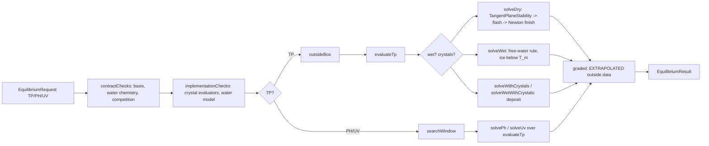

# Merge stack drafts: CHANGELOG headings, version line, code guide change lists (t47, 2026-10-19)

These are drafts for the owner's approval; nothing here is applied. This document is the companion of [MERGE_STACK_PLAN.md](MERGE_STACK_PLAN.md).

The facts come from read-only git on the branch code at these commits:

| Line | Commit |
|---|---|
| `main` (0.8.0) | `ffeafe8a` |
| port | `c9aea46e` |
| consolidation | `688f4cd7` |
| simplification | `32bf3fa4` |
| junction seeding | `8e470a3e`, then the tip `798bedd9` with t44c's follow-ups `373c8fee` and `bbbd8626` |

Five read-only Opus subagents drafted the code guide lists in section 2, one chapter group each, at `8e470a3e`. The orchestrating thread checked their findings and added the follow-ups' items (section 2.0).

Tags: [port] unified thermo port, [cons] consolidation, [simp] fluid solver simplification, [seed] junction seeding.

## 1. CHANGELOG and version

### 1.1 What `[Unreleased]` holds at `798bedd9`

Four lines, one per batch, in this order and layout:

| Line | Where | Defect to fix at the release |
|---|---|---|
| Fluid solver simplification (line 18) | directly under `## [Unreleased]`, above `### Changed` | No subsection. It names "the 678 commit" instead of `32bf3fa4`, says "batch" where the others say "batch folder", and names no branch or base. |
| Junction seeding (line 19) | under `## [Unreleased]`, above `### Changed` | No subsection; says "batch" (it already names the follow-ups `373c8fee` and `bbbd8626`). |
| Unified multiphase thermodynamics (line 23) | `### Changed` | none |
| Consolidation (line 24) | `### Changed` | It says "and this changelog commit"; that becomes `688f4cd7`. |

The version rule of `CHANGELOG.md` reads: "A work branch writes its entry under `[Unreleased]`; the merge moves it under a new version heading dated with the merge day." It also asks for one line per batch.

### 1.2 Shape (a), recommended: one release `0.9.0` for the whole stack

The release commit replaces lines 16 to 25 of `CHANGELOG.md`, from `## [Unreleased]` to the line before `## [0.8.0]`, with the block below. The block was generated from `git show 798bedd9:CHANGELOG.md` with five text edits applied:
- the consolidation's "this changelog commit" becomes `688f4cd7`;
- the simplification line gets "batch folder:", its branch and base, and `32bf3fa4` for "the 678 commit";
- the seeding line gets "batch folder:".

The lines are in batch order. Only `<merge date>` remains to fill.

```markdown
## [Unreleased]

## [0.9.0] - <merge date>

### Changed

- Unified multiphase thermodynamics, ported to main 0.8.0 (batch folder: `2026-09-24-coolprop-low-temperature`, commits `348d06e1`..`3db5e5d3`; P0 to P6b recorded on `claude/coolprop-multiphase-thermo-37f6b0` at `9aaafd4`). **Breaking, fresh world** (checkpoint format 10, island and topology unit format 3, protocol `fluid-10`, formulation `direct-liquid-v1:tp-engine-v1:range-continuation-v1` with `separate-free-water-v2`): the fluid network runs on a multiphase equilibrium engine (tangent-plane stability, TP/PH/UV, E-PPR78 kij(T) on the PR78 kernel, every phase at its own pressure, IF97 Region 1 water, nitrogen and methane to 10 MPa); the bundled package `createcheme:pilot_cryogenic` (N2, CH4, C2H6, CO2 with reference spines and the CO2-I crystal; selected by a datapack override of the network record) and ice Ih on every package freeze, melt, deposit and sublime as solids in reservoirs (crystal mass moved at a vessel's refresh about every 5 s, one size per solid from 0.25 mm frost to about 1 mm slush, outlets blocked at 0.5 solids, solids ride the liquid); leaving a data range no longer holds an island (properties continue and the status line notes it; a 10 to 6000 K, 1 Pa to 1 GPa box refuses trials); a port's static column is what fills its line, so a liquid trace at a tank's bottom port stands as gas (decision D34); gas keeps its weight in every column, as on main (D36's weightless gas column was reverted, D38); a phase under 1e-6 of its node that has shrunk since the solve's start leaves, in a junction as in a vessel (D38 C); a failed Newton iterate only folds what it empties and proposes no phase, and a phase the next pass drives to nothing is refused (D39); a vessel seeds its phases from its own state, not from a flash that ignores its volume (D40); a pump's start mode reads its own lines only, not every blocked pipe of its island (D40); the UV search answers a boiling step wet or dry and never carries a secant across a step (D40); a phase hold reads "HELD (phases)"; removed: `GlobalLiquidResponse` and the `liquidCompressibility` config entry, `ThermoDomainViolation`, `NO_LIQUID_CARRIER`, the approximate fallback mode (an island interval is the full solve on its whole wall budget), `Mover.efficiency` (a pump's or a compressor's shaft work is its ideal work), nitrogen's low-temperature cp segment (its fit is held below 273.16 K), potential energy in streams and ledgers (a pump's lift work arrives in the lifted fluid as heat); chain-100 and eight `LIQUID_JUNCTION` lines re-recorded; fixed: a pipe joining a lone boundary no longer leaves an island of one that crashed every save after a reload (`15220a07`); the MCP lane pins bridge 0.4.7-osguard (`026422fe`); detached material in the `tools/unified-thermo-port-*` folders (the probes, rule-off patches, traces and logs of D34 to D40 in `tools/unified-thermo-port-m5/`).
- Consolidation of the unified multiphase thermodynamics port (batch folder: `2026-10-18-unified-thermo-consolidation`, commits `8ca973e6`..`74785ddb` and `688f4cd7`, on `claude/unified-thermo-consolidation` from `c9aea46e`). Behaviour-free: every printed number of the 16 javac-lane groups bitwise. Deleted: unreferenced declarations, the `EquilibriumService` and `PhaseEvaluator` interfaces (folded into `FluidTpEquilibrium` and `CubicPhaseEvaluator`), parameters every caller passed alike (`FluidTpEquilibrium.Settings` is 12 components and five constants), the second copies of the kernel's sparse-pair sums and of the step solver's degree-two run walk (`PassiveStepSolver.Runs`), and about 1 500 lines of comment narrative condensed to the rules they state (PassiveStepSolver, FluidTpEquilibrium, FluidThermodynamics, 25 further classes, HoldClassWorldsTest). Owner decisions (2026-10-18): O1 no gas-hydrate request (`PhaseCompetition(crystals, packageCrystals)`), O2 a request names the contract basis (`SPECIES_NOT_IN_PACKAGE` gone), O4 the held-out fluid answers gone, O5 the `PhaseDerivatives` capability gating gone; O3 (onset searches) kept. Main -1 951 lines, tests -311; two tests removed (`LiquidFullBubblePointTest.theHeldOutUvIsTheFluidAnswerOfTheCrystalCompetitionsMaterial`, `CubicPhaseEvaluatorTest.derivativeBlocksAFamilyDidNotProvideAreRefused`) and one printed row (`G3F9DataRangeBoundaryTest` `hydrates (D8)`). Tools in `tools/unified-thermo-consolidation/`.
- Fluid solver simplification (batch folder: `2026-10-18-fluid-solver-simplification`, thread t38, on `claude/fluid-solver-simplification` from `688f4cd7`): the velocity cap is every throttling line's law and the cap active set, its three modes and the junction anchor are gone (checkpoint format 11, fresh world); a failed iterate's collapsing phase is folded and a bag's resolution is a millilitre; the pass cycle key carries its proposal; one Newton iteration limit of 30; a pump's suction limit reads a two-phase supplier's own pressure; a shrinking phase is nothing only below the vanishing share both by moles and by volume (D38 C amended on t40's trace); a proposed phase its own split holds below that share by moles and by volume is refused whatever its direction (t40's seed 678). Commits `6f1a524e`, `ec6114a7`, `a41bb39a`, `62db4bfd`, `28a4ed58`, `573b050b`, `35b35572`, `6c073298` and `32bf3fa4`; quick check cold 191 / bundled 198 / defaults 200 against 183 / 198 / 200; chain-100 unchanged.
- Junction seeding (batch folder: `2026-10-19-junction-seeding`, threads t44, t44b, t45, on `claude/junction-seeding` from `32bf3fa4`; commits `c623b29b`, `43a3c476`, `51093b94`, `33455d4c`, `c51df66a`): one start mechanism for the fluid network solver. A solve without a carried point starts from the island's quasi-steady balance (`PassiveStepSolver.BalanceNet`: every junction's net inflow zero under every connection's own law, saturated at the donor's 100 m/s cap, with per-junction PH density tables and the pump start modes decided on it), the cold rate seed starts from that balance and its converged point starts the step, and a minted junction's first state is what reaches it (decision D55's supplier composition). Deleted: the D55 mint's fixed point and pressure bisection, decision D12's rate-only closure, `seedBoundaryJunctions` and the run contraction of the static estimate. Gates: `JunctionSeedingGateTest` (bundled 988, cold 19 and 15); the gas-column band of `HoldClassWorldsTest` is stated from the two tanks' columns (owner decision 2 of `FORM_D_GATES_TRACE.md`). References move where a placed fixture's first interval or a junction mixture moves (`MOVED_REFERENCES.md` of the batch); no format change. Follow-ups of the final test (`373c8fee`, `bbbd8626`): an island replaced by one of the same graph carries its committed junctions and endpoint, and the balance decides a pressure valve's mode on its balanced pressures as it does a pump's; gates from bundled 483 and cold 271.

## [0.8.0] - 2026-10-15
```

Optional, the owner's call: a lead sentence under `### Changed` that states the release's net formats, for example "checkpoint format 11, island and topology unit format 3, protocol `fluid-10`; fresh world". The port line names format 10 and the simplification line names format 11.

The version line in `gradle.properties` (one edit):

```properties
mod_version=0.9.0
```

### 1.3 Shapes (b) and (c): one release per batch

The four lines move one at a time, each under its own heading. Each release commit also moves the next batch's line, which arrives under `[Unreleased]`. As simulated with `git merge-file`, a line can also land under the previous version's heading with no conflict reported.

```markdown
## [Unreleased]

## [0.11.0] - <merge date 4>

### Changed

- Junction seeding (...)

## [0.10.0] - <merge date 3>

### Changed

- Fluid solver simplification (...)

## [0.9.1] - <merge date 2>

### Changed

- Consolidation of the unified multiphase thermodynamics port (...)

## [0.9.0] - <merge date 1>

### Changed

- Unified multiphase thermodynamics, ported to main 0.8.0 (...)
```

The version lines, in order:

| Merge | `mod_version` | Why |
|---|---|---|
| port | `0.9.0` | minor: a batch of work |
| consolidation | `0.9.1` | patch: a behaviour-free consolidation (owner feedback 2026-10-15) |
| simplification | `0.10.0` | minor: a solver change, checkpoint format 11 |
| junction seeding | `0.11.0` | minor: a solver change |

The simplification and the seeding can share one `0.10.0` only if they merge together, which is shape (a) for those two.

### 1.4 D32 as `0.8.1` first (option, not recommended)

This applies if `15220a07` is cherry-picked onto `ffeafe8a` first. Its tree merges cleanly; it was not compiled here.

```markdown
## [Unreleased]

## [0.8.1] - <date>

### Fixed

- A pipe joining a lone boundary no longer leaves an island of one that crashed every save after a reload (owner decision D32 A, `<cherry-pick sha>` from `15220a07`; gate `LoneBoundaryJoinTest`; batch folder: `2026-09-24-coolprop-low-temperature`).
```

What follows from it:
- `mod_version=0.8.1`.
- The port line's clause "fixed: a pipe joining a lone boundary ... (`15220a07`)" becomes "D32 (`15220a07`) is in 0.8.1".
- The stack's merge can no longer fast-forward. `git merge-file` on the touched files predicts three code hunks: `PhysicalRegistry.java` 1 and `EventPathWorld.java` 2. All three are comment and constructor text that the stack rewrote later; take the stack's side.

## 2. Code guide change lists

The canonical guide is the main checkout's `documentation/reference/code-guide/`. Do not edit it before the merge. At the merge, every touched chapter's snapshot line becomes `**Snapshot:** <release-sha> (main, mod 0.9.0), <date> · **Updated:** <date>`. Under shape (a) that is all seven files plus the new chapter.

| File | port | cons | simp | seed | Notes |
|---|---|---|---|---|---|
| README.md | 17 | 4 | 6 | 4 (+2.0) | new row for `equilibrium-engine.md`; counts 228 main / 313 test files at `8e470a3e`; `PassiveStepSolver` 4 402 → 3 736 lines (3 768 at `798bedd9`); proposed new section "Unified thermo stack" |
| fluid-science.md | 73 | 3 | 31 | 22 (+2.0) | 104 items; snapshot label was 26ec48de, though nothing in `science/fluid` changed between 26ec48de and `ffeafe8a` |
| fluid-runtime.md | 57 | 7 | 11 | 4 (+2.0) | formats 11 / unit 3 / `fluid-10`; `FlowControl.Mode` 11 → 8 values |
| thermo-materials.md | 55 | 3 | 0 | 0 | `git diff 688f4cd7 8e470a3e` is empty for its paths |
| equilibrium-engine.md (new) | outline | | | | `science/thermo/phase/**` (20 files), `TangentPlaneStability`, `NumericalBox`, `IdealGasFunction` |
| client-gui.md | 14 | 0 | 1 | 0 | |
| column-v3.md | 10 | 3 | 0 | 0 | |
| verification.md | 49 | 8 | 15 | 10 (+2.0) | test totals 1476 / 1474 / 1477 / 1480 (+2 expected at `798bedd9`) |

Items can carry several tags. Under shape (a) the guide is written once, in its final state. The "Shape-dependent text" sections list what shapes (b) and (c) would write and then delete, for example `EquilibriumService`, `PhaseEvaluator`, format 10 and the `CAP_*` modes.

### 2.0 Addenda for the follow-ups `373c8fee` and `bbbd8626` (tip `798bedd9`; drafted by this thread from `git diff 8e470a3e 798bedd9`)

These two commits came after the subagents read `8e470a3e`. They touch `IslandCoordinator.java` (+8 / -1), `PassiveNetwork.java` (+18), `PassiveStepSolver.java` (+58 / -26) and `JunctionSeedingGateTest.java` (+51), plus the CHANGELOG line.

| Chapter | Section | Item |
|---|---|---|
| fluid-runtime | Main flow (topology commit) | [seed] A replacement island whose graph is one original's carries that island's committed junction states and interval endpoint, so nothing of it is minted or balanced anew. Same structure means the same pipe identities and node ids, in order. In `IslandCoordinator`, `same.size()==1` → `PassiveNetwork.withJunctionStates(replacement.graph, old.graph)` and `carried = old.lastResult`. The mint's states are discarded. Owner decision 2026-10-19, from t46's trace of bundled 483. |
| fluid-runtime | Change the layer that owns it | [seed] Row: "a re-mint that should keep its state": `IslandCoordinator` (the replacement step) and `PassiveNetwork.sameStructure`. |
| fluid-science | Class map (`PassiveNetwork`) | [seed] `PassiveNetwork.sameStructure(a, b)` delegates to `PassiveStepSolver.sameStructure`. `withJunctionStates(graph, from)` takes every junction's state and inventory from the node of the same id, and throws on a different structure. |
| fluid-science | Main flow (start of a solve) | [seed] The balance (`PassiveStepSolver.BalanceNet`) decides a pressure valve's mode on its balanced pressures, as it does a pump's; the pass loop may revise. The rules: <br>• a closed back-pressure valve whose balanced inlet stands above its target with forward drive regulates, its inlet anchored at the target; <br>• one that nothing reaches closes; <br>• one that the open valve cannot relieve at its target opens; <br>• an open valve whose inlet falls under the target regulates again. <br>`closed[]` also holds the device modes the balance may revise. From t46's trace of cold 271. |
| fluid-science | Tests that document it | [seed] `JunctionSeedingGateTest` has 5 tests: the 3 of `8e470a3e`, plus `aFilterPlacedBeyondATankLeavesAnUnchangedVentHeaderItsState` (bundled 483) and `aBackPressureValvePlacedUnderAChokedGasSupplyOpensAtTheStart` (cold 271). |
| verification | Test map; counts | [seed] The same two tests. Full `test`: 1480 at `8e470a3e`, 1482 expected at `798bedd9` (the Opus lane confirms). Test files unchanged at 313. |
| README | Unified thermo stack section | [seed] Add "an island replaced by one of the same graph carries its junctions; the balance decides valve modes as it does pump modes". |

### 2.1 fluid-science.md (fluid-science subagent, at `8e470a3e`)


Read-only draft, written 2026-10-19 against explicit SHAs. Batches and tags: [port] unified thermo port `ffeafe8a..c9aea46e` (code through `3db5e5d3`); [cons] consolidation `c9aea46e..688f4cd7`; [simp] fluid solver simplification `688f4cd7..32bf3fa4`; [seed] junction seeding `32bf3fa4..8e470a3e`. "Now" means the chapter text in the main checkout (snapshot `26ec48de`); "Code" means `8e470a3e` unless another SHA is named.

Path abbreviations (all under `src/main/java/com/wormzjl/createcheme/science/fluid/`): `PSS` = `network/PassiveStepSolver.java`, `PIS` = `network/PassiveIntervalSolver.java`, `PN` = `network/PassiveNetwork.java`, `IE` = `network/InventoryEquilibrium.java`, `NR` = `network/NetworkReduction.java`, `FC` = `network/FlowControl.java`, `FT` = `thermo/FluidThermodynamics.java`, `HM` = `thermo/HydrocarbonModel.java`, `SN` = `solver/SparseNewton.java`, `PL` = `solver/PhaseLayout.java`. Line numbers are at `8e470a3e` unless a SHA is given.

Baseline fact: `git diff --stat 26ec48de ffeafe8a -- src/main/java/.../science/fluid src/test/java/.../science/fluid` is empty, so the chapter was current for its package at main `ffeafe8a` (0.8.0); only its snapshot label is old.

#### 1. Header

##### fluid-science.md

Replacement snapshot line (the version is a placeholder too; the port plan proposed 0.9.0 for the port alone):

`**Snapshot:** <merge-sha> (main, mod <version>), <date> · **Updated:** <date>`

#### 2. Changes, by the chapter's sections

Items: 104 (tags: port 73, cons 3, simp 31, seed 22; an item can carry several tags; 6 items are untagged no-change confirmations).

##### Read this when

- **R1** [port] Now: the log list ends with `thermo-domain: ...`. Code: that key is gone with `ThermoDomainViolation` (at `ffeafe8a` `thermo/ThermoDomainViolation.java:26` `REASON_PREFIX="thermo-domain: "`). A capability hold is `thermo/ThermoHold.java:22` `REASON_PREFIX="phase-hold: "`; the island status reads `HELD (phases): ` (`runtime/ProcessSolveServices.java:422`, fluid-runtime chapter). Leaving a data range is not a hold: the status line gains `; outside data range: ...` (`thermo/DataRangeNotices.java` `STATUS_MARKER`). Replace the bullet's third log name with `phase-hold: ...` and add the notice suffix as "not a hold".
- **R2** [port][simp][seed] Now: "You change a constitutive law: pipe friction, velocity cap, pump or compressor limit, phase-port draw, junction holdup, vessel wall, slurry rules." Code adds three owners: a line's static column (D34, `PSS.columnDensity` 1432, `PhaseDraw.fill` 64), crystal and ice freezing and melting at a vessel's refresh (`network/VesselCrystals.java`), and the start of a solve (`PSS.BalanceNet` 2081). The velocity cap is now part of each throttling line's law, not an active set (see E2).
- **R3** [port] Now: "You add a component or property data and the network flash, viscosity or domain must accept it." Code: no domain refuses a state (`thermo/FluidDomain.java` class comment: "Nothing here refuses a state the network evaluates"); every model continues past its data and `FT.dataRanges` (288) writes notices. Reword to: the engine contract must accept it (`NetworkPhaseEngine`), a spine package goes through `SpinePackageData`, crystals through the catalog's crystal records (`NetworkCrystals`), and out-of-range data produces a notice, not a refusal.
- **R4** [port] Now: the pointer paragraph sends the EOS kernel, `PhaseSupport`, `TraceTruncationPolicy`, `DeterministicMath` and the catalog to thermo-materials. Add: the equilibrium engine (`science/thermo/phase/**`: `FluidTpEquilibrium`, `CubicPhaseEvaluator`, `CrystalPhaseEvaluator`, `FreeWaterIce`) and `science/thermo/NumericalBox` (the 10 to 6000 K, 1 Pa to 1 GPa box). The port review proposes a new `equilibrium-engine.md` for the former; point there if it is created, else to thermo-materials.

##### In one paragraph

- **O1** [port] Now: "Properties come from a translated Peng-Robinson for hydrocarbons and nitrogen plus IF97 region 1 for free water (`FluidThermodynamics`)." Code: phases are decided by the multiphase equilibrium engine (`thermo/NetworkPhaseEngine.java`, `FluidTpEquilibrium` with TP, PH, UV and crystal competition); each hydrocarbon phase is the translated PR78 evaluated at its own pressure (`HM` class comment 15-26: liquid at the state pressure, vapour at its hydrocarbon partial pressure), with E-PPR78 kij(T) on a spine package; free water is IF97 Region 1 at the state pressure; ice Ih (every package) and the package's admitted crystals are solid populations whose mass moves only at a vessel's refresh (`VesselCrystals` class comment); past its data a property continues and a notice reports it.
- **O2** [port] Now: "`InventoryEquilibrium` restates every vessel from what it holds." Code: the reconstruction still closes each vessel to its booked inventory, and in addition the interval start refreshes once (`PIS` 82-88: `InventoryEquilibrium.conversions` before the rest test, `completed` after it), which is also where crystal mass moves. Add that sentence.
- **O3** [simp] Now: "a pump holds its set suction volume flow or its pressure-rise limit"; "Fluid flows ... against Darcy-Weisbach friction". Code: a pump also stands on its suction limit (cavitation, D59 (4), extended by K6 to a two-phase supplier's own pressure, `PSS.suctionFloors` 758); every throttling line saturates at its velocity cap (`PSS.saturated` 1350). Add both.
- **O4** [simp][seed] Now: "Each step (`PassiveStepSolver.solve`) is one sparse Newton on all node states and connection flows with an active-set loop around it." Code: the edge unknown is the connection's law flow (`PSS:507` comment, `Equations.flow` 3161); a solve without a carried point starts from the island's quasi-steady balance (`PSS` 382-395). Change to "node states and connection law flows" and add the balanced start.

##### Class map

- **C1** [seed] `PassiveNetwork` row, "junction holdup minting". Code: `PN.mintJunctions` (90) sizes from `new PassiveStepSolver(model).balanceStarts(graph)` (at `32bf3fa4`: `fixedPointStarts`). Keep the row; name `balanceStarts` in "Read it for".
- **C2** [port][simp] `FlowControl` row: "`Mode` enum; device laws: rise limit, shaft power, inlet refusal thresholds". Code: no efficiency (`Mover.efficiency` removed in `9445106a`; `FC` 28-34 "It is the ideal work"); `Mode` has 8 values (`FC:124`: `PASSIVE, PUMP_TARGET, PUMP_HEAD_LIMIT, VALVE_REGULATING, VALVE_OPEN, CLOSED, INLET_WRONG_PHASE, PUMP_SUCTION_LIMIT`), the three velocity modes gone in `6f1a524e`. Row text stays; add "ideal shaft work (no efficiency)".
- **C3** [port] `NetworkReduction` row. Code adds `reopened` (179: an interval start reads every transport closure open, D33) and `drives` reads `PSS.columnDensity` (90-100; at `ffeafe8a` `endDensity`). Add `reopened` to "Read it for".
- **C4** [port] `InletPhase` row. Code: the suction fill is `PhaseDraw.fill` (shared with the static column); unchanged role. `PhaseDraw` row: add `fill` (64), the one statement of "a port's phases in priority order by volume" for draws and static columns (D34), and a BULK end of a donor holding solids but no liquid draws its gas (`order`, port commit `6b3d2234`).
- **C5** [port] `ApproximationAnchor` row: delete (file deleted in `65036f2b`; the approximate fallback mode is gone). Its revision strings moved to `FT.thermodynamicRevision()` / `FT.revision()` (131-136).
- **C6** [port][seed] `PassiveIntervalSolver` row: "nested `StageGuard` (per-step check hook: solid events and approximate-mode refusals interrupt steps)". Code: `StageGuard` only declares solid transport transitions (`PIS` javadoc above `interface StageGuard`: "a `SolidEventIntegrator.Transition` to declare a solid transport event"). "Read it for" add: the interval-start refresh (`InventoryEquilibrium.Refreshed` passed to `integrate`, 147), the cold rate seed (`coldRateSeed` 374, started from the balance since `33455d4c`).
- **C7** [cons][simp][seed] `PassiveStepSolver` row: "One BE step: start closures, seeds, active-set pass loop, inner `Equations` | Every row of the island system; device modes; velocity cap; ledger audit". Code: nested types `Runs` (124, [cons], the run walk shared by `reopenable` and `closeDeadHeads`), `Start` (1860), `BalanceNet` (2081, [seed]), `Proposal` (830, [port]), `Equations` (2693). "velocity cap" means the saturation law `saturated`/`saturationSlope`/`CAP_EXPONENT` (1348-1360, [simp]). Add "balanced start (`BalanceNet`, `balanceStart`, `balanceStarts`, `supplierSeeds`)".
- **C8** [port] `ConservativeTransport` row: add "no potential energy in any stream or ledger" (`eec02758`; at `ffeafe8a` the energy booking carried `GRAVITY*elevation` terms at `network/ConservativeTransport.java:421-514`, none at `8e470a3e`).
- **C9** [port] `InventoryEquilibrium` row: "`refresh` at interval start, `close` after booking, `CLOSURE`". Code: `Refreshed` record (21), `refresh` (34), `conversions` (41, the rest test's refresh of stocks that may convert, `mayConvert` 60), `completed` (51, one refresh per interval start, D37 S3), `passes` (177, a vessel's own pass loop, D30), `close` (229), `split` (269). Add them.
- **C10** [port] `SolidEventIntegrator` row: unchanged role; its `solve` now takes the interval's `InventoryEquilibrium.Refreshed` and refreshes each later segment start (`git diff ffeafe8a 8e470a3e -- network/SolidEventIntegrator.java`). The closure test is `SolidMobility.closable` (was `requiresFull`).
- **C11** [port] New row `network/VesselCrystals.java` (457 lines): the crystal part of a vessel's refresh, the one place crystal mass moves (class comment 17-44); nested `Joint`, `JointClosure` (300), `Settled` (61); `settle`, `competes` (79), `precipitateDiameter` (197).
- **C12** [port][simp] `SparseNewton` row: add `ITERATIONS` (`SN:73`, 30, [simp]); `Nonconvergence.phaseHold()` (98) and `at(node)` (102) replace `domainViolation()` [port]; `estimateCorrection` and `CorrectionEstimate` deleted [port].
- **C13** [port] `PhaseLayout` row: add `LOG_READ_SPAN` (`PL:114`, 1e4: the difference floor of a steam amount read through a logarithm) and the model-aware `support` overload (a stand-in liquid admits every component).
- **C14** [port] `SolidInventory` row: "Conserved solid populations (material x size), max 64". Code adds crystal populations (`crystals()`, `withoutCrystals()`), one size per solid per stock (`oneSizePerSolid()`, `size(material)`, `SIZE_DIGITS` 9).
- **C15** [port] `FluidThermodynamics` row: "Property model: `State`, `flashTP`, phase streams, velocity limit, trace folding". Code adds: engine entry points `equilibriumTP` (1091), `equilibriumPH` (1119; a `crystals` flag overload at 1125, [seed]), private `equilibriumUV`; the outer phase check `phaseCheck` (891) with `vanishing` (960), `nothing` (977), `collapsing` (996), `crossing` (1042); `folded` overloads; `dataRanges` (288); crystals `crystalSolids()`, `freeWaterIce()`, `crystalsAtVolume`/`crystalsAtPressure`, `crystalsCompete`, `condensedShareOnly`; holds `CriticalBandHold` (1276) and `UnsupportedPhases` (1302); `thermodynamicRevision()`/`revision()`. `State` gains `waterCompressibility` (1417-1421).
- **C16** [port] `HydrocarbonModel` row: "calibrates the volume shifts with its own private pure-component PR78 liquid Z (`pureLiquidCompressibility`) | Liquid volume at 2 MPa reference, revision". Code: two paths by package (`HM` 14-26): the coefficient path (shifted-polynomial ideal gas, constant kij, calibration anchors, pinned by `LegacyNetworkPathPinTest`) and the spine path (`SpinePackageData`); liquids at the state pressure, each translation anchored at its own (T, P) (`HM` 84-97); `REFERENCE_PRESSURE` = 2 MPa is gone; `FORMULATION` (35), `SPINE_DATUM`, `NETWORK_FAMILY`, `RootAbsent` (202, a typed missing root), `idealGasFitRange` (116). `pureLiquidCompressibility` is now package-private static (236) and used on the coefficient path only.
- **C17** [port] `TranslatedPengRobinson` row: add the spine variant (one `IdealGasFunction` per component, a datum offset subtracted, D10), `residualOnly` for the engine (with `PairInteractions`, kij(T) via `PengRobinsonKernel.Mixing.TEMPERATURE_DEPENDENT_PAIRS`), and the coefficient path's fit ranges past which cp is held at the end value (class comment 14-26).
- **C18** [port] `WaterRegion1` row: add "at the state pressure, continued past triple point..623.15 K and below saturation (metastable); `METASTABLE_MARGIN_PASCAL` 2 MPa; `Workspace`" (class comment 7-21).
- **C19** [port] Delete rows `GlobalLiquidResponse` and `ThermoDomainViolation` (files deleted). `FluidDomain` row: "T/P validity from package data | Envelope and per-component ranges" becomes "the package envelope (`fluid_domain`) and the input box of a device setting (`requireInput`, `requireInputPressure`); refuses no network state" (55 lines).
- **C20** [port] New rows: `thermo/ThermoHold.java` (sealed hold supertype: `CriticalBandHold`, `UnsupportedPhases`; `REASON_PREFIX`, `at`, `sameAs`); `thermo/DataRangeNotices.java` (one advisory notice per subject and side, `STATUS_MARKER`, `line`); `thermo/NetworkCrystals.java` (the package's crystals and the free water's ice as solids, `Crystal.logFugacityCoefficient`); `thermo/NetworkPhaseEngine.java` (package-private: the engine on the network's contract and free water; `tp`, `ph`, `crystalUv`, nested `Steam`); `thermo/SpinePackageData.java` (a spine package's components, pairs, translations, ideal gas and formation datum, shared by `HydrocarbonModel` and `CubicPhaseEvaluator.forPackage`).
- **C21** [port] `MixtureViscosity` row: add `liquidData`/`vaporData`/`waterLiquidData` (the ranges notices read), continuation past a table, the supercritical slot rule (`liquidSource` comment 91-100), liquid water's viscosity held inside Region 1's range.
- **C22** [port] `SlurryTransport` row: add `SLUSH_FRACTION` 0.5 (an outlet stops carrying a slurry at half solids; the viscosity law keeps 0.62); gravity is `PassiveStepSolver.GRAVITY` (its private copy removed). `SolidMobility` row: `Reason` has no `NO_LIQUID_CARRIER` (`transport/SolidMobility.java:20`); `closable` (32).
- **C23** [port][cons][seed] `SolverDiagnostics` row: counters added `phaseSeeds`, `phaseRefusals` [port] and `balanceStarts`, `balanceIterations`, `balanceSweeps`, `balanceLaws`, `balanceUnconverged`, `balanceFlashes` [seed]; `begin()`/`end()` helpers deleted [cons] (the Nanos adders stay).
- **C24** [port] `ScheduledTransfer` row: the test list "only tests do (ScheduledTransferTest, MixedGasJunctionTransientTest, VirtualJunctionHoldupTest, PhasePortPriorityTest)" gains `CrystalDepositionIslandTest` and `LiquidFullBubblePointTest` (`git grep -l 'new ScheduledTransfer' 8e470a3e -- src`).

##### Main flow

- **M1** [port][seed] Mermaid. Code: `PIS.solve` (66-92): `sizeJunctionHoldups` → `NetworkReduction.reopened` → `decideInlets` → `InventoryEquilibrium.conversions` → `atRest` (only when no stock converted) → `restInterval` of the committed graph; else `InventoryEquilibrium.completed` → `SolidEventIntegrator` or `integrate`. The node "integrate: refresh, then BE steps" becomes "integrate: steps from the refreshed start"; add the refresh nodes before the rest test. Inside the step: an optional "balance start" node before the pass loop [seed].
- **M2** (stale at main, see section 5) The edge "solids or filters" to `SolidEventIntegrator`: the trigger is `SolidMobility.monitored` (a filter, a solid, any hydrocarbon liquid, a solids feed) or an immobile-viscosity setting below 0.002 Pa s with free water (`PIS:90`; the same at `ffeafe8a` `PIS:75`).
- **M3** [port] Lifeline step 2. Add after the sizing: "`NetworkReduction.reopened` reads every transport closure open for the interval (D33); the slice's inlet decision reads that graph" (`PIS` 67-79).
- **M4** [port] Lifeline step 3. Now: "`NetworkReduction.atRest` checks the start state." Code: the rest test runs after `InventoryEquilibrium.conversions` refreshed the stocks that may convert, and only when nothing converted (`PIS` 82-83, D23 (6)).
- **M5** [port][seed] Lifeline step 4. Now: "`integrate`/`run` calls `InventoryEquilibrium.refresh`, then loops: ... `checkRate` at t0, `PassiveStepSolver.solve(graph, h, ...)`." Code: the refresh is `completed` in `solve` (`PIS:88`); `run` neither sizes nor refreshes (`integrate` 147, `run` 183). In the loop, while no step of the structure was accepted (`backwardEulerCold`), the step starts from `coldRateSeed` (229, 374): one rate solve of the port graph, itself started from the balance, its junction states written back with the junction's own solids scaled ([seed] `33455d4c`, comment-only change in `PIS` plus the solids scaling).
- **M6** [port][simp][seed] Lifeline step 5. Now: "initial modes per connection (pump target or head limit, valve open or closed); carried modes (`previousModes`, `previousCaps`); start closures `closeDeadHeads`, `closeIllegalStarts`, `closeColdReceivingGenerators`, `relieveSealedPockets`; component reachability and `initialPhaseSeeds`." Code (`PSS` 315-404): `initialModes` (1877; a pump reads its own lines only, D40 A [port]: at `ffeafe8a` `PSS:399` any blocked pipe of the island put every pump on its head limit); carry of head limit, suction limit and shutoff only (`previousCaps` gone [simp]; a carried suction limit needs a floor, 349); closed edges and slice refusals; `closeDeadHeads`; then, without a carried point (`needsBalance` 1862, `carriedPoint` 1870), `relieveSealedPockets` and `balanceStart` (2046), whose graph, law flows, modes and closures the solve takes (382-395) [seed]; then `closeIllegalStarts`, `relieveSealedPockets`, `reachableComponents`, `initialPhaseSeeds`. `closeColdReceivingGenerators` and `seedBoundaryJunctions` are deleted [seed].
- **M7** [port][simp] Lifeline step 6. Now: "(20 iterations; tolerance 1e-9, 1e-10 with a small taut headspace, 1e-6 approximate). On failure, read the last iterate for cavitation, cap release or entry, or an emptying vessel, and re-solve. On convergence, apply at most one active-set change (cap first, then device mode, then boundary closure). A repeated `PassKey` throws `Phase/device active-set cycle`." Code: `SparseNewton.ITERATIONS` = 30 (470) [simp]; tolerance 1e-9 or 1e-10 only (469) [port]. Failure branch (471-501): cavitation (`cavitates`), an emptying vessel (`runsDry`), the D39 B refutation of the pending proposal by `FluidThermodynamics.collapsing` (494) [port, `collapsing` simp], then `foldedIterate` (497: folds what the iterate empties, proposes nothing, D28 A'/D39) [port], then `drainedSeeds` (D11); cap correction gone [simp]. Converged branch: `reactivate`, `keptEmptying`, one change per pass, device mode first then boundary closure (533-545, "Decision A272") [simp], then `segmentsMoved`. `PassKey` (820) = structure, segments, folded record, proposal node and phases (form B `a41bb39a`) [simp]; it no longer carries caps.
- **M8** [port] Lifeline step 7. Now: "Folded or appeared phases (`recordFolds`, `phaseCorrection`) send the loop back." Code (559-574): `filled` (D54), `phaseAppeared`, `recordFolds`, then `phaseCorrection` on the converged reconstruction only; a phase it adds becomes the pending `Proposal` (574).
- **M9** [port] Lifeline step 8. Now: "at most 1e-8 (1e-6 approximate)". Code: `double gate=1e-8` (579); the approximate gate is gone with the mode (at `ffeafe8a` `PSS:691`).
- **M10** (no change) Lifeline steps 1 and 9: `RetainedSolver.solve` still calls `replayStart` then `solve(..., min(initialStep, duration))` (`runtime/fluid/RetainedSolver.java:49-50`); `STATE_CAP` 0.05, `reopenable`, `flushTraces` 1e-24, the end-of-step rest stop and the growth law are unchanged (`PIS` 25, 230-262, 313).

##### Data model and units

- **D1** [simp] Now: "Mass flows are signed: positive from `Pipe.first` to `Pipe.second`." Add: the connection unknown is the law flow `q_law` (unbounded); the transported flow `q = saturated(q_law, q_cap)` is what every booking reads (`Equations.flow` 3161) and what `Result.massFlows` and `PassiveIntervalSolver.Result.endpointFlows` hold (`PSS:519`).
- **D2** [port] `Inventory` and solids: add "`Inventory.moles` excludes crystal mass: a crystal is a `SolidInventory` population (`NetworkCrystals`), exchanged with its component only in a vessel's refresh; inside a step it is inert" (`thermo/NetworkCrystals.java` class comment).
- **D3** [port] `Pipe(...)`: add `volume()` (`PN:219`, the sum of section volumes), which the static column reads (D34).
- **D4** [port] `FluidThermodynamics.State`: add `waterCompressibility` (Region 1's own, used by the acoustic bound); a stand-in liquid may occupy the hydrocarbon liquid slot (a crystal's condensed share, `FT.condensedShareOnly` 1178).
- **D5** (no change) `PhaseLayout` unknowns per node and per edge are as stated (`PL` 78-90, 189, 232-233); the edge unknown's meaning changes per D1.

##### Equations and algorithm

- **E1** [port][simp] Connection row. Now: "`(P_a,end - P_b,end - rho_col g dz + head - loss(q)) / pressureScale = 0` ... The column density is the suction stream for a mover and the pass's column end for passive runs. `loss` ... in the donor (upwind) stream's density and viscosity." Code (`edgeRows` 3516-3547): `loss(q_law)` at the law flow in the drawn stream of the end the flow leaves; a passive line's column is `columnDensity(state, port, pipe.volume())` of the pass's column end (D34: the line filled with the port's phases in priority order by volume, so a milligram trace at a bottom port stands as gas, 1418-1445); a mover's column is its suction stream's density; gas keeps its density in every column (D36 reverted by D38, `26090bf0`). [simp]: `q` becomes `q_law`.
- **E2** [simp] Velocity cap. Now: "(decision A270): a connection is either on its law or at its cap flow ... The cap is an active-set state (`capDirections`), decided by the pass loop and never inside a residual." Code (`PSS` 1335-1360, `Equations.cap`/`capLimit` 3142-3175): `q = q_law (1 + (q_law/q_cap)^8)^(-1/8)` (`CAP_EXPONENT` 8; 8.3 % under the clamp where the drive equals the cap's drop, within 0.06 % at twice it); `q_cap` = drawn-stream density x `A_min` x velocity limit of the end the flow leaves (`massFlowLimit` 1332; a priority mixture's pinned phases in `capLimit`; a filling filter's cake room in `filterCapFlow` 3502); saturated only in throttling modes (`saturates` 1550: `PASSIVE`, `PUMP_HEAD_LIMIT`, `PUMP_SUCTION_LIMIT`, `VALVE_OPEN`), not `PUMP_TARGET` or `VALVE_REGULATING`. Deleted (`6f1a524e`): `CAP_OPEN`/`CAP_START`, `previousCaps`, `startCaps`, `capTransition`, `correctCaps`, `projectFlows`, `anchorJunctions`, the dead-end exemption, the cap-drop row scale, the `maximumStep` cap bound, the three velocity modes. Mode decisions that read the cap remain: a pump target above `A_min v_limit` of its suction starts and moves to its head limit (1882, 701); a regulating valve opens when its flow exceeds `capLimit` (715).
- **E3** [port] Velocity limit. Now: "`velocityLimit = min(100 m/s, isothermal acoustic bound)`". Code: that is the bulk stream (`FT:386`); a vapour stream's is `min(max, V_v/sqrt(M_v V_v/stiffness))` (`vaporVelocityLimit` 457) and a liquid stream's is the configured maximum (`phaseVelocityLimit` 575-577, D37 S5, `bff22e37`).
- **E4** [port] Devices. Now: rho_ref "= 996.0 kg/m3, model water at 298.15 K and 1 atm"; power "`q / rho_s * head / eff`" and "`... ln(1 + head / P_s) / eff`". Code: rho_ref is Region 1 at 298.15 K and 101 325 Pa itself, 997.05 kg/m3 (`FT` 120-122 and the `pumpReferenceDensity` comment); powers are the ideal work without `/ eff` (`FC` 63-65, 97-99).
- **E5** [simp][seed] `PUMP_SUCTION_LIMIT`. Now: "replaces the target with `P_suction = P_vap(T)` when the pump would cavitate". Code: the floor is the water saturation pressure where the pass laid free water out at the suction node, else the pressure of the supplier the suction walk ends at when that supplier holds gas beside a hydrocarbon liquid and is not the pump's own first node (`vapourPressure` 741, `suctionFloors` 758, K6 `28a4ed58`) [simp]; the balance may start a pump on it (`BalanceNet.solve` 2252-2276) [seed].
- **E6** [port] Vessel rows. Now: "an energy balance including flow enthalpy, `g z`, shaft work and the wall's work on the ambient". Code: no `g z` (D37 S1, `eec02758`; `PSS:18-22` "No stream or ledger carries potential energy"). A pump's lift work arrives in the lifted fluid as heat.
- **E7** [simp] Junction rows: unchanged form; the `q` there is the transported flow. Buffer sizing unchanged (`PN` 72-79, `HOLDUP_TAU`).
- **E8** [simp] Newton. Add: iteration limit `SparseNewton.ITERATIONS` = 30 for every production `SparseNewton.solve` (pass `PSS:470`, polish 653, vessel closure `IE:241`, crystal joint closure `VesselCrystals:318`), was 20 and 24 (`62db4bfd`). The rest of the paragraph (coloured FD 1e-6, block sweep, natural merit, 24 backtracks, chord, `maximumStep`, `project`) still holds.
- **E9** [port] Reconstruction: unchanged booking; the vessel closure is `InventoryEquilibrium.close` run in the vessel's own pass loop (`IE.passes` 177, D30), whose failed-iterate fold joins the closure's A85 record ([simp] form B, `a41bb39a`).
- **E10** [port] Interval controller: add "an interval starts from one refresh (`conversions`, then `completed`); the approximate interval and its 1e-6 tolerances are gone (`65036f2b`)". `Settings.defaults()` (1 s, 20 s, 1024) and `COLD_START_SECONDS` 0.05 s unchanged.
- **E11** [seed] New paragraph "Balanced start" (`PSS` 1847-2388). A solve without a carried point (`needsBalance`, `carriedPoint`: same structure and point; a rate solve only on value-identical states; a rate solve's point starts a step only where `coldRateSeed` wrote it back) runs `balanceStart`: at most `BALANCE_ROUNDS` = 2 rounds of (1) `BalanceNet`: junction pressures with every junction's net inflow zero under each open connection's own law (the loss inverted on the drive in the donor's column, saturated at the donor's cap, nothing in a refused direction, a pump's prescribed flow or its rise, a filter's cake law), held nodes fixed, a regulating valve's and a suction-limited pump's junction anchored; unknowns numbered breadth first for a banded Jacobian; a damped Newton (30 iterations, tolerance 1e-6 of the largest cap flow) with Gauss-Seidel sweeps (at most 12) inside the hull of what the neighbours can drive; two-phase junctions carry a `TABLE` = 5 point PH density and cap table in ln P, flashed fluid-only (`FT.equilibriumPH(..., false, ...)`); pump modes decided on it (head limit, suction limit; up to 3 rounds); (2) each junction restated as the upwind mixture the balanced flows deliver, PH at its balanced pressure, skipped when it already holds that mixture (`holdsMixture`). Then each open connection's law flow at the balanced ends, and a passive connection the balanced ends drive only the forbidden way is closed (this replaces D12's rate-only closure). A starting point only: no inventory moves. The mint (`balanceStarts` 2023) starts round 0 from D55's supplier composition (`supplierSeeds` 1909: mover suction lines first, then flow-weighted supplier streams flashed at the suppliers' flow-weighted end pressure, then a hop-by-hop sweep). Deleted: `fixedPointStarts`, `FIXED_POINT_ROUNDS`, `balancePressure`, `closeColdReceivingGenerators`, `oneWayPressures`, `OneWay`, `seedBoundaryJunctions`, `balancedBoundarySeed`, `initialMassFlows` (the run contraction); kept: `solveBanded` (2434), `lawFlow`, `staticDrive`, `columnFromFirst`, `Runs` for `reopenable` and `closeDeadHeads`.
- **E12** [port][simp] New paragraph "Phase check and folds" (`FT` 697-1053, `PSS` 1553-1636). After a converged pass, `phaseCheck` per node: a phase leaves only when the solve empties it (trace fold under `PHASE_TRACE_FRACTION` 1e-9, or vanishing: below `VANISHING_SHARE` 1e-6 of the node's fluid both by moles and by volume, and shrinking by moles since the solve's start, `vanishing` 960, D38 C amended in `6c073298` [simp]); a TP answer only says which phase is missing (D25, D26); a junction's own split is its PH answer, a vessel's its closure from its own state at the crossing (D40 A, `crossing` 1042); a proposed phase its own split holds below the share by moles and by volume is refused whatever its direction (`nothing` 977, `32bf3fa4` [simp]; the two direction tests went). A failed iterate only folds: `collapsing` (996) = vanishing plus any phase below `VANISHING_COLLAPSE` 1e-3 of its start share (form C `ec6114a7`) [simp]. A proposal the next pass collapses is refuted and recorded (D39 B) [port].
- **E13** [port] New paragraph "Crystals and ice" (`VesselCrystals` class comment 17-44; `NetworkCrystals`): at each interval and solid-event segment start a vessel's refresh equilibrates its crystals with its fluid (fugacity equality, crystal amounts as extra unknowns of the vessel's closure), books the latent offset and the ambient's work on a moving bag as an energy-only boundary transfer, enters frozen mass at `precipitateDiameter` and merges to one size per solid.

##### Contracts and invariants

- **K1** [port] Now: "`checkConservation` audits components, total energy (internal plus `m g z`), ...". Code (`PSS` 2614-2647): total energy is internal energy plus filter cake energy, no `m g z` (at `ffeafe8a` `PSS:2883` added `ma*GRAVITY*elevation`).
- **K2** [seed] Now: "`mintJunctions` starts new junctions from `fixedPointStarts` (decision D55)." Code: from `balanceStarts` (`PN:90-92`), round 0 = D55's supplier composition (`PSS:2023-2044`).
- **K3** [port][simp] Empty vessels: add the dry end (D33 with D54): a vessel holding no fluid at the bag's resolution `HOLDS_NOTHING` (1e-6 of capacity since form C; 1e-12 before) gives nothing, stands in the other end's column and is laid out dry, whatever solids it holds (`holdsNoFluid` 2509-2537; renamed from main's `holdsNothing`).
- **K4** [seed] Determinism: add "the balance is a pure function of the step's input graph, start modes and closures; its density tables are cached process-wide (`BalanceNet.TABLE_CACHE`, a synchronized `WeakHashMap` keyed by `State`, 2090) and per solver (`balanceFor`/`balanceCache`, 1857), a hit returning what a recomputation would" (see finding F6).
- **K5** [port] Typed refusals. Now: `Nonconvergence` carries "an optional `ThermoDomainViolation`"; "`ThermoDomainViolation`: a state is outside the package data ranges"; "`ApproximationAnchor.Rejected`". Code: `Nonconvergence.phaseHold()` (`SN:98`) and `at(node)` (102); `ThermoHold` = `CriticalBandHold` (engine unconverged in the declared critical band) or `UnsupportedPhases` (a phase set the network cannot carry, `Kind`), capability limits only; a trial outside `NumericalBox` or with no EOS root (`HM.RootAbsent`) is a plain `IllegalArgumentException`, a rejected trial; `ApproximationAnchor.Rejected` is gone. Add the owner rule: leaving a data range never holds; `dataRanges` writes notices on the committed end state.
- **K6** [port] Inlet decisions: add "on the interval start with its closures read open (D33)" (`PIS` 102-118).
- **K7** [port] New invariant: crystal mass moves only in a vessel's refresh (D23); within a step a crystal is an inert population.
- **K8** [port] Validation on construction: `FlowControl` settings have no efficiency to validate (`FC` 53-56, 87-90).

##### Constants with current values

- **N1** [port] "Equation gate | 1e-8 full, 1e-6 approximate" → "1e-8" (`PSS:579`).
- **N2** [port] Delete "`REFERENCE_PRESSURE` (liquid EOS) | 2 MPa | `HydrocarbonModel`" (`git grep REFERENCE_PRESSURE 8e470a3e -- science/fluid` is empty). Add `WaterRegion1.METASTABLE_MARGIN_PASCAL` 2 MPa (the metastable liquid's data bound for notices) and `REGION_1_MAXIMUM_TEMPERATURE`/`_PRESSURE` 623.15 K / 100 MPa.
- **N3** [port] Add `PHASE_TRACE_FRACTION`'s partners: `VANISHING_SHARE` 1e-6 (`FT:714`), and [simp] `VANISHING_COLLAPSE` 1e-3 (`FT:725`).
- **N4** [port][simp] Add `HOLDS_NOTHING` 1e-6 of capacity (`PSS:2537`; 1e-12 through `688f4cd7`).
- **N5** [simp] Add `SparseNewton.ITERATIONS` 30 (`SN:73`); `CAP_EXPONENT` 8 (`PSS:1348`).
- **N6** [seed] Add `BALANCE_ROUNDS` 2 (`PSS:1853`), `BalanceNet.TABLE` 5 (2088), balance Newton 30 iterations and at most 12 sweeps, tolerance 1e-6 x largest cap flow (2284-2307).
- **N7** [port] Add `PhaseLayout.LOG_READ_SPAN` 1e4; `SlurryTransport.SLUSH_FRACTION` 0.5; `SolidInventory.SIZE_DIGITS` 9; `ThermoHold.REASON_PREFIX` "phase-hold: "; `DataRangeNotices.STATUS_MARKER` "; outside data range: "; pump reference density 997.05 kg/m3 (derived, `FT:122`).
- **N8** (no change) `GRAVITY`, `HOLDUP_TAU`, `CHORD_CONTRACTION`, trace and solid clamps, `FILTER_CAPACITY_MARGIN`, `STATE_CAP`, `TRACE_FLUSH_FRACTION`, `MAXIMUM_TRANSITION_REJECTIONS`, `REST_RESOLUTION`, `CLOSURE`, `AMBIENT_PRESSURE`, `TRACE_DIFFERENCE_GUARD`, `DEFAULT_MAXIMUM_VELOCITY`, the trace cutoffs, refusal and dry thresholds, roughness, `MAXIMUM_POPULATIONS`, `MAXIMUM_PACKING_FRACTION`, `Settings.defaults()` of the slurry, `MAXIMUM_BACKWARD_ERROR`: all at the stated values at `8e470a3e`. Optional addition (exists at main too): `STATE_MASS_REFERENCE_DENSITY` 900 kg/m3 (`PIS:429`).

##### Traps and misleading names

- **T1** [port][simp] Now: "`ApproximationAnchor.thermodynamicRevision` starts with `fluid-trbdf2-r1`". Code: the string is built in `FT:131` (`thermodynamicRevision()`), and the full `revision()` (135) still says `velocity-clamp-v1` although since `6f1a524e` the cap is a smooth law, not a clamp (finding F4).
- **T2** [simp] Now: "`FlowControl.Mode` ordinals are saved ... `INLET_WRONG_PHASE` and `PUMP_SUCTION_LIMIT` were appended last for that reason." Code: the three velocity modes were removed from the middle, so `INLET_WRONG_PHASE` is ordinal 6 and `PUMP_SUCTION_LIMIT` 7, and the checkpoint format moved to 11 (`runtime/fluid/FluidCheckpointCodec.java:47`). Keep "do not reorder"; drop the "appended last" history; note the stale `Mover` javadoc (finding F3).
- **T3** [port][cons][simp][seed] Now: "`PassiveStepSolver` is 4402 lines. The inner class `Equations` (from about line 2944) ... private `solve` (about lines 375-745)." Code: 3736 lines; `solve` 315-615; `BalanceNet` section 1847-2388; `Equations` from 2693.
- **T4** [port] `HydrocarbonModel`'s own PR78 cubic: still true for the coefficient path (`HM:236`, now package-private static, anchoring each translation at the anchor's own T and P); a spine package takes `SpinePackageData`'s translations instead.
- **T5** [simp] New trap: the edge unknown is the law flow, not the flow carried. A line deep in saturation has `q_law` far above `q`; `PassiveIntervalSolver.Result.endpointFlows` are transported flows, and `replayStart` loads them as both `previousFlows` and `previousLawFlows` (`PSS:270`), so a job's first step starts a saturated line at `q_law = q` (finding F5).
- **T6** [simp] New trap: `SparseNewton.Settings.defaults()` still states 20 iterations and 1e-8 (`SN:79`); only tests call it; production passes `ITERATIONS`.
- **T7** [port] New trap: "stand-in". Between refreshes a crystal's condensed share is carried in the hydrocarbon liquid slot (`condensedShareOnly`), and free water below its melting line is carried as liquid water (ice's stand-in); the solids appear at the next refresh. The phase check never counts a stand-in as the node's own liquid (D31 B).
- **T8** [seed] Amend "A rate solve (`solveRate`, dt = 1) is not a step": still true, but a cold structure's first step starts from a rate solve's converged point (`coldRateSeed`), and a rate solve without a carried point is itself balance-started (`needsBalance` does not test `rateOnly`).
- **T9** (no change) `PassiveNetwork` not passive, `Reservoir` any node, junction `m h`, unsized all-zero, `PhasePort` vs `PORT`, ports act on outflow, SLACK/TAUT not an enum, pump not a curve, `initialNitrogenCharge`, `FluidMaterialCatalog` globals: all still accurate (`PN` 53-71, `PL` 287-326, `FluidMaterialCatalog.java`).

##### Change the layer that owns it

- **L1** [simp][seed] Row "Flow too high or choked | velocity cap in `PassiveStepSolver`, `FluidThermodynamics.velocityLimit` | `VelocityClampTest`, runtime `HoldClassWorldsTest` (capped junction)". Owners: `PSS.saturated`/`saturationSlope`/`CAP_EXPONENT`, `massFlowLimit`, `Equations.cap`/`capLimit`/`filterCapFlow`, `FT.velocityLimit`/`vaporVelocityLimit`/`phaseVelocityLimit`. Tests: `VelocityClampTest` (restated for the law in `6f1a524e`), `HydraulicReferenceQualificationTest` rows near the cap, `HoldClassWorldsTest.aChokedJunctionThatCannotBalanceKeepsOneLineOnItsLaw` and `aJunctionBetweenALineAtItsCapAndItsOutletsFindsItsPressure`, `JunctionSeedingGateTest` (bundled 988, cold 19).
- **L2** [simp][seed] Row "Pump or compressor flow, head, power": add `PSS.suctionFloors`/`vapourPressure`/`initialModes`, `BalanceNet.solve` (start modes); test `PumpCavitationTest.anLngSupplierAtItsBubblePointHoldsItsPumpOnTheSuctionLimit`.
- **L3** [seed] Row "Junction mixing lag or startup": owners `PSS.balanceStart`, `BalanceNet`, `balanceStarts`, `supplierSeeds`, `PassiveIntervalSolver.coldRateSeed`; tests add `runtime/fluid/JunctionSeedingGateTest` (3 worlds) and `HoldClassWorldsTest` start worlds (`twoGeneratorsVentingIntoAVoid...`, `aLoneSupplierThroughANarrowPipe...`).
- **L4** [port][simp] Row "Empty tank fills or drains wrongly": add `PSS.holdsNoFluid`/`HOLDS_NOTHING`; `EmptyNetworkTest` was restated by form C.
- **L5** [port] Row "Vessel T/P inconsistent with contents": add `IE.conversions`/`completed`/`passes`/`split`, `FT.crossing`; tests `LiquidFullBubblePointTest`, runtime `VesselPhaseSeedTest`.
- **L6** [port][simp] Row "Trace components or phases flicker": add `FT.phaseCheck`/`vanishing`/`collapsing`/`nothing`, `PSS.foldedIterate`/`Proposal`/`PassKey`; tests `HoldClassWorldsTest.aFailedIterateRaisesNoPhaseHold`, `aBubbleTheNextPassDrivesToNothingIsRefused`, `aJunctionsVapourCollapsingInASubcooledLiquidLeavesAtAFailedIterate` [port], `aCrudeGeneratorFillsATankToLiquidFullAndRests`, `aReceiverLandingOnItsBubblePointIsNotProposedAVapourBelowItsResolution` [simp].
- **L7** [port] Row "Property out of range | `FluidDomain`, `ThermoDomainViolation` | `ThermoDomainViolationTest`, `FluidPropertyCoverageTest`" becomes "Past a data range; a phase hold | `FT.dataRanges`, `DataRangeNotices`, `FluidDomain.requireInput`, `ThermoHold` | `thermo/DataRangeContinuationTest`, `thermo/RangeContinuationGateTest`, `FluidPropertyCoverageTest`, runtime `FluidDataRangeIslandTest`" (`ThermoDomainViolationTest` deleted).
- **L8** [port] Row "EOS, water or liquid volume values": drop `GlobalLiquidResponse`; add `NetworkPhaseEngine`, `SpinePackageData`; tests add `LegacyNetworkPathPinTest`, `SpineNetworkPathTest`, `DirectLiquidContinuityTest`, `DirectLiquidDeterminismTest`, `solver/DirectLiquidJacobianRowsTest`, `NetworkPhaseEngineTest`, `TranslatedPengRobinsonPairInteractionsTest`.
- **L9** [port][simp] New row "Crystals or ice freeze, melt or deposit wrongly | `VesselCrystals`, `NetworkCrystals`, `InventoryEquilibrium.refresh` | `PrecipitatedSolidsTest`, `CrystalDepositionIslandTest`, `CrystalFlushBudgetTest` (bound 10000 checkpoints since `573b050b` [simp]), `WaterIntoCryogenicMethaneTest`, runtime `CrystalIslandRuntimeTest`, `LiquidCo2LetDownTest`".
- **L10** [port][seed] New row "A line's static column (a trace at a port stands as gas) | `PSS.columnDensity`, `PhaseDraw.fill`, `Pipe.volume`, `NR.drives` | `HoldClassWorldsTest.aLiquidTraceAtATanksBottomPortLeavesItsDropLineAGasColumn` (its band is now between the two tanks' gas columns, `51093b94` [seed])".
- **L11** [port] Row "Island solved although at rest": add `InventoryEquilibrium.conversions` (a converting stock is not at rest, D23 (6)). Row "Solid settling, filter clog": add `SolidMobility.closable`, `SlurryTransport.SLUSH_FRACTION`; runtime `SlurryTankPumpTest`. Row "Newton stalls": add `SparseNewton.ITERATIONS` [simp].

##### Tests that document it

- **S1** [port] "Thermo:" list: add `thermo/NetworkPhaseEngineTest`, `thermo/SpineNetworkPathTest`, `thermo/LegacyNetworkPathPinTest` (JDK-pinned legacy path), `thermo/DataRangeContinuationTest`, `thermo/RangeContinuationGateTest`, `thermo/DirectLiquidContinuityTest`, `thermo/DirectLiquidDeterminismTest`, `thermo/TranslatedPengRobinsonPairInteractionsTest`; helpers `thermo/HydrocarbonValues`, `fluid/support/LegacyLiquidPath`. "Numerics:" add `solver/DirectLiquidJacobianRowsTest`. New "Crystals and solids:" `network/PrecipitatedSolidsTest`, `network/CrystalDepositionIslandTest`, `network/CrystalFlushBudgetTest`, `network/WaterIntoCryogenicMethaneTest`. "Start here" or phases: `network/LiquidFullBubblePointTest`, `network/StagnantJunctionTest`.
- **S2** [seed] Add the start's gate: `runtime/fluid/JunctionSeedingGateTest` (only new test file of batches cons, simp and seed).
- **S3** (no change) Gradle task bullets: `build.gradle` changed only for the MCP bridge jar between `ffeafe8a` and `8e470a3e`; `fluidScienceTest`, `fluidRuntimeTest`, `fluidSolverRegression` (properties as stated, default mode `declared`, `build.gradle:351-364`), the two benchmarks and `fluidServerBenchmark` are as stated.

##### Terms

- **W1** [simp] "Active set: per connection, the mode, cap state and closure" → "the mode and closure" (no cap state).
- **W2** [port][simp] "Trace fold / flush": add the vanishing rule (below 1e-6 of the node's fluid by moles and by volume and shrinking, any node) and the failed-iterate collapse (below 1e-3 of its start share).
- **W3** [seed] New: "Balance (balanced start)": the island's quasi-steady junction pressures and mixtures on the start states, a solve's starting point where no point is carried.
- **W4** [simp] New: "Law flow / transported flow".
- **W5** [port] New: "Refresh" (once per interval and solid-event segment start; the one place crystal mass moves), "Crystal" and "stand-in", "Data-range notice", "Phase hold", "Proposal" (D39 B), "Dry end" (D33, `HOLDS_NOTHING`).

#### 3. Where each batch changes nothing in this chapter

- **[port]** No change to: `TopologyCompiler`, `PipeResistance`, `InlineFilter`, `PipeTransfer`, `ScheduledTransfer` (code), `SparseLuSolver`, `SparseMatrix`, `ParticleSize`, `EnergyReference`, `SolverOwnership` (no diff); the friction paragraph, the wall row, the junction rows' form, `HOLDUP_TAU`, `STATE_CAP`, `Settings.defaults()`, the Gradle tasks.
- **[cons]** Behaviour-free; in this chapter's scope it changes only: the new nested `PassiveStepSolver.Runs` (`74785ddb`), the `PassiveStepSolver` line count (4624 to 3973; class-map and trap line numbers), `SolverDiagnostics.begin/end` deleted, one `FluidThermodynamics.state` overload and the `InletPhase.Supply` / `Reservoir(..., boolean junction)` convenience constructors deleted (none named by the chapter), `FluidMaterialCatalog.CRUDE_BASIS_PACKAGE` deleted (not named). Comment narratives were condensed; the trap "most constants carry their measurement history in Javadoc" still holds. No flow, contract, constant, format or test the chapter names changed.
- **[simp]** No change to: topology, reduction and rest test, `InletPhase`, `PhaseDraw`, `ConservativeTransport`, `SolidEventIntegrator`, `PhaseLayout`, the thermo classes other than `FluidThermodynamics`, transport, solids, diagnostics, the Gradle tasks; no new test file.
- **[seed]** No change to: `FlowControl`, `SparseNewton`, `PhaseLayout`, `ConservativeTransport`, `InventoryEquilibrium`, `NetworkReduction`, every thermo class but one `equilibriumPH` overload, transport, solids, formats (checkpoint `VERSION=11` at both `32bf3fa4` and `8e470a3e`), constants other than N6, the Gradle tasks.

#### 4. Shape-dependent text (if the batches merge one by one)

| Statement the chapter would carry | after [port] (`c9aea46e`) | after [cons] (`688f4cd7`) | after [simp] (`32bf3fa4`) | after [seed] (`8e470a3e`) |
|---|---|---|---|---|
| Velocity cap | active set (`capDirections`, `previousCaps`, `CAP_OPEN`, `anchorJunctions`), 11 `Mode` values, `PassKey` with caps | same | smooth law, 8 modes, `PassKey` with proposal | same |
| Newton limit | 20 per pass, 24 per closure | same | `ITERATIONS` 30 | same |
| Bag resolution `HOLDS_NOTHING` | 1e-12 | 1e-12 | 1e-6 | 1e-6 |
| Vanishing rule | moles only, shrinking; D26 direction tests on proposals | same | moles and volume; `nothing` for proposals; `collapsing` at failed iterates | same |
| Start machinery | D55 `fixedPointStarts` + `balancePressure`, `seedBoundaryJunctions`, D12 `closeColdReceivingGenerators`/`OneWay`, `initialMassFlows` run contraction | same, plus `Runs` shared by `initialMassFlows`, `reopenable`, `closeDeadHeads` | same | `BalanceNet` / `balanceStart` / `balanceStarts` with `supplierSeeds`; `Runs` for two walks |
| Suction limit | water vapour pressure only | same | + two-phase supplier pressure (K6) | + decided by the balance at a start |
| `PassiveStepSolver` size and spans | 4624 lines; solve 377-767; `Equations` 3152 | 3973; 320-648; 2720 | 3790; 312-608; 2747 | 3736; 315-615; 2693 |
| Checkpoint format the Mode trap cites | 10 | 10 | 11 | 11 |

Cost of per-batch refreshes: a [port] refresh writes about 15 names that [simp] or [seed] then delete or redefine (the cap active-set names, the start-machinery names, the 20/24 limits, `HOLDS_NOTHING` 1e-12, the D26 direction tests); a [cons] refresh touches only the line numbers and one class-map line; a [simp] refresh writes the D55/D12/`initialMassFlows` start that [seed] removes. Refreshing once, at the last merge, writes each fact once.

#### 5. Stale at main already (`ffeafe8a`)

- **Empty vessels:** "`NetworkReduction.ambient`: 1 mol nitrogen, 298.15 K, 101 325 Pa". The ambient is `initialNitrogenCharge(1, 298.15, 101325)` (`NR:332` at `ffeafe8a`), whose first argument is a volume: 1 m3 of nitrogen, about 40.9 mol, not 1 mol.
- **Main flow mermaid and the `SolidEventIntegrator` row:** "solids or filters". The trigger is also any hydrocarbon liquid, a solids feed, or a low immobile-viscosity setting with free water (`SolidMobility.monitored` and `PIS:75` at `ffeafe8a`).
- **Lifeline step 6, failure branch:** the list "cavitation, cap release or entry, or an emptying vessel" omitted the failed iterate's phase correction and the D11 drained-phase reseed (`PSS` 545-596 at `ffeafe8a`: `phaseCorrection` on the failed iterate, then `drainedSeeds`).
- **In one paragraph:** "a pump holds its set suction volume flow or its pressure-rise limit" omitted the cavitation mode `PUMP_SUCTION_LIMIT` (D59 (4)) the Devices paragraph names.
- **Lifeline step 9:** the mass change is measured against the larger of the vessel's mass and 900 kg/m3 times its volume (`STATE_MASS_REFERENCE_DENSITY`, `PIS:427` at `ffeafe8a`), not against the mass alone (omission, not an error of the pressure half).
- **Lifeline step 5:** "initial modes per connection (pump target or head limit, ...)" did not say that any blocked pipe in the island put every pump on its head limit (`PSS:399` at `ffeafe8a`); the port removed that rule (D40 A), so this needs no text at the merge.

#### 6. Findings

None blocks a merge. Every name the three `[Unreleased]` lines cite for this package exists or is deleted as they say (port: `GlobalLiquidResponse`, `liquidCompressibility`, `ThermoDomainViolation`, `NO_LIQUID_CARRIER`, `Mover.efficiency`, the approximate mode all gone; simp and seed: `BalanceNet`, `JunctionSeedingGateTest`, `fixedPointStarts`, `balancePressure`, `closeColdReceivingGenerators`, `seedBoundaryJunctions`, `initialMassFlows`, the three velocity modes, `anchorJunctions`, `ITERATIONS`, format 11, no format change in [seed]).

- **F1** (wording, CHANGELOG [seed] line) "saturated at the donor's 100 m/s cap": the cap is the donor stream's velocity limit, `min(configured maximum, default 100 m/s, its acoustic bound)` for a bulk or vapour stream (`FT` 386, 457), the configured maximum for a liquid stream; 100 m/s is the default, not a constant. Suggest "saturated at the donor's velocity cap".
- **F2** (scope of "one Newton iteration limit") `ITERATIONS` covers every `SparseNewton.solve`; the [seed] balance adds its own damped Newton with a literal `iteration<30` and a 12-sweep cap (`PSS:2286`, 2307), not tied to the constant. Not a contradiction of the [simp] line (written before), but the guide should not say "every Newton" without that exception.
- **F3** (stale comments that a guide writer could copy) `FC:12` lists `PUMP_VELOCITY_LIMIT` among the movers' modes; `FC:119` says the suction limit is "the vapour pressure of the water it draws" (K6 extended it); `PIS:174` names "the balanced pressure seed" (`seedBoundaryJunctions`, deleted in [seed]); `FT:708` says "a closure's 24 iterations" (now 30); `FT:870-872` still describes the D26 direction tests that `32bf3fa4` replaced with `nothing` (the inline comment at 915-922 is current); `PSS:1557` states the vanishing rule without the volume half.
- **F4** (revision key) `FT:135` still writes `velocity-clamp-v1` into the model revision after form A replaced the clamp by the saturation law. Harmless (checkpoint format 11 refuses older saves) but misleading; a trap line, or a revision bump if the owner wants the key to name the law.
- **F5** (start point at a job boundary, observation) `PSS:270` (`replayStart`, since `6f1a524e`) sets `previousLawFlows` to the committed `endpointFlows`, which are transported flows. Inside a job a saturated line restarts at its law flow; at every job start (each `RetainedSolver` job) it restarts at `q_law = q`, whose saturation is about 8 % under the carried flow (`2^(-1/8)` = 0.917 at `q = q_cap`). Deterministic and root-neutral (the Newton corrects it), but it is a different start from the in-job carry; the guide's T5 states it. Owner may want the checkpoint to carry the law flows or the start to invert the saturation.
- **F6** (shared cache, observation) `BalanceNet.TABLE_CACHE` (`PSS:2090`) is static and process-wide, keyed by `State` alone (no model), synchronized. Values are a pure function of the state, the hull and the model, so results do not depend on hits; the only exposure is a `State` instance evaluated under two models (not a path the runtime takes as far as read). It is the one shared mutable structure in the step solver outside `SolverOwnership`.
- **F7** (README, outside this chapter) README level 2 "Shortest reading paths" says "`PassiveStepSolver` (4.4 k lines ...)" and "Misleading names" cites `ApproximationAnchor`'s revision string; both change with this chapter (3.7 k lines; `FluidThermodynamics.thermodynamicRevision`). The port review's lead names `LiquidRootAbsent` as replaced by `RootAbsent`; `LiquidRootAbsent` never existed on main (`git grep LiquidRootAbsent ffeafe8a c9aea46e` is empty), so the guide should call `RootAbsent` new.

### 2.2 fluid-runtime.md (fluid-runtime subagent, at `8e470a3e`)

##### fluid-runtime.md

Draft change list for the owner's approval. Facts are read from the code at `8e470a3e` unless another SHA is named; `path:line` is at `8e470a3e`. Batch tags: [port] `ffeafe8a..c9aea46e` (code through `3db5e5d3`), [cons] `c9aea46e..688f4cd7`, [simp] `688f4cd7..32bf3fa4`, [seed] `32bf3fa4..8e470a3e`. Paths without a prefix are under `src/main/java/com/wormzjl/createcheme/`.

Replacement snapshot line (line 3):

```
**Snapshot:** <merge-sha> (main, mod <version>), <date> · **Updated:** <date>
```

(`<version>` is the merge's `mod_version`; the guide README's snapshot line moves with it.)

---

#### Read this when

- **RT1** [port][simp] Now: "You change the save format (checkpoint format 8)". Code: checkpoint format 11. Evidence: `runtime/fluid/FluidCheckpointCodec.java:47` `VERSION=11` (10 at `c9aea46e`, set by `9445106a`; 11 set by `6f1a524e`). Proposed: "checkpoint format 11".

#### In one paragraph

- No change. Ledger event, fence, `PhysicalRegistry.applyPending`, `IslandCoordinator` deadlines, worker pool, all-or-nothing commit, 100-tick buckets and the open replay are as stated. `MinecraftFluidRuntime`, `IslandScheduler`, `FluidPresentation`, `ProcessSolveCoordinator` and `WorkerAllocation` are unchanged by all four batches (`git diff ffeafe8a 8e470a3e` is empty for them).

#### Class map

- **CM1** [port] `CreateChemE` row. Now: "Tick order; `FluidOptions`; every config key". Code: `FluidOptions` has no `compressibility` component (`CreateChemE.java:208`); the tick order is unchanged. Row text can stay; the config table changes (CF1, CF2).
- **CM2** [port][simp] `FluidWorldAuthority` row. Now: "place/edit/remove/recover; builds views". Code adds:
  - the model is `model(PackageKey(networkPackage(catalog)))`, with no compressibility from the first saved island (`FluidWorldAuthority.java`, constructor; diff `ffeafe8a..c9aea46e`);
  - `phaseHeld`, one WARN per island per phase hold, `status=PHASE_HOLD code=… package=… temperature=… pressure=… waits_for_inputs=…` (`:357`, `:361`; was `domainHeld` / `THERMO_DOMAIN`);
  - `capture` throws `Fluid island N holds no device; refusing to save it` (`:249`, D32, `15220a07`);
  - [simp] `view` no longer appends a pipe's velocity-limit endpoint mode to its status. The line was `688f4cd7:runtime/fluid/FluidWorldAuthority.java:273`, removed by `6f1a524e`. An actuator still appends its endpoint mode (`:275`).
- **CM3** [port][cons] `WorldTopologyLedger` row. Now: "material totals". Code: `MaterialTotal.plus(reservoirs, components, weights)` (`WorldTopologyLedger.java:43`) books a crystal as its component's moles and adds its energy offset times its mass. The totals carry no `m·g·z` potential energy (the `GRAVITY*elevation` term is gone, `eec02758`; the crystal booking is `61693616`). [cons] `Prepared.events()` removed (`8ca973e6`). Proposed addition: "material totals on the component basis (a crystal booked as its component; no potential energy)".
- **CM4** [port] `PhysicalRegistry` row. Now: "`submit` fences (only neighbours the edit joins, `joined`)…". Code adds D32:
  - `standsFor` fences a lone fixed boundary's island of one, so the batch that joins it replaces it (`PhysicalRegistry.java:400-409`, `loneIsland`);
  - `load` refuses a saved island that holds no device (`:98`).
  - Commit `15220a07`.
- **CM5** [port] `FluidDeviceSpec` row. Now: "`validate` against the model domain". Code: `validate` checks only a void's or a generator's T and p, against the package envelope (`case VOID,GENERATOR->model.domain().requireInput(…)`, `FluidDeviceSpec.java:39`). This is an input box, not the old nitrogen-charge `checkTotals` (`a169fa85`). Proposed: "`validate`: a void's or generator's T, p inside the package envelope (`FluidDomain.requireInput`)".
- **CM6** [cons] `FluidPresetCatalog` row. No text change (`CRUDE_BASIS_PACKAGE` alias removed, `8ca973e6`).
- **CM7** [port] `FluidPropertyReloadGuard` row. Now: "Compares the live material catalog with the startup snapshot; `validateSolids` checks only the solids a save owns or references". Code:
  - the constructor is `(catalog, packageId, model)`, with no compressibility (`FluidPropertyReloadGuard.java:17`);
  - it compares `FluidThermodynamics.revision()` (`:23`; was `ApproximationAnchor.revision`), which covers crystal records;
  - `validateSolids` checks custom solids only; `SolidMaterialCatalog.validate` skips a population whose material is a crystal;
  - test: `FluidPropertyReloadGuardTest.aChangedCrystalRecordHoldsTheWorld`.
  - Proposed addition: "(a changed crystal record holds the world through the revision)".
- **CM8** [port][cons] `IslandCoordinator` row. Now: "Clocks, rounds, commits, fences, holds, certificates, topology replacement | `pump`, `closeRound`, `hold`, `qualify`, `materialise`, `acceptAtFence`". Code:
  - [port] `Snapshot(id, revision, graph, clock, lastResult, status, fences, certificate, payloadGeneration)`: no `allowance` or `anchor` (`65036f2b`);
  - [port] the phase-hold listener `onPhaseHold(PhaseHolds)` (`:320`), formerly `onDomainHold(DomainHolds)`;
  - [port] the data-range `notice` per island (`:131-133`), restored from a saved status (`:181`);
  - [port] `topology` compares `old.model.revision()` with `model.revision()` and carries no allowance;
  - [cons] `resolveDeliveryFence` and `certificates()` deleted (`8ca973e6`).
  - Proposed "Read it for": add `onPhaseHold`, the status `notice`.
- **CM9** [port] `IslandCertificate` row. Now: "Stationarity evidence, linear replay…, saved form and `Signature`". Code:
  - `Summary` has no `fullAcceptance`;
  - `discreteDifference` (`:234`) and `issue` (`:271`) have no FULL condition;
  - `transitionFree` refuses rejection keys with the `ThermoHold.REASON_PREFIX` (`"phase-hold: "`, `:164`);
  - `Signature.of` uses `model.revision()` (`:317`);
  - the graph digest of a pump or a compressor has no efficiency.
  - Row text can stay; the details change in SC3.
- **CM10** [port] `RetainedSolver` row. Now: "reset per job to the committed interval". Code: one `solve` that calls `solver.replayStart(snapshot, committed)` on every job (`RetainedSolver.java:45-49`). `solveApproximate` and the `replayPending` flag are gone. Row text stays true.
- **CM11** [port] `FallbackAllowance` row. **Delete.** The file is removed (`65036f2b`), and so is its nested `Policy`.
- **CM12** [port][simp] `FluidSavedData` row. No row text change. Its class comment says "format 10" (`FluidSavedData.java:18`, `:107`) while the code is 11 (see CP7).
- **CM13** [port][simp] `FluidCheckpointCodec` row. Now: "Format 8: core NBT record and binary island/topology units…". Code: format 11, unit format 3 (`:47`, `:50`). Solids are read back as their package records (`record(saved, model)`, `:498`). Proposed: "Format 11 (unit format 3): …; a solid population is read back as its package record (crystal or custom solid)".
- **CM14** [port] `FluidCheckpointStore` row. No row text change. The topology unit is decoded with the package models, for the solids of pending recoveries (`FluidCheckpointStore.java`, `topology(…, key->…)`). The class comment says "format 10" (`:20`).
- **CM15** [cons] `FluidView` row. No text change (the 6-argument `State` constructor is removed, `3a1e2f9e`).
- **CM16** [port] `network/FluidNetwork` row. Now: "Protocol `fluid-9`". Code:
  - `PROTOCOL="fluid-10"` (`network/FluidNetwork.java:36`, `177141ac`);
  - `MenuData` refuses a crystal made of a component off the axis (`requireCrystalAxis`, `:127`).
  - Proposed: "Protocol `fluid-10`: four payloads…".
- **CM17** [port] `runtime/ProcessSolveServices` row. Now: "`FluidIslandCommand`, `owe(...)`". Code:
  - `FluidIslandCommand(model, snapshot, durationSeconds, settings, wallBudgetNanos, retained)`, with no fallback policy (`:369`);
  - `FluidIslandSolveResult(candidate, detail, workerNanos, workerCpuNanos, phaseHold, notices)` (`:424`);
  - `notices(model, candidate)` reads the data ranges of the accepted end state in the worker (`:414`);
  - detail constants `WALL_DEADLINE` and `PHASE_HOLD = "HELD (phases): "` (`:420-422`); `THERMO_DOMAIN` and `SOFT_BUDGET_REFUSED` are gone.
  - Proposed "Read it for": add "`notices`; the full solve on the whole wall budget".
- **CM18** [cons] `runtime/BoundedCpuSolveService` row. No text change. `CancellationToken` keeps only `throwIfCancellationRequested()` (`BoundedCpuSolveService.java:543`; `deadlineNanos`, `isDeadlineExceeded` and `isCancellationRequested` are gone from the interface; `8ca973e6`).
- **CM19** [port] `FluidRuntimeDiagnostics` row. Code: the counter `domainHolds` is renamed `phaseHolds` (`FluidRuntimeDiagnostics.java:78`, sample key `:103`). Applies to the row "Measurement counters" in the owning-layer table too (CL10).
- Rows whose text stays true (an empty diff over all four batches, except the two noted): `registry/*`, `FluidDeviceBlock`, `FluidDeviceBlockEntity`, `FluidDeviceMenu`, `RecoveredSolidsItem`, `PhysicalFluidTopology` (only the mover constructors lose efficiency), `MinecraftFluidRuntime`, `IslandScheduler`, `IslandClock` (comment only), `CertificatePolicy`, `SlurryFeed`, `FluidPresentation`, `TankOutlets`, `PipePresentation`, `ProcessSolveCoordinator`, `WorkerAllocation`, `PresentationMailbox`.

#### Main flow

- Mermaid diagram: no change.
- **MF1** [port] (a) step 2. Now: "It stops at an owned device, which fences that whole island…". Add: "A fixed boundary (generator, void) that the walk only passes fences no island (D17). The one exception is a boundary alone in its island of one: the join replaces that island with the rest (D32, `PhysicalRegistry.standsFor`/`loneIsland`)."
- **MF2** [port] (b) step 3. Now: "`FluidIslandCommand(model, graph, seconds, settings, hardBudget, fallbackPolicy, retainedSolver)`". Code: `FluidIslandCommand(model, graph, seconds, settings, hardBudget, retainedSolver)` (`IslandCoordinator.java:469`, `ProcessSolveServices.java:369`).
- **MF3** [port] (b) step 4. Now: "The worker solves and posts a terminal message." Add: "the full solve on the whole wall budget; an accepted result carries the data-range notices of its end state (`ProcessSolveServices.notices`); a failed one may carry a phase hold."
- **MF4** [port] (b) step 5. Now: "`closeRound` validates each candidate…, commits it or applies the hold policy…". Add: "an accepted island's status is its detail plus its data-range notice (`island.status=outcome.detail()+island.notice`, `IslandCoordinator.java:511-512`); a held one with a phase hold reads `HELD (phases): …`."
- **MF5** [port] (b) step 6. Now: "`FluidWorldAuthority.published` marks the saved data dirty, logs holds". Code: it logs every `HELD` status except a phase hold, which has its own rate-limited WARN (`phaseHeld`). Proposed: "logs holds (a phase hold through its own rate-limited line)".
- (a) steps 1, 3, 4, 5 and (c) steps 1-5: no change. The placement defaults are verified at `FluidWorldAuthority.java:140`: pump `Pump(.01, 500000)`, compressor `Compressor(.05, 3.0)`, valve `PressureValve(200000)`. The movers lost only the efficiency argument, which the chapter never mentioned.
- [seed] Batch 4 changes no step: `IslandCoordinator.topology` still starts a replacement island with no carried interval at `8e470a3e`. See finding 6 for an uncommitted change that would alter step 4.

#### Threading model

- No change. The worker contract (immutable command plus `RetainedSolver`, `SolverOwnership`), `CompletionWakeup`, the tick hook order (`CreateChemE.java:280`) and the IO-worker saves are as stated.

#### Scheduling, holds and certificates (STEADY)

- **SC1** [port] Budgets. Now: "Soft = 75 % of it, at which the approximate fallback starts." Code: soft = `wallBudgetNanos*3/4` (`FluidWorldAuthority.java:62`). It is only the adaptive cadence's load measure. An interval at or over it, CPU-bound, is a high-load sample; an accepted one under a quarter of it is a light sample (`IslandCoordinator.java:39-43`, `:532`). No job is cut at it (`65036f2b`, owner decision D37 S2). Proposed: "Soft = 75 %, the adaptive cadence's load threshold only (light sample: wall < soft/4); every attempt is the full solve on the hard budget."
- **SC2** [port][cons] Hold policy. Now:
  - "The first FULL acceptance doubles the slice back."
  - "A thermo-domain failure that repeats at the same node and boundary *parks* the island (`holdUntilInputsChange`) until a fence, a resolved fence or a property resume."
  - Code:
    - any accepted interval doubles the slice cap back, and the cap is lifted once it reaches cadence/2 (`:523`);
    - a **phase hold** (`ThermoHold`, sealed: `UnsupportedPhases`, `CriticalBandHold`) whose fresh-solver retry meets the same hold (`sameAs`) parks the island (`holdUntilInputsChange`, counter `phaseHolds`);
    - the parked status is `HELD (phases): …; the retry failed the same way, so the island waits for a change to its network`;
    - the WARN is rate-limited by `PHASE_HOLD_WARNING_TICKS = 6000` (`:232`);
    - the park is cleared by `inputsChanged`, which three paths call: `fence` (`:638`), `releaseFence` (`:676`) and the property resume (`:376`). [cons] `resolveDeliveryFence` is deleted, and it had no caller at main either (see S2).
    - Leaving a data range is never a hold (owner rule 2026-10-16).
  - Proposed: "Each accepted interval doubles the slice back. A phase hold (a phase set the network cannot carry, or the critical band) that repeats on its fresh-solver retry parks the island (`holdUntilInputsChange`) until a fence, a released fence or a property resume. Leaving a data range never holds; the status line carries a notice instead."
- **SC3** [port] Certificate entry. Now: "the interval must be FULL, with no degraded (approximate) episode." Code: `usable = policy.enabled() && !stopped && suspension == null && accepted != null` (`IslandCoordinator.java:843`). The refusal text is "stopped or suspended" (`:846`). An interval whose rejections carry the `phase-hold: ` key prefix is not transition-free (`IslandCertificate.java:164`). Proposed: "the interval must be accepted, outside a stop or a property suspension, and free of solid-transport transitions and phase-hold rejections."
- **SC4** [port] Certified-island status. Now: "`STEADY: no flow since … s` or `STEADY: replaying X kg/s since … s[, next check at … s]`". Code appends the island's data-range notice (`…+island.notice`, `:883`). The marker is `"; outside data range: "` (`science/fluid/thermo/DataRangeNotices.java:19`). Proposed: add "[; outside data range: …]".
- **SC5** [port] Property reload. No text change. `suspendForPropertyChange` no longer rewrites an anchor; the guard compares `FluidThermodynamics.revision()` (CM7).
- Deadline kinds, one live deadline, clock, adaptive cadence factors, `acceptAtFence` (`:665`), certified island, REST/STEADY, scheduler verify: no change.

#### Checkpoint format 8: layout and what it round-trips

- **CP1** [port][simp] Heading "Checkpoint format 8" becomes "Checkpoint format 11".
- **CP2** [port][simp] Now: "`FluidCheckpointCodec.VERSION = 8`… Format 8 removed the core record's `Ledger`…". Code: `VERSION=11` (`:47`), `UNIT_FORMAT=3` (`:50`, one constant for island and topology units). Proposed history line:
  - format 9: unit format 2, the global liquid compressibility leaves the package key, the package table and the island unit (`0ab70bc8`); solids name their records (`cbf2579f`);
  - format 10: unit format 3, the movers' efficiency (`9445106a`), the fallback allowance, the approximation anchor and the saved interval's acceptance (`65036f2b`);
  - format 11: unit format still 3, the three velocity-limit modes leave `FlowControl.Mode`, so the saved endpoint-mode ordinals move (`6f1a524e`);
  - pinned by `FluidCheckpointFormatTest.olderFormatsAreRefusedWithAFreshWorldInstructionAndLeftUntouched` (formats 1, 2, 3, 7, 8, 9 and 10 refused), `FluidCheckpointCodecTest` (`assertEquals(11, …"FluidFormat")`, test line 159) and `FluidCheckpointStoreTest` (`VERSION`).
- **CP3** [port] Core record. Now: "`Packages` (thermo revision and energy reference)". Code: each entry is `Package`, `PropertyRevision`, `EnergyRevision`, `EnergyComponents`, with no `Compressibility` (`:538`). The types are `PackageKey(packageId)` (`:80`) and `PackageRecord(packageId, propertyRevision, energyRevision, energyComponents)` (`:521`). The current text becomes exact; optional: name the four fields.
- **CP4** [port][simp] Island unit. Now: "header (magic `0x43434655`, unit format 1, …), dimension, package, status, fallback allowance, fences, and the graph topology… After that: state, approximation anchor, last solved interval with end flows (since format 7)…". Code (`islandUnit`, `:274`):
  - header with unit format 3, then dimension, package (no compressibility `f64`), status (`:282`) and fences;
  - no allowance triple and no anchor;
  - controls: tag 1 pump and tag 3 compressor carry two `f64` each, flow and limit (`:329`, `:457`);
  - the last interval carries the endpoint modes, heads and end flows with no acceptance byte;
  - the endpoint modes are written as `u8` ordinals of `FlowControl.Mode` (`modes`, `:353`; read `:506-508`; any ordinal ≥ `values().length` is refused).
  - Proposed: add a line with the ordinals of format 11: `PASSIVE 0, PUMP_TARGET 1, PUMP_HEAD_LIMIT 2, VALVE_REGULATING 3, VALVE_OPEN 4, CLOSED 5, INLET_WRONG_PHASE 6, PUMP_SUCTION_LIMIT 7` (`science/fluid/network/FlowControl.java:124`).
  - In formats 8 to 10, ordinals 6 to 8 were `VELOCITY_LIMITED`, `PUMP_VELOCITY_LIMIT` and `VALVE_VELOCITY_LIMIT`, then `INLET_WRONG_PHASE 9` and `PUMP_SUCTION_LIMIT 10` (`ffeafe8a`, `c9aea46e`, `688f4cd7`).
- **CP5** [port] New bullet, solids. Every population (stock, stream, cake, pending recovery) is written as its material's id, revision, density and heat capacity, then its size and mass. It is read back as the record that id names in the island's package, a crystal of the package or a custom solid. An unknown id, or constants that differ from the record, is refused "(no migration; create a fresh world)" (`record`, `:498`). Test: `FluidCheckpointCodecTest.aCrystalIsReadBackAsItsRecordBesideACustomSolidAndAnIdNamingNoRecordIsRefused`.
- **CP6** [port] Topology unit. Now: "online tick, next identity, active registrations, queued events, constructed and destroyed totals, `FluidBasis`, pending recoveries". Code:
  - the same fields;
  - a registration's control carries two `f64` (`:174`, `:188`);
  - pending recoveries' solids are read with the basis package's model (`decodeTopology(bytes, onlineTick, models)`, `:137`);
  - the constructed and destroyed totals contain no potential energy and book crystals as their component (CM3).
  - Proposed addition: "(recovered solids read as records of the basis package)".
- **CP7** [port][simp] Now: "The class comments of `FluidSavedData` and `FluidCheckpointStore` still say 'format 7'. The code reads and writes format 8 only." Code at `8e470a3e`:
  - `FluidSavedData.java:18`, `:107` and `FluidCheckpointStore.java:20` say "format 10";
  - the codec's own class comment says `FluidFormat = 10` (`FluidCheckpointCodec.java:25`) and "format 9 and older are refused" (`:42`);
  - the code reads and writes format 11 only (`:576`).
  - Proposed: replace the bullet with that statement, or delete it if the comments are fixed before the merge (see finding 3).
- Packs, certificate restore and the load log line: no change.

#### Wire packets and codecs (protocol `fluid-9`)

- **WP1** [port] Heading and bullet 1. Now: "protocol `fluid-9`"; "Protocol `fluid-9` (2026-10-15) dropped…". Code: `fluid-10` (`network/FluidNetwork.java:36`). Proposed added sentence: "Protocol `fluid-10` (2026-10-16, `177141ac`, owner decision D23): a solid population's material carries its crystal record (component and energy offset); `MenuData` refuses a crystal of a component off the axis (`requireCrystalAxis`)."
- **WP2** [port] Kind-specific edits. Now: "Generator, void and valve values are checked against `model().domain()` before anything is queued." Code: the generator's and the void's T, p go through `FluidDeviceSpec.validate`, and the valve's pressure through `domain().requireInputPressure` (`FluidNetwork.java:243-244`). This is the package envelope as an input box, never a hold of a state the network reaches by itself. The refusal reads `Not applied: …` with the envelope named. Proposed: "…checked against the package envelope (`FluidDomain.requireInput`, `requireInputPressure`) before anything is queued."
- Payload table, bounds, admission rules, the opening buffer and the update tag: no change.

#### Config keys

- **CF1** [port] Delete the row `fluid.liquidCompressibility | 1e-9 1/Pa | Fixed per world by its first island` (removed with `GlobalLiquidResponse`, `0ab70bc8`; no `define("liquidCompressibility"…)` remains in `CreateChemE.java`).
- **CF2** [port] `fluid.wallBudgetMilliseconds`. Now: "Hard budget per island interval; soft = 75 %". Proposed: "Hard budget per island interval (every attempt is the full solve); 75 % is the adaptive cadence's load threshold". The TOML comment still says "75% is reserved for the full solve" (`CreateChemE.java:95`); see finding 3.
- Every other key, default and range: no change (verified `CreateChemE.java:65-125`).

#### Traps

- **TR1** [port] Proposed new trap: "**A data-range notice is not a hold.** An island past a component's data range keeps running; its status line carries `; outside data range: …` after its own words (`DataRangeNotices`). Only a phase hold (`HELD (phases): `) parks an island. A test that waits for `HELD` on an out-of-range state waits forever (`FluidDataRangeIslandTest`)."
- **TR2** [port] Proposed new trap: "**An island must hold a device.** `FluidWorldAuthority.capture` refuses to save an island with no member, and `PhysicalRegistry.load` refuses to restore one (D32). The island of one a join used to leave beside a lone boundary crashed every save after a reload."
- Other traps: no change. `fluidRuntimeTest` still catches `runtime.Fluid*Test`, so `FluidDataRangeIslandTest` runs under it (`build.gradle` unchanged except the MCP bridge pin).

#### Change the layer that owns it

- **CL1** [port] Row "Hold and retry policy, thermo-domain park". Rename it to "phase-hold park". The tests change:
  - `FluidThermoDomainHoldTest` is deleted (`a169fa85`);
  - the replacements are `IslandCoordinatorTest.aReproducedPhaseHoldWaitsForAnInputChangeInsteadOfTheLadder`, `IslandCoordinatorTest.aDifferentHoldOnTheRetryKeepsTheLadder` and `CrystalIslandRuntimeTest.aCrystalBesideTwoLiquidsParksTheIslandTypedAndAFencedEventIsAcceptedWhileHeld`;
  - `RetainedSolverTest`, `WorkerTrajectoryEquivalenceTest` and `HoldClassWorldsTest` stay.
- **CL2** [port] Row "Approximate fallback | `FallbackAllowance` (with `Policy`) | `FluidFallbackQualificationTest`". **Delete.** Both the class and the test are removed (`65036f2b`). The budget behaviour is now pinned by `FluidIslandCommandTest.aJobPastTheOldSoftBudgetIsTheFullSolveOnTheWholeWallBudget`.
- **CL3** [port] New row: "Data-range notice on the status line | `ProcessSolveServices.notices`, `IslandCoordinator` (`notice`), `science/fluid/thermo/DataRangeNotices` | `FluidDataRangeIslandTest.aCompressorHeatingNitrogenPastItsRecordKeepsRunning`".
- **CL4** [port] Row "Placement, removal, event batching, fences". Add `LoneBoundaryJoinTest.joiningALoneGeneratorAndALoneVoidToATankEndsTheirIslandsOfOneThroughASaveAndAReload` (D32).
- **CL5** [port] Row "Save fields, packs, load refusal". Add:
  - `FluidCheckpointCodecTest.aCrystalIsReadBackAsItsRecordBesideACustomSolidAndAnIdNamingNoRecordIsRefused`;
  - `WorldTopologyLedgerTest.aTankBrokenHoldingDryIceBooksItsCrystalAsItsComponent`.
  - Renamed tests, for information: `roundTripRetainsStockDebtAndFences`, `changingVelocityLimitPreservesSavedStockAndClocks`.
- **CL6** [port] Row "Property or material reload". Add `FluidPropertyReloadGuardTest.aChangedCrystalRecordHoldsTheWorld`.
- **CL7** [port] Row "Certificate entry, replay, horizon". Add `IslandCertificateTest.aPhaseHoldRejectionKeepsTheIntervalFromCertifying` (renamed from `aThermoDomainRejection…`) and `CrystalIslandRuntimeTest.aDepositedVesselCertifiesAndReplaysItsCrystalsExactly`.
- **CL8** [port] Row "Default device settings, boundary validation". `FluidDeviceSpecDomainTest` keeps its file. Its methods are renamed `aGeneratorIsCheckedAgainstTheEnvelopeAndControlsAreOnlyStructural` and `aNitrogenVoidAt200KelvinIsValidAndOneAt50KelvinIsRefusedByTheInputBoxWhileAReservoirIsPlacedEmpty`. The cell text can stay.
- **CL9** [port] Row "GUI update timing, replies, cached open". Add `CrystalIslandRuntimeTest.theCrystalReachesTheViewsAndMenusOnTheEnginesBucketOnly`.
- **CL10** [port] Row "Measurement counters…". Code: the counter is `phaseHolds` (was `domainHolds`). Proposed cell: "(incl. `phaseHolds`, `heldEventAcceptances`, `droppedHeldTicks`)".
- **CL11** [simp] Row "Status text, tank ports, pipe panel". No velocity-limit mode is shown any more. `FluidPhasePortGameTests` looks for `PUMP_TARGET`, `PUMP_HEAD_LIMIT`, `CLOSED` and `INLET_WRONG_PHASE` only (`6f1a524e`). The cell text can stay.
- **CL12** [seed] Last row "How the physics behaves". Optional pointer: the junction-seeding gates are runtime tests, `JunctionSeedingGateTest` (3 tests, cold and bundled worlds), but they pin science behaviour (`PassiveStepSolver.BalanceNet`), so the row stays "not here: `science/fluid`". If kept, name the test there.

#### Tests that document it

- **TD1** [port][seed] Now: "(62 files…)". Code: 68 files in `src/test/java/com/wormzjl/createcheme/runtime/fluid/`.
  - [port] adds 5: `CrystalIslandRuntimeTest`, `LiquidCo2LetDownTest`, `LoneBoundaryJoinTest`, `SlurryTankPumpTest`, `VesselPhaseSeedTest`.
  - [seed] adds 1: `JunctionSeedingGateTest`.
  - [port] `runtime/` keeps 7 Java files: `FluidFallbackQualificationTest` and `FluidThermoDomainHoldTest` are deleted, `FluidDataRangeIslandTest` is added.
- **TD2** [port] Shared rigs. `EventPathWorld` gains a reload constructor `(workers, saved, islands)`, which restores as `FluidWorldAuthority` starts, and a cold-catalog constructor `(catalog, model)`. `HoldClassWorldsTest` runs on `EventPathWorld(catalog, model)`. `EventPathWorld.committed` still ignores `recompiled` (test line 70), so the "Recompiled devices" row stays true.
- **TD3** [simp][seed] `HoldClassWorldsTest` gains the D38 C and 678 worlds ([simp]: `aCrudeGeneratorFillsATankToLiquidFullAndRests`, `aReceiverLandingOnItsBubblePointIsNotProposedAVapourBelowItsResolution`). Its gas-column band is now stated from the two tanks' columns ([seed], `51093b94`). `PumpCavitationTest.anLngSupplierAtItsBubblePointHoldsItsPumpOnTheSuctionLimit` is added ([simp], K6, `28a4ed58`). These pin fluid-science rules; optional mention only.
- **TD4** GameTests: no change. There are still 13 fluid files with 31 tests in `createcheme_fluid_test`, plus `ColumnRegroupingGameTests`. The benchmark profiles are unchanged. [port] The `FluidServerBenchmark` report lost `approximateIntervals` and `compressibility`, and its pass gate no longer counts approximate intervals. Optional.
- **TD5** Gradle tasks: no change.
- **TD6** [port][cons][simp][seed] Design background. Add:
  - `2026-09-24-coolprop-low-temperature` (unified thermo port: formats 9 and 10, protocol `fluid-10`, phase holds, data-range notices, D32);
  - `2026-10-18-unified-thermo-consolidation` (dead members removed);
  - `2026-10-18-fluid-solver-simplification` (format 11);
  - `2026-10-19-junction-seeding` (no runtime change).

#### Terms

- **TE1** [port] "Hold". Now: "Statuses start with `HELD`." Still true. Proposed addition: "A phase hold reads `HELD (phases): `. Leaving a data range is never a hold."
- **TE2** [port] Proposed new term: "**Data-range notice**: the non-blocking note `; outside data range: …` that an accepted or certified island's status carries when its committed state lies outside a component's data range (`DataRangeNotices`); saved with the status and restored from it."

---

#### Where each batch changes nothing in this chapter

- **[port]**: no change to the paragraph, the Mermaid diagram, flow (c), the threading model, the deadline kinds, `acceptAtFence`, presentation buckets, the payload table and admission, the opening buffer, any config default other than CF1/CF2, the GameTests, or the Gradle tasks.
- **[cons]**: behaviour-free in this chapter. The only changes are deleted members:
  - `IslandCoordinator.resolveDeliveryFence` and `certificates()`;
  - `BoundedCpuSolveService.CancellationToken`'s three query methods;
  - `WorldTopologyLedger.Prepared.events()`, `FluidPresetCatalog.CRUDE_BASIS_PACKAGE`, the 6-argument `FluidView.State` constructor;
  - `FluidCheckpointCodec.Strings.size()`.
  - `Reader.text(int)` became `text()` with the same `MAXIMUM_TEXT` bound.
  - Comments are condensed. There is no format, protocol, flow, config or test-file-count change.
- **[simp]**: the main runtime files touched are `FluidCheckpointCodec` (format 11) and `FluidWorldAuthority` (one status line removed). There is no flow, scheduling, config, protocol or class-map change other than CM2, CM13, CP2, CP4 and CP7.
- **[seed]**: no main file under `runtime/**`, `network/FluidNetwork`, `world/**`, `registry/**` or `CreateChemE` changed (`git diff --stat 32bf3fa4 8e470a3e` for those paths is empty). `FlowControl.Mode` and the protocol are unchanged, which agrees with "no format change" in its CHANGELOG line. It touches only the test inventory (TD1, TD3, CL12).

#### Shape-dependent text

What the format-bearing lines would say if the four batches merged one by one:

| Text | after [port] (`c9aea46e`) | after [cons] (`688f4cd7`) | after [simp] (`32bf3fa4`) | after [seed] (`8e470a3e`) |
|---|---|---|---|---|
| Checkpoint `VERSION` / `UNIT_FORMAT` | 10 / 3 | 10 / 3 | 11 / 3 | 11 / 3 |
| `FlowControl.Mode` saved ordinals | 11 values (6-8 velocity-limit, 9 `INLET_WRONG_PHASE`, 10 `PUMP_SUCTION_LIMIT`) | same | 8 values (6 `INLET_WRONG_PHASE`, 7 `PUMP_SUCTION_LIMIT`) | same |
| Protocol | `fluid-10` | `fluid-10` | `fluid-10` | `fluid-10` |
| Comment drift bullet (CP7) | none: the comments say 10 and the code is 10 | none | the comments say 10, the code is 11 | same |
| Pipe status shows velocity-limit modes | yes | yes | no | no |
| `IslandCoordinator` "Read it for", `CancellationToken` | still lists `resolveDeliveryFence` and `certificates()`; 4-member token | trimmed | trimmed | trimmed |
| `runtime/fluid` test files | 67 | 67 | 67 | 68 |

Item count by batch (an item can carry several tags; 63 items, TD5 a no-change): [port] 57, [cons] 7, [simp] 11, [seed] 4.

Cost of per-batch refreshes: the port rewrites most of this chapter (57 of the 63 items). The consolidation needs one more pass over two class-map rows. The simplification rewrites the checkpoint section a second time (format 11, ordinals, comment drift) and one status note. The seeding changes only one test count. Four refreshes touch the checkpoint heading and the `VERSION` line twice. One refresh at a combined merge writes each line once.

#### Stale at main already (`ffeafe8a`)

- **S1** "The class comments of `FluidSavedData` and `FluidCheckpointStore` still say 'format 7'." This was false at main. Both said format 8: `ffeafe8a:runtime/fluid/FluidSavedData.java:18` ("format 8") and `:107` ("Reads format 8"), and `ffeafe8a:runtime/fluid/FluidCheckpointStore.java:21` ("Where checkpoint format 8 lives"). Only the phrase "no upgrade from format 7 or older" (`:108`) names 7, and it is correct.
- **S2** Hold policy: "…parks the island… until a fence, a resolved fence or a property resume." `IslandCoordinator.resolveDeliveryFence` (`ffeafe8a:runtime/fluid/IslandCoordinator.java:708`) had no caller anywhere in `src` at main, so "a resolved fence" was a dead path. The real wake-ups were `fence`, `releaseFence` and the property resume.
- **S3** The checkpoint section did not list fields that format 8 held:
  - the `Compressibility` entry of `Packages` (`ffeafe8a:FluidCheckpointCodec.java`, `entry.putDouble("Compressibility",…)`);
  - the compressibility `f64` after the island unit's package;
  - the per-mover efficiency `f64`.
  - The port removes all three, so the text becomes accurate by deletion.

#### Findings

1. **Not blocking: CHANGELOG reading.** The port's `[Unreleased]` line says "checkpoint format 10, island and topology unit format 3, protocol `fluid-10`". The simplification line says "checkpoint format 11". Both are true of their batches. A combined merge ships format 11, unit format 3 and `fluid-10`. The version heading or the guide must state 11, not 10; nothing in the CHANGELOG is wrong. The seeding line's "no format change" is confirmed (see "Where each batch changes nothing", [seed]).
2. **Not blocking: unit format.** [simp] renumbered the `u8` endpoint-mode ordinals stored in the island units, but `UNIT_FORMAT` stays 3 (`FluidCheckpointCodec.java:50`). The port bumped it 1→2→3 for its unit changes. A format-10 world is still refused, because the core `FluidFormat` check (`:576`) runs before any unit is read. The unit format number no longer identifies the unit's encoding on its own. The owner may want `UNIT_FORMAT=4` for consistency (not resolved here).
3. **Comment drift in tracked code at `8e470a3e`** (cosmetic, a merge-prep candidate):
   - `FluidCheckpointCodec.java:25` (`FluidFormat = 10`) and `:42` ("format 9 and older are refused"; 10 is refused too);
   - `FluidSavedData.java:18`, `:107`, and `FluidCheckpointStore.java:20` ("format 10");
   - `CreateChemE.java:95`, TOML comment "75% is reserved for the full solve";
   - `IslandCoordinator.java:566` ("a released or resolved one"; no resolve path exists);
   - outside this chapter: `science/fluid/network/FlowControl.java:12` still lists `PUMP_VELOCITY_LIMIT` among the mover modes.
4. **README of the guide** (not this chapter, the same merge): the code-map row says `runtime/** (4 + fluid/ 24)`, and the code has 4 + 23. "Facts the old guide got wrong" says "fluid checkpoint format 8, fluid menu protocol `fluid-9`", and the code has 11 and `fluid-10`.
5. **Reconcile with `claude/custom-equipment-rendering-805e7d` (`d8f6a375`, based on `ffeafe8a`).** `git merge-tree --write-tree 8e470a3e d8f6a375` conflicts in `runtime/fluid/FluidCheckpointCodec.java` (class comment + `VERSION`; the registration reader) and `runtime/fluid/FluidDeviceSpec.java` (compact constructor). In this chapter's tests it conflicts in `EventPathWorld`, `FluidCheckpointCodecTest` and `FluidCheckpointStoreTest`, plus `CHANGELOG.md`, `build.gradle` and three science files. The items to reconcile:
   - `FluidCheckpointCodec.VERSION`: rendering 9 (vessel ports and level heights), seed 11. The number 9 means different contents on the two lines (port 9 = no compressibility).
   - `FluidCheckpointCodec.UNIT_FORMAT`: rendering 1, unchanged although its unit bytes changed; seed 3.
   - Topology-unit registration record (`registration` writer and reader):
     - rendering adds, after the control, `varint` port count ≤ `PhysicalFluidTopology.MAXIMUM_PORTS` (64), each port as position, `u8` face, `u8` `PhasePort`;
     - rendering adds `f64 levelHeight` after the slurry grades, before the revision;
     - pump and compressor controls: rendering 3 `f64` (with efficiency), seed 2 `f64`.
   - Island-unit node topology (`topology(Writer, PassiveNetwork)` and `topology(Reader)`): rendering adds `f64 levelHeight` per node after the volume; the private `Topology` record gains `heights`; `state` builds `Inventory(…, heights[n])`. It merges cleanly but changes the unit bytes.
   - Island-unit pipe controls: rendering 3 `f64` per mover (efficiency), seed 2 `f64`. It merges to the seed form because rendering left those lines alone.
   - Fields only the rendering line still has, which vanish in the merge where the seed removed them: package `compressibility` (`IslandEntry`, `PackageKey`, `PackageRecord`, core `Packages.Compressibility`), the island unit's fallback allowance triple, the approximation anchor, and the last interval's acceptance `u8`.
   - `FlowControl.Mode` saved ordinals: rendering has 11 values (6-8 velocity-limit), seed has 8.
   - `FlowControl.Pump` and `Compressor`: rendering keeps `(target, limit, efficiency)`; seed has `(target, limit)`. The rendering-only call sites (`FluidWorldAuthority.place`, `FluidNetwork` edit) merge to the seed form, and its `placeVessel` uses `Passive`.
   - `FluidDeviceSpec`: rendering adds the `levelHeight` component, `MAX_VOLUME=10_000` and `MAX_LEVEL_HEIGHT=128` (volume bound 1000 → `MAX_VOLUME`). Seed changed `validate` to `requireInput`. The spec's volume and level height are saved in every registration.
   - `PhysicalFluidTopology.Device` gains `ports` (with `Port`, `Contact`, `cells()`, `contacts()`). The `WorldTopologyLedger` snapshot validation and position index run over `cells()`; this is saved through the registration record above.
   - `PassiveNetwork.Inventory` gains `levelHeight` (5-argument record; the 3- and 4-argument constructors default to `LEVEL_HEAD_HEIGHT`). In the trial-merge tree, seed-line code still builds inventories with 3 or 4 arguments from an existing vessel: `InventoryEquilibrium.java:99`, `VesselCrystals.java:232`, `:234`, `:252` and `:268` (port code), besides the conflicted `ConservativeTransport` and `PassiveIntervalSolver` sites. A drum's saved level height would silently reset there unless they move to `Inventory.with`.
   - `IslandCertificate`: the rendering side's `rebuild` uses `inventory.with(…)`, which keeps the level height, and merges cleanly. Neither line digests `levelHeight` or vessel ports in `Signature.graphIdentity`.
   - `FluidNetwork.PROTOCOL`: rendering `fluid-9`, seed `fluid-10`. Rendering also adds, without a protocol bump: a `double` reach to the menu opening buffer (`FluidDeviceMenu`); `Bore` (double) and `Faces` (byte[6]) to the block-entity update and save tag (`FluidDeviceBlockEntity`); and a new channel `EquipmentNetwork.PROTOCOL="equipment-9"`.
   - The codec's class comment history paragraph: two incompatible "format 9" histories.
6. **Uncommitted runtime change (not part of `8e470a3e`).** The session worktree has an uncommitted edit to `runtime/fluid/IslandCoordinator.java`, the other thread's work (owner decision 2026-10-19, "t46's trace of bundled 483"). With it, a replacement island whose graph has the same structure as exactly one original carries that island's junction states and last interval (`PassiveNetwork.sameStructure`, `withJunctionStates`). If it is committed before the merge, flow (a) step 4 ("a new island starts with `initialIntervalSeconds` cadence…", "Stock is kept") needs one more sentence, and the [seed] statement "no runtime file changed" no longer holds. This draft does not cover it.

### 2.3 thermo-materials.md and the new equilibrium-engine.md (thermo subagent, at `8e470a3e`)


Draft for the owner's approval; nothing in the guide was edited. Facts were read from the code with git at explicit SHAs.

- Batches and tags: [port] unified thermo port `ffeafe8a..c9aea46e` (code through `3db5e5d3`); [cons] consolidation `c9aea46e..688f4cd7`; [simp] fluid solver simplification `688f4cd7..32bf3fa4`; [seed] junction seeding `32bf3fa4..8e470a3e`.
- Evidence: `File.java:N` is a line at `8e470a3e`, and `@ffeafe8a` marks a line on main. Java paths are relative to `src/main/java/com/wormzjl/createcheme/` unless they start with `src/`.
- **[simp] and [seed] change nothing in this scope.** `git diff --stat 688f4cd7 8e470a3e` is empty for `science/thermo`, `science/material`, `science/math`, `material/`, `data/createcheme/materials/`, `materials-index.json`, `MATERIALS.md` and their tests. [simp] changes one GameTest line (`FluidPhasePortGameTests`), which is outside this scope. Both batches touched only `science/fluid/thermo/FluidThermodynamics.java` in the thermo area, and that file belongs to fluid-science.md.

---

#### 1. `### thermo-materials.md`

Replacement snapshot line (the version is a placeholder; the port plan says 0.9.0 for one batch):

```
**Snapshot:** <merge-sha> (main, mod <version>), <date> · **Updated:** <date>
```

Items per batch: [port] 55 plus T1 (the snapshot line, all batches), [cons] 3 (T6, T58, T59), [simp] 0, [seed] 0. The ids T1..T59 are used again in sections 3 to 5.

##### Header

- **T1** [all]: the snapshot line above. The chapter says `ffeafe8a (main, mod 0.8.0), 2026-10-15`.

##### Read this when

- **T2** [port] Add a bullet: "You add or change a reference spine, a crystal record (CO2-I, ice Ih), a group-interaction matrix or an E-PPR78 `rule`, a property's `volume_translation`, or the water's `ice`." Evidence: the kind set at `MaterialCatalog.java:355` now has `spine`, `crystals` and `group_interactions`.
- **T3** [port] Add a pointer line: phase answers (split, label, freeze, frost, deposit, PH/UV) are in equilibrium-engine.md. The network's use of them is in fluid-science.md.

##### In one paragraph

- **T4** [port] Today: "binary interaction parameters" are constants, "ideal-gas Cp supplies the rest of the enthalpy", the material records are components / properties / interactions / water / package, and "the column and the fluid network wrap them". At `8e470a3e`:
  - kij can be temperature dependent. E-PPR78 is resolved at load from a `group_interactions` matrix and each spine's group counts, and the kernel runs `Mixing.TEMPERATURE_DEPENDENT_PAIRS`.
  - In a package with a reference spine, the ideal gas is the spine (formation enthalpy, standard entropy, segmented Cp). It is never a `shifted_polynomial_5` fit (decision D6, `MaterialCatalog.java:480-485`).
  - Three record kinds are new (`spine`, `crystals`, `group_interactions`). The water record names its ice.
  - Past its data range every material model continues. Only a non-positive or non-finite temperature is refused (`ViscosityCorrelation.java:80`, the `ReferenceSpine` class comment, the `CrystalReference` class comment).
  - A third consumer of the kernel exists: the equilibrium engine `science/thermo/phase` (new chapter).

##### Class map: `science/thermo`

- **T5** [port] `PengRobinsonKernel` row. Today: "Allocation-free PR78 kernel ... `Root` (`LIQUID`/`VAPOR`) is the one root choice of the column and the fluid code". Add:
  - a third plan `Mixing.TEMPERATURE_DEPENDENT_PAIRS`. Only the constructor that takes a `PairInteractions` selects it (`PengRobinsonKernel.java:86,103-110,135`). `prepareTemperature` fills k_ij(T), dk/dT and d²k/dT² per pair into the `Workspace`, and a pair value that is not finite is refused before it is cached (`prepareInteractions`, `:278`).
  - the typed `NoPhysicalRoot extends IllegalStateException` (`:760`, thrown at `:658`).
  - new users: `TangentPlaneStability`, `CubicPhaseEvaluator` (through `TranslatedPengRobinson.residualOnly`), and `VolumeTranslation.shift` (a one-component kernel, `science/material/VolumeTranslation.java:33-44`).
  - Commits `49ad6968` (kij(T)) and `8220d4bc` (refused root).
- **T6** [cons] The two sparse branches (`SPARSE_PAIRS`, `TEMPERATURE_DEPENDENT_PAIRS`) share one sum body. The helper `pairInteractions(Workspace)` is at `:227` (`74785ddb`). Use one sentence, "the two pair plans share one sum body"; do not describe separate branches.
- **T7** [port] `ThermoComponent` row. Today: "Input of the fluid `HydrocarbonModel` and `TranslatedPengRobinson`". Add `fluid/thermo/SpinePackageData` and `thermo/phase/CubicPhaseEvaluator` (`git grep -w ThermoComponent 8e470a3e`).
- **T8** [port] `PhaseSupport` row: add `VesselCrystals` to the fluid users.
- **T9** [port] New rows. The placement is the owner's choice (see 2.9):
  - `PairInteractions` (268 lines), if it stays here, which this draft recommends. It is the kernel's pair model: a constant k_ij or E-PPR78 group terms. `evaluate` fills k, dk/dT and d²k/dT² per declared pair and allocates nothing. It has `Builder.constant` and `Builder.groupTerms`, `REFERENCE_TEMPERATURE_KELVIN` = 298.15, and `temperatureDependent()`. It is built by `fluid/thermo/SpinePackageData.java:97` from `MaterialCatalog.Package.groupContributions()`.
  - A pointer row: "`TangentPlaneStability`, `NumericalBox`, `IdealGasFunction`, `phase/**`: see equilibrium-engine.md."
- **T10** [port] Test-tree paragraph: add the test-tree Helmholtz oracle `src/test/.../science/thermo/reference/` (`HelmholtzFluid`, `IdealHelmholtz`, `ResidualHelmholtz`, `SaturationAncillary` and others). It reads the CoolProp files in `src/test/resources/science/thermo/coolprop/`, which `.gitattributes` stores `-text`. `ReferenceSpineTest.coolPropSegmentEqualsTheHelmholtzOracle` and `PilotVolumeAnchorTest` use it. The detailed text belongs to verification.md; one line and a link here. (For the `PhaseRoot` sentence see section 4.)

##### Class map: `science/material` (9 files at main, 19 at `8e470a3e`)

- **T11** [port] `MaterialCatalog` row. Today: "nested records `Property`, `Pr78`, `CpSegment`, `Validity`, `Water`, `Assay`, `Package`, `NrtlPair`, `FluidAppearance`". At `8e470a3e`:
  - `CpSegment` is gone.
  - `Property` has `Double idealGasMinimumTemperature` and `VolumeTranslation volumeTranslation` in place of `lowTemperatureCp`. Its `cp` is empty for a record without `ideal_gas_cp` (`:26-31`).
  - `Validity` is a data range ("leaving either never holds a state"), and `within` is gone (`:42`).
  - `Water` has the nested `Ice(crystal, coefficients, exponents)` (`:56,65`).
  - `Package` adds `spine`, `crystals`, `spineFingerprint` and `groupContributions` (`:87`).
  - New accessors: `crystals()` (`:146`), `requireSpine(pkg, component)` (`:148`), `volumeTranslation(pkg, component)` (`:157`). Commit `2b31cb90`.
- **T12** [port] New rows, one per class:
  - `ReferenceSpine` (569 lines). Implements `IdealGasFunction`. Segments are `helmholtz_ideal_terms`, `nasa9` or `nasa7`: 1 to 16 of them, contiguous, covering 298.15 K. h(298.15 K) is the formation enthalpy and s(298.15 K, 1e5 Pa) the standard entropy, chained across joins. The Cp step at a join must be at most `maximum_cp_step_fraction` (default 0.005). Past the ends Cp is held. It also carries `groups` (E-PPR78 counts) and `coverage`. Constants: `GAS_CONSTANT` 8.31446261815324 (pressure term only) and `CEA_GAS_CONSTANT` 8.31451 (the default for nasa7/nasa9).
  - `CrystalReference` (579 lines). Kinds `SEGMENTS` and `JAEGER_SPAN_2012`. Anchored at the triple point to the fluid family's liquid (g_s = mu_L, h_s = h_L - dH_fus). It has `usable()` and `missing()`, and it continues past its ranges with Cp, dv/dT and dv/dP held.
  - `JaegerSpanGibbsFunction` (280 lines). The CO2-I Gibbs function; g0 and g1 are solved from the anchor (`integrationConstants`). The paper's 80..300 K and 0..500 MPa is a data range only. It calls `DeterministicMath.atan`.
  - `GroupInteractionMatrix` (118 lines). Kind `group_interactions`: A_kl and B_kl in MPa, `UNITS` "MPa", at most 64 groups.
  - `GroupContributionInteractions` (216 lines). The E-PPR78 pairs resolved per package; `RULE_EPPR78` is "eppr78". A pair with an explicit constant is kept out. `science()` is hashed only for a package with a rule.
  - `Eppr78Groups` (116 lines). The 40 groups; `SCHEME` is "eppr78-2022".
  - `VolumeTranslation` (72 lines). The Tr = 0.8 saturated-liquid anchor; `shift` is c = v_ref - v_PR,L; `TYPE` is "saturated_liquid_reduced_temperature".
  - `MaterialCoverage` (41 lines). A grade (`qualified`, `estimated_declared_error`, `research_only`, `unavailable`) and its evidence; required on spine and crystal records.
  - `CrystalPhasesUnavailable` and `IdealGasFitUnavailable`. Typed `IllegalArgumentException` refusals, thrown by `column/v3/thermo/V3CatalogPropertyPackage.java:23,25` and `MaterialCatalog.inferenceView` (`:260`).
- **T13** [port] `JsonFields` row. Today: "Used by `MaterialCatalog`, `MaterialPresets`, `LiquidMixtureCorrection`". Add `ReferenceSpine`, `CrystalReference`, `JaegerSpanGibbsFunction`, `GroupInteractionMatrix`, `VolumeTranslation` and `MaterialCoverage`.
- **T14** [port] `ViscosityCorrelation` row. Today: "domain-checked", "Transport data, no extrapolation". At `8e470a3e`:
  - The signature is `dynamicViscosityPascalSeconds(double T, Phase phase)`; on main it was `(T, P)` (`:80`).
  - Past the declared T range a `log_table` continues (`continued`, `:95`). A liquid below the table keeps the end slope with ln mu linear in 1/T, and above it holds the end value. A vapour has ln mu linear in ln T at both ends. A formula model continues by its own equation.
  - Results are capped at `MAXIMUM_VISCOSITY` = 1e12 Pa s (`:67`). Only a non-positive or non-finite T is refused, and the pressure interval is data only. Commit `a169fa85`.
- **T15** [port] `SolidMaterialCatalog` row. Today: "nested `SolidMaterial` (inert incompressible solid, U = cp (T - 298.15 K))". At `8e470a3e`:
  - `SolidMaterial(id, revision, density, heatCapacity, Crystal crystal)` (`:43`). The nested `Crystal(component, energyOffset)` (`:52`) is a crystal formed from the fluid: its true u is c (T - 298.15) + u0, and a population stores only the sensible part.
  - `validate` skips crystal populations, which are built from the package's crystal record by `NetworkCrystals` (`:22`).
  - Crystal ids and solid ids must differ (`MaterialCatalog.java:129`). Commit `675db18b`.

##### Class map: `science/math`

- **T16** [port] `DeterministicMath` row. Today: "log, log10, log1p, exp, expm1, cbrt, cos, acos and pow". Add `atan` and `tanh` (`DeterministicMath.java:63,68`, commit `348d06e1`; both are `StrictMath` bit for bit). Callers: `JaegerSpanGibbsFunction` (atan) and `ReferenceSpine` (tanh, the GERG-2008 cosh terms of the methane spine).

##### Class map: `material`

- **T17** [port] Today: "registered in `CreateChemE` line 192". It is line 191 at `8e470a3e` (moved by `0ab70bc8`). This draft suggests dropping the line number.

##### Main flow

- **T18** [port] Mermaid changes:
  - node `V`: "validate kinds -> packages -> assays -> presets -> network" becomes "components -> spine / crystals / group_interactions -> properties -> water (ice) -> interactions (rule) -> packages (spine, crystals, E-PPR78) -> assays -> presets, transport -> solids -> column presets -> network".
  - node `COL`: add "(refuses crystal and spine packages)".
  - node `FLU`: "... `PengRobinsonKernel` SPARSE_PAIRS" becomes "SPARSE_PAIRS, or TEMPERATURE_DEPENDENT_PAIRS for a spine package (`SpinePackageData`)".
  - a new node: "fluid: `NetworkPhaseEngine` -> `FluidTpEquilibrium` (equilibrium-engine.md)".
- **T19** [port] Step 3. Today: "validates components, properties, water, interactions, packages ...". The order at `8e470a3e`: components, then `spine` (`:395`), `crystals` (`:398`), `group_interactions` (`:402`), properties, water, interactions, packages. Rules to state:
  - The water `ice` must name a usable Water crystal anchored at the water's triple point (`:442-455`).
  - An interactions `rule` needs model `pr78` and type `eppr78` (`:655-657`).
  - A package `spine` has one record per component, for the same component, with a molar mass within 1e-4 relative of the property's (`:496`).
  - D6: `ideal_gas_cp` is absent in a spine package and required otherwise (`:480-485`).
  - Package `crystals` need a spine and a package component, with no duplicates (`:573-577`). E-PPR78 pairs are resolved from the matrix and the spines' groups (`:516-525`).
  - The crystal/solid id check runs in the constructor (`:129`).
- **T20** [port] Step 5, column. Today: "refuses non-`pr78` with `Thermodynamic solver unavailable: <model>`". Add: then `CrystalPhasesUnavailable` for a package with crystals, then `IdealGasFitUnavailable` for a spine package (`V3CatalogPropertyPackage.java:21-25`, commit `5e72eb2a`).
- **T21** [port] Step 5, fluid. Today: "`HydrocarbonModel` builds `ThermoComponent`s, calibrates volume shifts ... `TranslatedPengRobinson` evaluates on `PengRobinsonKernel` with `Mixing.SPARSE_PAIRS`. `FluidDomain` enforces `fluid_domain`." At `8e470a3e`:
  - For a spine package, `SpinePackageData` gives the components, a `PairInteractions` model (TEMPERATURE_DEPENDENT_PAIRS), one volume anchor per species, and the spines as the ideal gas. The anchor is `volume_translation` through `VolumeTranslation.shift`, else the calibration point or the standard density through `HydrocarbonModel.pureLiquidCompressibility` (`SpinePackageData.java:108-126`).
  - Phase decisions come from `NetworkPhaseEngine` -> `FluidTpEquilibrium`.
  - `FluidDomain` no longer enforces anything. It reports data ranges and checks device inputs (`requireInput`); `NumericalBox` is the only bound a trial meets (`fluid/thermo/FluidDomain.java` class comment).
- **T22** [port] Step 5, water. Add: the fluid model builds `FreeWaterIce` from `Water.ice()` and `catalog.crystals()`, and it refuses a water model without ice (`fluid/thermo/FluidThermodynamics.java:125-129`).

##### Data schema and units (collapsed)

- **T23** [port] Row `components`: 21 becomes 22 (adds `CarbonDioxide`, `components/carbon_dioxide.json`).
- **T24** [port] Row `properties`: 20 becomes 24 (adds `pilot_nitrogen`, `pilot_methane`, `pilot_ethane`, `pilot_carbon_dioxide`, each `pilot-*-p3-r1`). Field changes:
  - `ideal_gas_cp` is optional: absent in a spine package, required otherwise.
  - "optional `below` segment" becomes `ideal_gas_cp.temperature_min_kelvin`, which must lie in (record `temperature_min_kelvin`, 298.15] (`:429`).
  - New `volume_translation` {type `saturated_liquid_reduced_temperature`, `reduced_temperature` in (0,1), `temperature_kelvin` = Tr·Tc within 1e-9, `pressure_pascal`, `molar_volume_m3_per_mol`, texts `reference`, `oracle`, `source`}. It needs `models.pr78`, and the kernel must have two physical roots there (`VolumeTranslation.java:33-44` shift, `:46-70` read).
  - `fluid_domain` is no longer checked against the vapour viscosity table (`:435`).
  - Parsed into `Property` (no `CpSegment`) and `VolumeTranslation`.
- **T25** [port] Row `interactions`: 2 becomes 3 (`pilot_cryogenic`, `pairs: []`). Add an optional `rule` {`type` `eppr78`, `group_interactions` id}, for the pr78 model only.
- **T26** [port] Row `water`: add `ice` {`crystal`, `sublimation_pressure` {`type` `iapws_r14_08`, 3 `coefficients`, 3 `exponents`, `source`}}, parsed into `Water.Ice`. The bundled record is now revision `water-iapws-shomate-r2` (`13bcfe31`).
- **T27** [port] Row `packages`: 8 becomes 9 (`pilot_cryogenic`). New fields `spine` (one id per component) and `crystals`. `fluid_domain` is no longer required to contain the components' ranges and the water's range (the nesting check at `MaterialCatalog.java:418-429@ffeafe8a` is gone).
- **T28** [port] New rows:
  - `spine`: 4 files (nitrogen, methane, ethane, carbon_dioxide). Fields `molar_mass_kg_per_mol`, `formation_enthalpy`, `standard_entropy`, `ideal_gas.segments`, `groups.scheme` + `counts`, `coverage`; read by `ReferenceSpine`.
  - `crystals`: 2 files (`crystal_carbon_dioxide_i`, revision r2, `gibbs_function` `jaeger_span_2012`; `crystal_ice_ih`, revision r1, heat-capacity segments and a linear `molar_volume`). Both have an `anchor` (`triple_point`) and `coverage`; read by `CrystalReference`.
  - `group_interactions`: 1 file (`eppr78_2022`, 40 groups, 356 pairs `{first, second, a_mpa, b_mpa}`, revision `eppr78-2022-si-table-s4-r2`); read by `GroupInteractionMatrix`, resolved per package into `GroupContributionInteractions`.
- **T29** [port] "Bundled packages" list: add `pilot_cryogenic`. "lists all 80 bundled material files" becomes 94 (`materials-index.json`, 14 entries added).
- **T30** [port] New paragraph, the pilot package (`packages/pilot_cryogenic.json`):
  - N2, CH4, C2H6, CO2; revision `pilot-cryogenic-p3-r1`; `missing_interactions: error`; all six pairs from the E-PPR78 rule; four spines; crystal CO2-I.
  - Column-style range 216.592..1200 K; `fluid_domain` 63.151..1200 K and 100 Pa..10 MPa.
  - Not selected by the bundled `networks/default.json`, which still names `tjl20_methane_nitrogen`. It is selected by an override of that record. The test overlay is `src/test/resources/materials/pilot-cryogenic/` (index.json, a network override, and the component fluid presets `methane`, `ethane`, `carbon_dioxide`).
  - An override must list presets on the pilot axis. The bundled crude presets fail `requireSharedFluidPhysics` there, because the pilot lacks their components (`MaterialCatalog.java:298-300`).
- **T31** [port] Nitrogen paragraph: the column facts still hold. Add:
  - The nitrogen record is now `fluid-nitrogen-nist-r3`: no low-T segment, and the fit declares `temperature_min_kelvin` 273.16 (`22b76697`).
  - The tjl20-family package envelopes and the methane and nitrogen records' `fluid_domain` now reach 10 MPa (`c91e3234`).

##### PR78 conventions (collapsed)

- **T32** [port] Mixing bullet. Add `TEMPERATURE_DEPENDENT_PAIRS` with the rule from the `PairInteractions` class comment:
  - E_ij(T) = -1/2 Σ_k Σ_l (α_ik - α_jk)(α_il - α_jl) A_kl (298.15/T)^(B_kl/A_kl - 1)
  - k_ij = [E_ij - (√a_i/b_i - √a_j/b_j)²] / [2 √(a_i a_j)/(b_i b_j)], on the kernel's own Soave a_i and b_i, in the rearrangement without cancellation.
  - A model whose pairs are all constant reproduces SPARSE_PAIRS bit for bit (`PengRobinsonKernelPairInteractionsTest.constantModelReproducesSparsePairsBitForBit`).
- **T33** [port] The k-matrix bullet: on the `PairInteractions` path the matrix is a zero placeholder, and the model's basis must match the components (`PengRobinsonKernel.java:180`).
- **T34** [port] Root bullet. Today: "If no root exceeds B the call throws `IllegalStateException`". Write instead: it throws `PengRobinsonKernel.NoPhysicalRoot`, an `IllegalStateException` that the fluid turns into `HydrocarbonModel.RootAbsent`.
- **T35** [port] Domain bullet: see 4.3. At `8e470a3e` the fluid's trial states are bounded by `NumericalBox`, not by the kernel.
- **T36** [port] `pureLiquidCompressibility` bullet. Today: "The fluid `HydrocarbonModel.pureLiquidCompressibility` (volume calibration, one pure component) ...". It is now package-private and also called by `SpinePackageData:122` for components without `volume_translation` (the body is unchanged). A `volume_translation` shift is computed on the kernel itself instead: one component, `Root.LIQUID`, two physical roots required.

##### Determinism contract (collapsed)

- **T37** [port] Today: "The unused wrappers `sin`, `tan`, `asin`, `atan`, `atan2`, `sinh`, `cosh`, `tanh` and `hypot` were removed on 2026-10-15". At `8e470a3e` `atan` and `tanh` are back (`348d06e1`). `DeterministicMathTest.atanAndTanhAreStrictMathBitForBit` pins the `StrictMath` bits on special values, 200 000 sampled inputs and 10 pinned values. The test count goes from 6 to 7.
- **T38** [port] Scanned-file count: 201 files at `8e470a3e`. That is 198 main files under `science/` and `runtime/` plus 4 under the test tree `fluid/benchmark/`, minus the facade. The floor of 150 is unchanged. (The "about 190" is already wrong on main; see 4.2.)

##### Reload, validation and identity behaviour (collapsed)

- **T39** [port] Fingerprint table:
  - `Package.fingerprint` / `scientificRevision()`: adds `groupContributions.science` when the package has a rule (`:564-566`). The water is hashed as the `Water` record, now with its `Ice` and revision, so water r2 moved the scientific revision of every bundled package. Spine and crystals are excluded; they have their own `spineFingerprint`.
  - `physicsFingerprint`: the water without `revision` and `ice` (`:242`), plus the group contributions when the package has a rule (`:246`). It is unchanged for every bundled package except `tjl20_methane_nitrogen` (nitrogen r3). The pins live in `src/test/.../material/PilotCryogenicCatalogTest.java:33-49`.
  - New row `Package.spineFingerprint`: the science of the spines and crystals (`:579`), empty when a package has neither. It is read by `ThermoIdentity` (engine chapter).
  - `fluidThermoFingerprint`: adds the ice's science (crystal record, R14-08 coefficients and exponents, `:180`). A component with `volume_translation` drops its global calibration point (`:173`).
  - `viscosityFingerprint`: no change.
  - Add a pointer to `ThermoIdentity.revision()` (engine chapter).
- **T40** [port] `inferenceView` bullet. Add: it refuses a package with crystals (`CrystalPhasesUnavailable`, `:260`) and a package with E-PPR78 pairs (`:262`). The projected view carries no spine and no crystals.
- **T41** [port] New bullet: crystal and solid ids are one namespace (`:129`).

##### Constants and limits (collapsed)

- **T42** [port] Add rows:

| Constant | Value | Where |
|---|---|---|
| Fit lower end | `ideal_gas_cp.temperature_min_kelvin` in (record min, 298.15] K | `MaterialCatalog.parse` (`:429`) |
| Spine vs property molar mass | at most 1e-4 relative | `parse` (`:496`) |
| Spine segments | 1..16; Cp step at a join at most `maximum_cp_step_fraction` (0.005 default); must contain 298.15 K | `ReferenceSpine` (`:52`, `DEFAULT_MAXIMUM_CP_STEP_FRACTION`) |
| Spine anchors | 298.15 K, 1e5 Pa; CEA R 8.31451 | `ReferenceSpine.REFERENCE_*`, `CEA_GAS_CONSTANT` |
| Spine and crystal revisions | stable identifier, at most 63 characters | `ReferenceSpine.revision` (`:280`) |
| Group matrix | 1..64 groups, units MPa; E-PPR78 T_ref 298.15 K | `GroupInteractionMatrix` (`:39-40`), `GroupContributionInteractions.REFERENCE_TEMPERATURE` |
| Volume anchor | Tr in (0, 1); T = Tr·Tc within 1e-9 | `VolumeTranslation.read` |
| Viscosity cap | 1e12 Pa s | `ViscosityCorrelation.MAXIMUM_VISCOSITY` |
| Ice sublimation | 3 coefficients, 3 exponents (R14-08 eq. 6) | `parse` (`:451-453`) |

  Add a pointer: the numerical box is in equilibrium-engine.md.

##### Traps (collapsed)

- **T43** [port] Today: "The column ignores the low-temperature Cp segment (`lowTemperatureCp`) ... There is no shared ideal-gas Cp class". At `8e470a3e`:
  - No segment exists. The fit's lower end (`idealGasMinimumTemperature`, nitrogen's 273.16 K) is read only by the fluid (`HydrocarbonModel.idealGasFitRange`), which holds Cp below it.
  - `IdealGasFunction` is now a shared ideal-gas interface, implemented by `ReferenceSpine`, `NetworkPhaseEngine.CoefficientIdealGas` and `NetworkPhaseEngine.Steam`.
  - The `shifted_polynomial_5` polynomial is still evaluated separately in three places: `V3PropertyComponent` (column), `TranslatedPengRobinson.prepare` (the fluid coefficient path, `:264-270`) and `NetworkPhaseEngine.CoefficientIdealGas`.
- **T44** [port] Today: "`fluid_domain` ... Its range must lie inside the property's vapor viscosity table." That check is gone (`:435`). `fluid_domain` is still outside `physicsFingerprint` and inside `fluidThermoFingerprint`.
- **T45** [port] Today: "`missing_interactions: zero` (all bundled PR packages)". True for all except `pilot_cryogenic`, which uses `error`.
- **T46** [port] New trap: for an E-PPR78 pair, `Package.interactions()` holds 0.0, not its kij. Read `groupContributions()` (`Package` comment, `:73-86`).
- **T47** [port] New trap: `ideal_gas_cp` must be absent in a spine package and present elsewhere (D6).
- **T48** [port] New trap: the name `PilotCryogenicCatalogTest.bundledPackageFingerprintsAreUnchanged` is misleading. It pins the current values, which already include the moved scientific revisions (its comment, `:33-41`).
- **T49** [port] New trap: the catalog holds two crystals, CO2-I and ice Ih (`PilotCryogenicCatalogTest:87`). Only a package's `crystals` list competes (the pilot: CO2-I). Ice Ih comes into every package through `Water.ice`, by water's own rule.
- **T50** [port] New trap: the pilot is bundled but not selected (T30).

##### Change the layer that owns it

- **T51** [port] Add rows:

| Change | Owning class / file | Tests that pin it |
|---|---|---|
| Reference spine (ideal gas, formation data, groups) | `materials/spine/*.json`, `ReferenceSpine` | `ReferenceSpineTest`, `MethaneSpineTest`, `PilotCryogenicCatalogTest` |
| Crystal record | `materials/crystals/*.json`, `CrystalReference`, `JaegerSpanGibbsFunction` | `CrystalReferenceTest`, `JaegerSpanGibbsFunctionTest`; engine: `CrystalPhaseEvaluatorTest`, `FreeWaterIceTest` |
| E-PPR78 kij(T) | `group_interactions/eppr78_2022.json`, interactions `rule`, `GroupInteractionMatrix`, `GroupContributionInteractions`, `Eppr78Groups`, `PairInteractions`, kernel | `GroupContributionInteractionsTest`, `PairInteractionsTest`, `PengRobinsonKernelPairInteractionsTest`; fluid `TranslatedPengRobinsonPairInteractionsTest` |
| Liquid volume anchor of a spine package | property `volume_translation`, `VolumeTranslation` | `PilotVolumeAnchorTest`, `PilotCryogenicCatalogTest.volumeTranslationRules` |
| A package one consumer cannot use | `CrystalPhasesUnavailable`, `IdealGasFitUnavailable` (thrown by the column and `inferenceView`) | `science/column/v3/CrystalPackageConsumersTest`, `science/fluid/thermo/SpineNetworkPathTest` |
| Continuation past a data range | `ViscosityCorrelation`, `ReferenceSpine`, `CrystalReference` | `ViscosityTest`, `ReferenceSpineTest.evaluationOutsideTheSegmentsContinuesOnTheEndsHeatCapacity`, `CrystalReferenceTest.segmentsContinuePastTheirRangeWithValueAndSlope`; fluid `RangeContinuationGateTest`, `DataRangeContinuationTest` |

- **T52** [port] Existing rows:
  - "PR78 equation, mixing or root policy": add `PengRobinsonKernelPairInteractionsTest`.
  - "Fluid volume calibration": add `volume_translation` and `SpinePackageData`.
  - "Viscosity correlation type": the ambient case remains, and continuation assertions replace the domain throws in `ViscosityTest`.

##### Tests that document it

- **T53** [port] `science/material`. Add `CrystalReferenceTest` (6), `GroupContributionInteractionsTest` (7), `JaegerSpanGibbsFunctionTest` (4), `MethaneSpineTest` (5), `PilotCryogenicCatalogTest` (8), `PilotVolumeAnchorTest` (2), `ReferenceSpineTest` (11), and the helper `PilotCryogenicTestCatalog`. The other counts are unchanged: `MaterialCatalogTest` 8, `MaterialAuthoringTest` 4, `MaterialPresetsTest` 5, `MaterialFluidDataTest` 2, `ViscosityTest` 8, `LiquidMixtureCorrectionTest` 4, `FluidAppearanceTest` 5, `Cdu17TestCatalogTest` 3.
- **T54** [port] `science/thermo`. Add `PairInteractionsTest` (7) and `PengRobinsonKernelPairInteractionsTest` (4) if `PairInteractions` stays here. `TangentPlaneStabilityTest` (10) goes to the engine chapter. `PengRobinson78Test` (7) and `PengRobinsonKernelRootPrecisionTest` (5) are unchanged.
- **T55** [port] Determinism: `DeterministicMathTest` now has 7 tests (T37).
- **T56** [port] Gradle: no new task. Everything above runs in `test`; `fluidScienceTest` matches only `science.fluid.*`, as before (`build.gradle:257-268`). `MaterialReloadGameTests` is unchanged.

##### Terms

- **T57** [port] Add:
  - **Reference spine**: a species' formation enthalpy, standard entropy and segmented ideal-gas Cp.
  - **Crystal anchor**: the triple point where a crystal meets the fluid family's liquid.
  - **E-PPR78**: group-contribution kij(T).
  - **Volume anchor**: the Tr = 0.8 saturated-liquid shift.
  - **Coverage grade**.
  - **Data range vs numerical box**: a data range gives a notice and continuation; the box refuses a trial.

##### [cons] items in this chapter

- **T6**: above.
- **T58** [cons] Accessors that are gone and that a port-level refresh would have listed: `ReferenceSpine.source()`, `CrystalReference.crystal()` and `source()`, `JaegerSpanGibbsFunction.referencePressure()`, `GroupContributionInteractions.Term.bPascal()` (`8ca973e6`). The class-map rows must not name them.
- **T59** [cons] `SolidMaterial.specificEnthalpy(T, P)`, which existed on main, is gone (`8ca973e6`). The chapter never names it, so no text change.

---

#### 2. `### equilibrium-engine.md (new)`

##### 2.0 Header and README rows

```
# Multiphase equilibrium engine

**Snapshot:** <merge-sha> (main, mod <version>), <date> · **Updated:** <date>
Up: [code guide](README.md)
```

README level-2 row (new):

| Package / area | Owns | Chapter |
|---|---|---|
| `science/thermo/phase/**` (20), `science/thermo/TangentPlaneStability`, `NumericalBox`, `IdealGasFunction` | Multiphase equilibrium engine: TP/PH/UV requests on a package contract, tangent-plane stability and flash, phase labels, free water and ice, pure crystals (CO2-I) and their onsets, coverage grades, thermodynamic identity, the numerical box | [equilibrium-engine.md](equilibrium-engine.md) |

README row to change (thermo-materials). Today: "`science/thermo/` (4), `science/material/` (9), `science/math/` (3), `material/` | PR78 kernel and its `Root`, material catalog and datapack reload, viscosity, solids, deterministic math". At `8e470a3e`:

| `science/thermo/` (kernel, `PairInteractions`, `ThermoComponent`, `PhaseSupport`, `TraceTruncationPolicy`), `science/material/` (19), `science/math/` (3), `material/` | PR78 kernel (constant and E-PPR78 kij(T) plans, `Root`, `NoPhysicalRoot`), material catalog and datapack reload (spines, crystals, group interactions, the water's ice), viscosity with continuation, solids, deterministic math | [thermo-materials.md](thermo-materials.md) |

Other README changes:
- Routing row: "A phase answer is wrong (split, label, freeze, frost, deposit, PH/UV fails, critical band, extrapolated grade)" → [equilibrium-engine.md](equilibrium-engine.md).
- Shortest reading path: "**Equilibrium:** `EquilibriumRequest` → `FluidTpEquilibrium.tp/ph/uv` → `PhaseContract` checks → `TangentPlaneStability` → flash / free-water rule / crystals → `EquilibriumResult`; the network's entry is `NetworkPhaseEngine`."
- Level-2 header numbers: production files 192 → 228 and test Java files 236 → 313 at `8e470a3e`; GameTests stay at 18 files.

##### 2.1 Read this when

- A network node, junction or vessel gets the wrong phases, phase labels or phase amounts (gas, hydrocarbon liquid, free water, ice, CO2 frost).
- An island holds with "HELD (phases)" and the detail names `CRITICAL_BAND`, `UNSTABLE_PRODUCT`, `UNRESOLVED_PRODUCT`, `CRYSTAL_PHASES` or `CRYSTAL_STEP`. A PH or UV search does not converge, or its answer comes from a balance (`coexistenceFromBalance`).
- A status notice says "extrapolated past ...", or a grade is `RESEARCH_ONLY` or `EXTRAPOLATED`.
- You add a crystal to a package's competition, change the free-water or ice rule, or change the stability test or flash settings.

The network side (when the network calls the engine, holds, notices, `NetworkPhaseEngine`) is in fluid-science.md. The data records, the PR78 kernel and `PairInteractions` are in thermo-materials.md.

##### 2.2 In one paragraph (contents)

- A request has a specification (TP, PH or UV), the amounts over the package contract's basis (the EOS components, then `Water`), and a phase competition (fluid only, or the fluid phases plus the package's pure crystals).
- `FluidTpEquilibrium` refuses or answers it. First it runs the contract checks. Then a tangent-plane stability test of the hydrocarbon feed on the PR78 kernel, then a flash with Newton on the Gibbs energy when the feed is unstable, then the network's separate free-water rule (ice below the melting line), then each crystal against the fluid answer by chemical potential.
- PH and UV are outer searches over TP answers inside the numerical box. Undetermined steps (pure coexistence, boiling, freezing, the triple point, a binary's three-phase step) are split from the energy (and volume) balance.
- The `EquilibriumResult` gives the phases and amounts on the shared basis, a classification, a coverage grade, typed details and diagnostics.
- Data ranges never refuse: an answer outside them is graded `EXTRAPOLATED`, and only the box (10..6000 K, 1 Pa..1 GPa) bounds a trial.
- It is deterministic and allocation-light. A `Workspace` carries only prepared temperatures.
- Today its only production caller is the fluid network (`NetworkPhaseEngine`). The column does not use it, and it refuses crystal packages.

##### 2.3 Class map (line counts at `8e470a3e`)

| Class | Role | Read it for |
|---|---|---|
| `phase/FluidTpEquilibrium` (5708) | The engine: `tp`, `ph`, `uv` (also warm-started `uv(..., hintT, hintP)`), onsets `depositionTemperature`, `frostTemperature`, `freezingTemperature`, `depositionPressure`, `anchoredCrystal`, `forPackage`; nested `Settings` (12 components, `DEFAULT`) and `Workspace` | Every algorithm; public constants (2.6) |
| `phase/EquilibriumRequest` (71) | Record: `Specification {TP, PH, UV}`, two values (K/Pa, Pa/J, J/m3), species list (= the contract basis, in order: decision O2), amounts, competition | Input validation |
| `phase/EquilibriumResult` (476) | Answer: `Status`, `UnsupportedReason`, `Classification` (13 values), `PhaseAmounts` list, `coexisting`, `Coverage`/`CoverageGrade`, `FreeWater`, `Deposition`, `Diagnostics`; typed detail prefixes | Status rules, grades, holds |
| `phase/PhaseContract` (160) | What a package promises: basis, `WaterParticipation`, qualified competitions, water-chemistry species, `PhaseDomain`, fluid coverage, `ThermoIdentity`; `forNetworkPackage`, `forPackage`, `admittedCrystals`, `resolve` | Which requests are refused and why |
| `phase/PhaseCompetition` (58) | `(crystals, packageCrystals)`; `FLUID_ONLY`, `FLUID_AND_CRYSTALS`, `withCrystals` (hydrates gone: O1) | Competition semantics |
| `phase/PhaseDomain` (56) | The package envelope (`fluid_domain`) used for grading; `open` for test contracts | `covers` = extrapolated or not |
| `phase/CubicPhaseEvaluator` (264) | Fluid family `pr78_translated_v1`: translated PR78 at the state pressure, ideal-gas functions per component; `forPackage` (spine packages, `SpinePackageData`), `fromPackage` (caller's translations and ideal gas) | State and derivative conventions |
| `phase/CrystalPhaseEvaluator` (217) | `SolidPhaseEvaluator` of a crystal record; `anchor(CubicPhaseEvaluator)`, `anchored(...)` → immutable `Anchored` (a `CrystalFugacity`) | Crystal state, ln phi against the ideal gas |
| `phase/FreeWaterIce` (126) | Ice Ih of the free water: melting line by Clapeyron, steam fugacity over ice (R14-08 scaled to meet the liquid on the line) | Freeze rules |
| `phase/FreeWaterModel` (45) | Interface of the water the free-water rule needs; implemented in fluid (`NetworkPhaseEngine.NetworkFreeWater`) | Water datum contract |
| `phase/PhaseState` (179), `PhaseDerivatives` (70), `PhaseAmounts` (54) | Caller-owned phase state (frozen copies in results); first derivatives (no capability set: O5); one phase of a result | Conventions, conservation |
| `phase/PhaseIdentification` (134) | Venkatarathnam–Oellrich PIP on the untranslated cubic; liquid-like when PIP > max(1, Z); `denseLiquidLike` (v < 3.9514 b) | Phase labels |
| `phase/ThermoIdentity` (86) | Cache key: fluid thermo fingerprint + family + spine fingerprint + water formulation (`separate-free-water-v2`) | What invalidates caches |
| `phase/DepositionOnset` (63) | Onset answer (frost, liquidus or three-phase point); `approximation` for diagnostics only | Onset searches |
| `phase/PhaseKind` (27), `WaterParticipation` (24), `SolidPhaseEvaluator` (52), `CrystalFugacity` (12) | Enums and interfaces | |
| `thermo/TangentPlaneStability` (819) | Michelsen TPD on the kernel; one-pressure and per-branch-pressure `test`; `Settings.DEFAULT`; shared `cholesky`, `solveCholesky` | Stability verdicts |
| `thermo/NumericalBox` (53) | 10..6000 K, 1 Pa..1 GPa, partial-pressure floor 1e-6 Pa; `contains`, `require` | The only trial bound (also used by fluid code) |
| `thermo/IdealGasFunction` (31) | Ideal-gas interface: h(298.15 K) = formation enthalpy, s(298.15 K, 1e5 Pa) = standard entropy, continues past its range | Datum convention |

##### 2.4 Main flow (mermaid outline and steps)



Steps to write:
1. Construction: `forPackage`, or the network's `NetworkPhaseEngine.of`. Each crystal is anchored once (constructor `FluidTpEquilibrium.java:376`, anchoring `:459`), and the corners of the water triangle are precomputed (`:441`, method `waterTriangle` `:495`).
2. `contractChecks` (`:4474`). A species list other than the basis throws `IllegalArgumentException`. Water with a water-chemistry species is `WATER_CHEMISTRY_NOT_MODELLED`; an unqualified competition is `PHASE_COMPETITION_NOT_QUALIFIED`.
3. `implementationChecks` (`:975`). A missing crystal evaluator or water model is `NOT_IMPLEMENTED`.
4. TP (`:900`): `outsideBox` gives `NOT_CONVERGED`. `evaluateTp` (`:1037`) dispatches dry, wet, dry with crystals or wet with crystals, and turns a refused model state into `NOT_CONVERGED` "evaluation refused".
5. PH (`:923`) and UV (`:946`, `:957`): `searchWindow` (`:1160`), then `solvePh` (`:1328`), or `solveUv` (`:1487`) with `newtonUv` (`:1632`), `nestedUv` (`:1780`) and `innerUv` (`:1915`).
6. `graded` (`:1072`) and `outsideData` (`:1088`): the envelope, the ideal gas of each carried species, steam range and partial pressure, crystal records.

##### 2.5 Collapsed-detail topics

1. **Request, contract and result model**: units; basis order (water last); status rules; the 13 classifications; `UnsupportedReason` {`PHASE_COMPETITION_NOT_QUALIFIED`, `WATER_CHEMISTRY_NOT_MODELLED`, `NOT_IMPLEMENTED`}; detail prefixes `CRITICAL_BAND`, `UNSTABLE_PRODUCT`, `UNRESOLVED_PRODUCT` (NOT_CONVERGED), `CRYSTAL_PHASES` (UNSUPPORTED / NOT_IMPLEMENTED: two liquids or three fluids beside a crystal, two crystals), `CRYSTAL_STEP` (NOT_CONVERGED, D21); `CoverageGrade` {QUALIFIED, ESTIMATED_DECLARED_ERROR, RESEARCH_ONLY, EXTRAPOLATED, UNAVAILABLE}, where `answer()` is true for the first four; `solidsAssessed()` false for fluid-only.
2. **Stability and flash**:
   - TPD trials: Wilson vapour, Wilson liquid, then pure components while at most 8 are present. Substitution with acceleration, then Newton on α = 2√W. Per-branch pressures with the shift ln(pc/P) + (pc - P) c_i/(RT). A dense one-root fluid at the lower pressure is not a vapour.
   - Rachford–Rice substitution with dominant-eigenvalue extrapolation every `accelerationCycle` steps. Newton finish on the vapour mole numbers (Cholesky with a μI shift, Armijo, fraction to the boundary 0.9).
   - Merge: tie line < 1e-8 and volume gap < 1e-2. Critical band (`pureBandBox`, `BAND_TIE_LINE` 0.1, `BAND_STATIONARY_DISTANCE` 0.1) gives RESEARCH_ONLY.
   - `LIQUID_LIQUID`. A product re-test that fails gives `UNSTABLE_PRODUCT` or `UNRESOLVED_PRODUCT`. An unresolved stability test is repeated with 10 times the budget.
3. **Free water and ice**:
   - Liquid water needs P > p_sat + 1e-6 Pa. Otherwise pc solves pc + n_w RT/V_gas(pc) = P: 3 fixed-point steps, then a bisection (70 halvings, tolerance 1e-8, acceptance 1e-6, floor 1e-6 Pa).
   - Steam above the qualified partial pressure is graded EXTRAPOLATED.
   - Ice below T_m(P): the slope is -7.42e-8 K/Pa (272.42 K at 10 MPa), and the ice fugacity is p_sub(T) p_sat(T_m(P))/p_sub(T_m(P)).
   - Ice is water's own rule, never a competition crystal, and coexists with CO2 frost.
4. **PH and UV searches**:
   - PH: a bracketed T search (Newton with c_p for one dry phase, else secant, bisection when two steps do not halve the residual).
   - UV: Newton on (ln T, ln P), analytic for one dry phase, else differences plus Broyden; 30 evaluations; then the nested T search with V(P) = V_spec. A warm start (`WARM_UV_EVALUATIONS` 16) is used by vessel crystal equilibration.
   - Steps answered from a balance: `pureCoexistence`, `wetCoexistence` (`:2179`), `waterBoiling`, `waterFreezing`, `freezingAtVolume` (`:2535`), `waterTriplePoint` (`:3791`), `pureTriplePoint`, `binaryThreePhase`. Any other step gives `NOT_CONVERGED`. `SPECIFICATION_TOLERANCE` 1e-6.
5. **Crystal competition**:
   - Anchoring: g_s = mu_L and s_s = (h_L - mu_L)/T_t - dH_fus/T_t.
   - Driving force D = (mu_i - mu_s)/RT above `DEPOSITION_TOLERANCE` 1e-9. `depositFromVapour` (`:2961`) is tried first, then `depositFromFluid` (`:3086`) with a re-flash at every iterate.
   - A pure feed, or a species below `DEPOSITION_TRACE` 1e-15, gives `SOLID_PRESENT`.
   - Near-pure feeds (D21): `NEAR_PURE_TRACES` 1e-5, `STEP_FLUID_TRACES` 1e-4.
   - The crystal ceiling is the lowest record maximum, 300 K for CO2-I. It is not a data range: crystals stop existing above it, and searches restart there.
   - Onsets are bracketed searches on D (100 evaluations).
6. **Data ranges, box and grades** (owner rule of 2026-10-16): what `outsideData` checks; the box gives NOT_CONVERGED; continuation is the models' job (thermo-materials).
7. **Identity and caching**: the `ThermoIdentity` format `thermo-identity-v1` with length-prefixed parts; `NO_SPINE` "spine:none"; `NO_WATER` "water:none"; family ids `pr78_translated_v1` and `crystal_<segments|jaeger_span_2012>_triple_point_anchored_v1`; what keys on `revision()`.
8. **Determinism and threading**: fixed arithmetic order. The engine is immutable. A `Workspace` is per thread (the network keeps a `ThreadLocal`, `NetworkPhaseEngine.java:45,49`). `CrystalPhaseEvaluator` caches a `volatile Anchored last`. `FreeWaterIce` is immutable. Iterations allocate nothing.
9. **Constants with values**: `Settings.DEFAULT` = (1e-10, 1000, 5, 1e-9, 1e-8, TPD DEFAULT, 50, 50, 1e-8, 1e-2, 100, 1e-11). TPD `DEFAULT` = (1e-8, 1e-10, 1e-2, 30, 5, 100, 1e-4, 8, false). Public constants of `FluidTpEquilibrium`: `SATURATION_MARGIN`, `PARTIAL_PRESSURE_*`, `UNRESOLVED_STABILITY_BUDGET_FACTOR`, `SPECIFICATION_TOLERANCE`, `WARM_UV_EVALUATIONS`, `DEPOSITION_TOLERANCE`, `DEPOSITION_TRACE`, `SLOW_SUBSTITUTION_STEPS` 10, `SLOW_EIGENVALUE` 0.9, `FUGACITY_TOLERANCE` 1e-10, `BAND_TIE_LINE` 0.1, `BAND_STATIONARY_DISTANCE` 0.1. Also `NumericalBox`.
10. **Traps and misleading names**:
    - `FluidTpEquilibrium` also answers PH, UV, crystals and onsets.
    - Package cycle: `phase/CubicPhaseEvaluator` imports `fluid/thermo/SpinePackageData` and `TranslatedPengRobinson`; `PhaseContract` and `PhaseDomain` import `fluid/thermo/FluidDomain`; `thermo/TangentPlaneStability` imports `thermo/phase/PhaseIdentification`. The engine is not free of the fluid package.
    - `FluidTpEquilibrium.forPackage` needs a spine package and builds no water model, so a wet request is `NOT_IMPLEMENTED`. The network builds its own engine.
    - `PhaseContract.forNetworkPackage` qualifies fluid-only; `forPackage` adds the crystal set.
    - `PhaseKind` on a `PhaseState` is the root situation; on a `PhaseAmounts` it is the equilibrium's label.
    - A crystal leaves the composition block of `PhaseDerivatives` unfilled, and nothing flags it (O5).
    - `EXTRAPOLATED` is an answer, not a failure.
    - `DepositionOnset.approximation` is never the answer.
    - The five former `Settings` components are now constants.

##### 2.6 Change the layer that owns it

| Change | Owning class | Tests that pin it |
|---|---|---|
| Stability test (trials, Newton, per-branch pressures) | `TangentPlaneStability` | `TangentPlaneStabilityTest` |
| Flash, Newton finish, merge, critical band, two liquids | `FluidTpEquilibrium` (`hydrocarbon`, `attempt`, `newtonFinish`, `merged`, `inBand`), `Settings` | `FluidTpEquilibriumTest`, `FluidTpEquilibriumP3Test` |
| Phase labels | `PhaseIdentification` | `FluidTpEquilibriumP3Test` (label, hot-gas and PIP tests) |
| PH/UV searches and balance steps | `FluidTpEquilibrium` (`solvePh`, `solveUv`, `newtonUv`, `nestedUv`, `wetCoexistence`, `freezingAtVolume`, `waterTriplePoint`) | `FluidTpEquilibriumPhUvTest`, `qualification/G3F8ConservationAndDerivativeTest` |
| Free-water rule | `FluidTpEquilibrium` (`solveWet`, `freeWaterSplit`, `hydrocarbonVapour`), `FreeWaterModel` | `FluidTpEquilibriumP3Test.freeWater*`, `FreeWaterIceTest` |
| Ice | `FreeWaterIce`; data `crystals/ice_ih.json`, water `ice` | `FreeWaterIceTest` |
| Crystal competition and deposition | `FluidTpEquilibrium` (`solveWithCrystals`, `depositFromVapour`, `depositFromFluid`, `binaryThreePhase`, `pureCrystalStep`), `CrystalPhaseEvaluator` | `GasSolidEquilibriumTest`, `NearPureCrystalStepTest`, `CrystalPhaseEvaluatorTest`, `SolidCarbonDioxideQualificationTest`, `qualification/G4*`, `G5*` |
| Onsets | `depositionTemperature`, `frostTemperature`, `freezingTemperature`, `depositionPressure`, `DepositionOnset` | `GasSolidEquilibriumTest`, `G4F1`, `G4F2`, `G5F2` |
| Admitted competitions, water chemistry | `PhaseContract` | `FluidTpEquilibriumTest.waterChemistryAndQualifiedCrystalsFollowTheContract`, `GasSolidEquilibriumTest.theCrystalCompetitionIsQualifiedAsAWholeSet`, `SpinePackageEvaluatorTest` |
| Grades and extrapolation | `graded`, `outsideData`, `PhaseDomain`, `EquilibriumResult.Coverage` | `qualification/G3F9DataRangeBoundaryTest`, `FluidTpEquilibriumPhUvTest.aClosedVesselBeyondThePressureEnvelopeIsAnsweredExtrapolated` |
| Fluid evaluator and conventions | `CubicPhaseEvaluator` (+ fluid `TranslatedPengRobinson.residualOnly`, `SpinePackageData`) | `CubicPhaseEvaluatorTest`, `SpinePackageEvaluatorTest` |
| Cache identity | `ThermoIdentity` | `ThermoIdentityTest` |
| Numerical box | `NumericalBox` | fluid `RangeContinuationGateTest` |
| How the network calls the engine | fluid-science: `NetworkPhaseEngine` | `science/fluid/thermo/NetworkPhaseEngineTest` (8), `LegacyNetworkPathPinTest`, `science/fluid/network/CrystalDepositionIslandTest`, `CrystalFlushBudgetTest`, `LiquidFullBubblePointTest` |

##### 2.7 Tests that document it (counts of `@Test` at `8e470a3e`)

- `science/thermo/phase` (77): `CrystalPhaseEvaluatorTest` 5, `CubicPhaseEvaluatorTest` 6, `FluidTpEquilibriumP3Test` 16, `FluidTpEquilibriumPhUvTest` 8, `FluidTpEquilibriumTest` 7, `FreeWaterIceTest` 7, `GasSolidEquilibriumTest` 12, `NearPureCrystalStepTest` 4, `SolidCarbonDioxideQualificationTest` 5, `SolidPhaseEvaluatorTest` 2, `SpinePackageEvaluatorTest` 3, `ThermoIdentityTest` 2. Helpers: `PhaseTestSupport`, `SolidCarbonDioxideReferences`.
- `science/thermo/TangentPlaneStabilityTest` 10.
- Qualification families (`science/thermo/qualification`, owned by verification.md, listed here): G3F1..G3F10 (23 tests), G4F1 4 and G4F2 1, G5F1..G5F6 (11). Helpers: `G3Support`, `G5Support`. Fixtures: CoolProp (`src/test/resources/science/thermo/coolprop/`), `gerg2008/pilot-binaries.json`, `solid-co2-holdouts/*.tsv` (14 files).
- Oracle (`science/thermo/reference`): `HelmholtzReferenceTest` 3, `HelmholtzReferenceParityTest` 2.
- Gradle: these run in `test` only; no dedicated task.

##### 2.8 Terms

TPD (tangent-plane distance), stationary point, trivial solution, branch pressure, PIP, critical band, free water, melting line, crystal anchor, crystal ceiling, deposition driving force D, onset (frost point / liquidus / three-phase point), coexistence from balance, coverage grade, numerical box, contract basis.

##### 2.9 Where the chapter boundaries should sit

- **thermo-materials.md** keeps the data and the shared arithmetic:
  - all of `science/material/**`, including `ReferenceSpine`, `CrystalReference`, `JaegerSpanGibbsFunction`, `GroupInteractionMatrix`, `GroupContributionInteractions`, `Eppr78Groups`, `VolumeTranslation`, `MaterialCoverage` and the two refusal types;
  - the datapack kinds `spine`, `crystals` and `group_interactions`, and the water `ice`;
  - `science/math/**` and `material/`;
  - `PengRobinsonKernel` (all three plans, `NoPhysicalRoot`), `ThermoComponent`, `PhaseSupport`, `TraceTruncationPolicy`.
  - **Recommended:** `PairInteractions` also stays here. It defines the kernel's `TEMPERATURE_DEPENDENT_PAIRS`, it is built in `fluid/thermo/SpinePackageData` from `science/material` data, and the engine uses it only through the kernel (`CubicPhaseEvaluator`'s private constructor). The port review's lead lists it under the new chapter instead; the owner decides.
- **equilibrium-engine.md** owns `science/thermo/phase/**`, `TangentPlaneStability` (only the engine uses it), `NumericalBox` and `IdealGasFunction`. The last two are cross-cutting contracts that the engine defines; fluid-science and thermo-materials link to them and do not restate them. The chapter ends at the engine's public API and at the interfaces it consumes (`FreeWaterModel`, `IdealGasFunction`, `SolidPhaseEvaluator`, `CrystalFugacity`). The implementations of those interfaces in `science/fluid/thermo` are not in it.
- **fluid-science.md** keeps all of `science/fluid/thermo/**`:
  - `FluidThermodynamics` (the adapter, `equilibriumTP`, the ice construction), `NetworkPhaseEngine` (contract and evaluator choice, spine vs coefficient path, `NetworkFreeWater`, `CoefficientIdealGas`, `Steam`, per-thread workspaces);
  - `SpinePackageData`, `NetworkCrystals`, `DataRangeNotices`, `ThermoHold`, `FluidDomain`, `HydrocarbonModel` (`idealGasFitRange`, `pureLiquidCompressibility`), `TranslatedPengRobinson` (including `residualOnly`, which the engine calls), `WaterRegion1`.
  - The engine chapter names these only as callers or implementers, with links.
- **column-v3.md**: the column's refusals of crystal and spine packages (`V3CatalogPropertyPackage`, `V3NeuralRegistry`) are stated there. thermo-materials only names the exception types.

---

#### 3. Shape-dependent text (added by [port], removed by [cons])

A refresh done batch by batch would write these at `c9aea46e` and delete them at `688f4cd7`. Write only the `8e470a3e` shape.

- `phase/EquilibriumService`: an interface with a marker `Workspace` and defaults `tp/ph/uv(request)`. `FluidTpEquilibrium` implemented it, and its methods took `EquilibriumService.Workspace`. It was folded into `FluidTpEquilibrium` by `4bc62e7c`.
- `phase/PhaseEvaluator`: an interface with the enum `Capability`, a marker `Workspace` and defaults. `CubicPhaseEvaluator` implemented it, and `CrystalPhaseEvaluator.anchor(PhaseEvaluator)` took it (now `anchor(CubicPhaseEvaluator)`). Folded by `4bc62e7c`.
- `PhaseDerivatives` capability gating (`supported()`, `supports()`, `provide()`, checks in the accessors), and `CAPABILITIES`/`capabilities()` on both evaluators and on `SolidPhaseEvaluator`. Removed by O5, `517a6278`.
- `PhaseCompetition.hydrates`, its 2-argument constructor and the hydrate refusal in `PhaseContract`. Removed by O1, `7b77fb25`. The hydrate wording in `WaterParticipation` and `UnsupportedReason` went too.
- `EquilibriumResult.UnsupportedReason.SPECIES_NOT_IN_PACKAGE` and the species-name mapping of `EquilibriumRequest`. Removed by O2, `919cbf82`; a request now names the basis or `contractChecks` throws.
- `FluidTpEquilibrium.tpCrystalsHeldOut` and `uvCrystalsHeldOut`. Removed by O4, `265cf745`.
- `FluidTpEquilibrium.Settings`: 17 components and a 15-argument convenience constructor at `c9aea46e`. At `8e470a3e`: 12 components and the five constants `SLOW_SUBSTITUTION_STEPS`, `SLOW_EIGENVALUE`, `FUGACITY_TOLERANCE`, `BAND_TIE_LINE`, `BAND_STATIONARY_DISTANCE` (`3a1e2f9e`).
- The onset overloads without a crystal argument, `depositionTemperature(double, List, double[])`, `freezingTemperature(double, ...)` and `depositionPressure(double, ...)`, and the public `species(int)`. Removed by `8ca973e6`/`d88ec0ed`.
- `EquilibriumResult.entropy()`, `molarEntropy()`, `molarInternalEnergy()`, `molarVolume()` and `Property.ENTROPY`; `PhaseKind.fluid()`; `PhaseDomain.packageId()` and `open()`; `FreeWaterIce.meltingSlope()` and `sublimationPressure(double)`; `CubicPhaseEvaluator.sourceId()`; `CrystalPhaseEvaluator.Anchored.evaluator()`, `idealGas()` and `family()`.
- `IdealGasFunction.revision()`. Also `ReferenceSpine.source()`, `CrystalReference.crystal()` and `source()`, `JaegerSpanGibbsFunction.referencePressure()`, `GroupContributionInteractions.Term.bPascal()` (T58).
- `TangentPlaneStability`: the test-only `Result` constructor went. `cholesky` and `solveCholesky` changed from private to public (shared with `FluidTpEquilibrium.java:5169,5706`).
- Kernel: the separate `TEMPERATURE_DEPENDENT_PAIRS` copies of the sparse sums at `c9aea46e` became one body (T6, `74785ddb`).
- File count of `science/thermo/phase`: 22 files at `c9aea46e`, 20 at `8e470a3e`. `FluidTpEquilibrium` had 5993 lines and now has 5708.

#### 4. Stale at main already (wrong at `ffeafe8a`)

- **4.1** "A test-tree `PhaseRoot.java` also sits there; nothing uses it." It was removed by `bbc23f70b` (2026-10-15, an ancestor of `ffeafe8a`), and `git ls-tree ffeafe8a` has no `PhaseRoot`. README open item 5 repeats the same claim.
- **4.2** `DeterministicMathSourceTest` "(about 190 after the consolidation)". At `ffeafe8a` the scan covers 165 files: 162 main Java files under `science/` and `runtime/`, plus 4 under the test tree `fluid/benchmark/`, minus the facade. (The 192 main files of the whole tree may have been taken for it.) The test's own comment (`DeterministicMathSourceTest.java:60`, unchanged through `8e470a3e`) has the same figure. At `8e470a3e` the count is 201.
- **4.3** "Domain: the kernel is built with the package's T and P range and throws `IllegalArgumentException` outside it". That holds only for the column (`V3PengRobinsonSession.kernelFor`). The fluid's `TranslatedPengRobinson` builds the kernel with an open domain, `Double.MIN_VALUE..MAX_VALUE`, and checks states itself (`fluid/thermo/TranslatedPengRobinson.java:91-95@ffeafe8a`).
- **4.4** No other numeric or name statement of the chapter was found wrong at `ffeafe8a`. Checked: kind counts, the 80-file index, the ID regexes, `MAX_TEXT` 2048, preset limits (`MAX_PRESETS` 32, 64 records), stages 2..64, the trace budgets, mixture defaults 323.15/373.15 K, `advisory_evidence` 32 × 256, line 192, the `water()` fallback package, no `FluidAppearance` reader outside `science/material`, and the test counts.

#### 5. Findings

No code finding in this scope blocks a merge. `materials-index.json` lists exactly the 94 bundled files. The new records parse under the rules above. No in-scope file differs between `688f4cd7` and `8e470a3e`. The items below are contradictions between documents and code.

- **F1 (MATERIALS.md contradicts the port and its CHANGELOG line).** MATERIALS.md at `8e470a3e` changed only in the `ideal_gas_cp` paragraph (`22b76697`). It still says:
  - (a) packages: "A fluid state is valid only inside the envelope ... otherwise the network refuses it with the thermo-domain error (`ThermoDomainViolation`)", and every component's `fluid_domain` and the water's range "must lie inside it". The CHANGELOG says `ThermoDomainViolation` is removed and "leaving a data range no longer holds an island"; the nesting check is gone (T27).
  - (b) properties: "Its temperature range must be covered by the record's vapor viscosity table". The check is gone (T44).
  - (c) viscosity: "Queries outside the limits throw an explicit domain error", "No extrapolation is performed", and "Call `dynamicViscosityPascalSeconds(T, P)`". The code continues past the range, caps at 1e12 and takes a `Phase` (T14).
  - (d) "no silent clamping or lower-temperature extrapolation is applied in production" (the regrouped-crude section).
  - (e) "Topology format 2 snapshots". The CHANGELOG says island and topology unit format 3.
  - (f) It does not document the kinds `spine`, `crystals` or `group_interactions`, the interactions `rule`, the package `spine`/`crystals`, the water `ice`, the property `volume_translation`, the optional `ideal_gas_cp`, the pilot package or how to select it. The chapter calls MATERIALS.md the "Full field reference".
  - Proposition: update MATERIALS.md in the merge, or have the chapter point to the record classes' comments for the new kinds.
- **F2 (MATERIALS.md already stale at main, not from these batches).** It says an `appearance` object is optional, with "an estimated, opaque white fallback for backward compatibility". The code requires it (`MaterialCatalog.readAppearance`; owner decision S10). It also says "The column protocol is version 8 (wire schema 11), and the fluid protocol is `fluid-2`", against schema 16 and `fluid-9` on main and `fluid-10` after the port.
- **F3 (CHANGELOG layout, merge task).** In `[Unreleased]` at `8e470a3e`, the [simp] and [seed] lines (lines 18-19) sit above `### Changed` with no change-type heading. The [port] and [cons] lines sit under `### Changed`. The merge that turns `[Unreleased]` into a version heading should put all four under one type heading.
- **F4 (structure, informational).** The packages depend on each other in both directions: `science/thermo/phase` → `science/fluid/thermo` (`CubicPhaseEvaluator` → `SpinePackageData`, `TranslatedPengRobinson`; `PhaseContract`/`PhaseDomain` → `FluidDomain`), and `science/fluid/thermo` → `phase`. `science/thermo/TangentPlaneStability` → `phase/PhaseIdentification`. This does not block a merge; the new chapter should state it (2.5, topic 10).
- **F5 (misleading test name).** `PilotCryogenicCatalogTest.bundledPackageFingerprintsAreUnchanged` pins scientific revisions that moved with water r2 and nitrogen r3. Its comment says so; its name does not (T48).

### 2.4 client-gui.md, column-v3.md and README.md (GUI, column and README subagent, at `8e470a3e`)


Draft for the owner's approval, 2026-10-19. Read-only. Every fact below was read with `git show`, `git grep`, `git diff` and `git ls-tree` at the SHAs named. No build or test ran.

Stack: main `ffeafe8a` (mod 0.8.0, the guide's snapshot) → [port] `ffeafe8a..c9aea46e` (code through `3db5e5d3`) → [cons] `c9aea46e..688f4cd7` → [simp] `688f4cd7..32bf3fa4` → [seed] `32bf3fa4..8e470a3e`. Line numbers are at `8e470a3e` unless a SHA is named. `mod_version` is still 0.8.0 at every SHA of the stack.

Files of these three chapters' areas that each batch changed:

- [port]: `client/.../FluidDeviceScreen.java`, `lang/en_us.json`, `build.gradle` (`prepareMcpControlMod`), `src/mcpCompat/.../neoforge.mods.toml`, `network/FluidNetwork.java` (`MenuData`), `V3NeuralRegistry`, `thermo/V3CatalogPropertyPackage`, `thermo/V3WaterProperties`, `materials/water/water.json`. Tests: `CrystalPackageConsumersTest` (new), `thermo/RegroupedCrudeTest`.
- [cons]: `RelativeComposition`, `V3CompositionDraft`, 13 files under `science/column/v3`, `ColumnInputPreset`, `BoundedCpuSolveService`. Test: `V3ColumnCommandTest`.
- [simp]: `FluidDeviceScreen` (1 line), `en_us.json` (1 key). Also one line in `FluidWorldAuthority` (fluid-runtime's file).
- [seed]: none of them. The batch changed only `SolverDiagnostics`, `PassiveIntervalSolver`, `PassiveNetwork`, `PassiveStepSolver` and `FluidThermodynamics`, plus the new test `JunctionSeedingGateTest`.

---

##### client-gui.md

Replacement snapshot line: `**Snapshot:** <merge-sha> (main, mod <version>), <date> · **Updated:** <date>`

Items per batch: [port] 14 (G1 to G6, G8 to G15); [cons] 0; [simp] 1 (G7); [seed] 0.

- [cons] needs no text change. It removed `RelativeComposition.molecularWeights()` and `V3CompositionDraft.total()` and `.molecularWeights()` (`8ca973e6`); the chapter names none of them.
- [seed] needs no text change. Nothing under `client/**`, `src/mcpCompat`, `lang` or `build.gradle` changed in `32bf3fa4..8e470a3e`.

###### Read this when
- **G1** [port] (optional). Add a bullet: "A fluid status line shows 'outside data range' or 'HELD (phases)', or the Solids tab lists a crystal such as 'Carbon dioxide (solid)'." Evidence: `FluidDeviceScreen.java:486-494`, `:318-321`.

###### In one paragraph
- No change in any batch.

###### Class map
- **G2** [port] Row `FluidDeviceScreen`.
  - Now: "One screen for every fluid device kind: rail, phase tables, composition, solids, connections, outlets; …; `loadMixture` loads a generator mixture choice".
  - Code adds three things:
    - The Solids tab draws `shownSolids()`: one row per solid at its mean size, through `SolidInventory.oneSizePerSolid`.
    - `solidName` names a crystal after its component (key `crystal_name`, "%s (solid)").
    - `statusText` keeps a data-range notice after the status words.
  - Evidence: `FluidDeviceScreen.java:313-321`, `:486-488`; commits `61a1eba0`, `085676ea`.
- **G3** [port] Row "McpCompatibilityMod + mixins".
  - Now: "Routes the bridge's click, type, paste and Ctrl+A to the focused widget".
  - Code: the mixins are unchanged. The compat mod now requires `mcpmod` `[0.4.7,0.5.0)`; it was `[0.3.0,0.4.0)`.
  - Evidence: `src/mcpCompat/resources/META-INF/neoforge.mods.toml:17`; `026422fe`.
- **G4** [port] The sentence "Client-side packet entry points live in server-owned classes …".
  - Every name in it still exists at `8e470a3e`.
  - Add: "`FluidNetwork.MenuData`, built by `acceptLive`, also refuses a view that holds a crystal made of a component off the menu's axis (`requireCrystalAxis`)."
  - Evidence: `FluidNetwork.java:90-93`, `:127`; `177141ac`. The test that pins it is `FluidPacketCodecTest.theProtocolIsFluidSixWithDistinctStaticAndLivePayloads`, which asserts `fluid-10` despite its name.

###### Main flow
- **G5** [port] (optional). In fluid step 3 ("`acceptLive` joins it with the live part … and validates the result"), append "(including the crystal-axis check)". Evidence as G4.
- Nothing else changes in either sequence, in any batch.

###### Pages and tabs of each screen (collapsed)
- **G6** [port] The "Fluid device" paragraph, about `statusText`.
  - Now: "`statusText` (was `pipeStatus`) passes `HELD`, `ERROR`, `WAITING`, `closed` and `UNBOUND` statuses through and turns `STEADY:` statuses into short text."
  - What the code does first: it cuts the notice suffix (`DataRangeNotices.suffix`, marker `"; outside data range: "`), words the rest of the status, then appends the notice unchanged. Example: "Ready.; outside data range: Nitrogen ideal-gas heat capacity extrapolated above 300 K at <node> (+N more)".
  - An accepted interval's status is `FULL` plus the notice (`IslandCoordinator.java:511-512`). A steady status is `STEADY: …` plus the notice (`:883`).
  - Phase holds now read "HELD (phases): …" (`ProcessSolveServices.PHASE_HOLD`, `:422`). They pass through as `HELD`.
  - Evidence: `FluidDeviceScreen.java:486-494`; `DataRangeNotices.java:19`, `:51-61`; `085676ea`, `04f84aa5`.
- **G7** [simp] The same paragraph.
  - Code: every `STEADY:` status other than "STEADY: no flow" now reads `flowing` ("Flowing normally.").
  - The key `velocity_limited` ("Flow is limited by the allowed fluid velocity.") is gone. So is the server's " / <…VELOCITY_LIMIT…>" suffix on a pipe's status.
  - Evidence: `FluidDeviceScreen.java:491`; `en_us.json` (the key was at `:377` at `ffeafe8a`, absent now); `6f1a524e` (it also removes that line from `FluidWorldAuthority`).
- **G8** [port] The phase-ratio sentence. Both hints now say "solids (crystals included)" (`phase_ratio.hint`, `phase_ratio.tank_hint`). Evidence: `en_us.json:377-378`; `61a1eba0`.
- **G9** [port] Table row "0 Overview". It now describes only the component table. Add the Solids phase tab:
  - The header is Solid / Mean size (µm) / Mass (kg) (keys `solid`, `mean_size`, `mass_kg`).
  - There is one row per solid at its mean size. Arrivals since the stock's last refresh are merged as that refresh merges them (owner decision D23).
  - A crystal reads "<component> (solid)". Its hover shows that name, the material id and `crystal.hint`. A custom solid shows its material id.
  - The generator's Solids editor (page 2) keeps the `solid_col.0..2` headers.
  - Evidence: `FluidDeviceScreen.java:524-532`, `:254`, `:372-373`; `en_us.json:296-299`, `:341`. `material.createcheme.carbon_dioxide` is at `:7` (`2b31cb90`).

###### Draft parsing and units; Shared widgets; Presets; Layout scaling
- No change in any batch. `ProcessUi`, `ComponentDropdown`, `ComponentSearch`, `V3EditorDraft`, `V3ClientPresets` and `ColumnCalculatorV3Screen` are untouched in `ffeafe8a..8e470a3e`.
- Spot-checked and still true:
  - the dropdown: at most 6 rows, z 500;
  - the column screen: narrow below 710, `bothRates` from 660, minimum 180×140, the tray-pitch formula;
  - the fluid screen: width 300..790, rail `min(210, w/3)`;
  - the delivered-view LRU: 32;
  - pressure: 0.1 Pa steps, printed as `%.4f kPa`;
  - the search score bands;
  - `-PmcpClientWidth/Height`.

###### Traps
- **G10** [port] The translations bullet. Add: "Data-range notices and hold reasons are English text built by the server. The screen shows them as received; they have no lang key." Evidence: `DataRangeNotices.Notice.text` (`DataRangeNotices.java:29-32`); `FluidDeviceScreen.java:488`.
- **G11** [port] (optional) "All other ranges (domain, T, p) are checked by the server, whose reason arrives as the reply text."
  - Still true.
  - The refusal now names the package's input envelope ("Not applied: …"); it no longer reads "Thermo domain: …".
  - Evidence: `FluidNetwork.java:241-246` (`spec.validate`, `requireInputPressure`).

###### Change the layer that owns it
- **G12** [port] Add three rows:

| Change | Owning class | Tests that pin it |
|---|---|---|
| Solids tab rows, crystal name and hint | `FluidDeviceScreen.shownSolids`, `.solidName`; the merge rule `SolidInventory.oneSizePerSolid` (see fluid-science.md) | `PrecipitatedSolidsTest.aRefreshLeavesOneSizePerSolidInEveryStock`, `.aStockOfOneSizePerSolidAndNoCrystalIsLeftAsItIs` (merge rule); display: none, dev client |
| Data-range notice on a status line | server: `DataRangeNotices.line`, `IslandCoordinator`; client: `FluidDeviceScreen.statusText` | `runtime/FluidDataRangeIslandTest.aCompressorHeatingNitrogenPastItsRecordKeepsRunning` (the server line); display: none |
| Crystal axis of a menu view | `FluidNetwork.MenuData` (`requireCrystalAxis`) | `FluidPacketCodecTest.theProtocolIsFluidSixWithDistinctStaticAndLivePayloads` |

###### Tests that document it (including "GUI verification through the MCP bridge")
- The unit-test list needs no change in any batch: no client test changed.
- **G13** [port] Step 1 of the bridge procedure.
  - Now: "`prepareMcpControlMod` copies `run/mcp-client-mods/minecraft-mcp-1.21.1-neoforge-v0.3.0.jar` after a SHA-256 check".
  - Code: it copies `run/mcp-client-mods/minecraft-mcp-1.21.1-neoforge-v0.4.7-osguard.jar` (SHA-256 `d71b35aa…60ec4e7`) into `run/mcp-client/mods`, and deletes every other `minecraft-mcp-*.jar` there.
  - The jar, its patch and its notes are in the main checkout's `tools/minecraft-mcp-bridge/`: upstream 0.4.7 plus the background-input fix, batch `2026-10-16-minecraft-mcp-mouse-input`.
  - The skill at `03952fd3` still names the 0.3.0 jar. Say that the build file wins.
  - Evidence: `build.gradle:163-181`; `026422fe`.
- **G14** [port] The last paragraph.
  - Now (two sentences): "Bridge 0.3.0 otherwise misses `charTyped` and inserts nothing" and "The `prepareMcpControlMod` error text points to `documentation/2026-09-15-fluid-network/FLUID_NETWORK_PROGRESS.md`".
  - The error text now reads: "Copy minecraft-mcp-1.21.1-neoforge-v0.4.7-osguard.jar from tools/minecraft-mcp-bridge/ (main checkout) into run/mcp-client-mods/ first." (`build.gradle:172`).
  - The mixins and their comments are unchanged. `ScreenInputMixin.java:13` and the mod description (`neoforge.mods.toml:9`) still say "MCP 0.3.0". Nothing records whether 0.4.7 still needs the `charTyped` forward.
  - Proposed text: "The mixins were written for bridge 0.3.0, which missed `charTyped`; they stay for 0.4.7 (not re-measured)."
  - Add `tools/minecraft-mcp-bridge/` beside the two helper folders.
- The sentence on where the skill lives is still true at `8e470a3e`. No `.claude/skills` is tracked. Branch `claude/minecraft-mcp-skill-c3f0f0` is at `03952fd3`, checked out in worktree `cleanup-unused-branches-deee8e`.

###### Terms
- **G15** [port] Add two terms:
  - "**Data-range notice**: one advisory line after an island's status when its committed state lies outside a data range; never a hold."
  - "**Crystal**: a solid made of a fluid component (CO2-I, ice Ih), shown as '<component> (solid)'."

---

##### column-v3.md

Replacement snapshot line: `**Snapshot:** <merge-sha> (main, mod <version>), <date> · **Updated:** <date>`

Items per batch: [port] 10 (K1, K3, K4, K6 to K12); [cons] 3 (K2, K4, K5); [simp] 0; [seed] 0.

- [simp] and [seed] change nothing for this chapter. Neither batch touched a column, column-network, block, worker or config file.
- [simp] and [seed] edit `FluidThermodynamics`, which calls `V3WaterProperties.wagnerPruss`. The column's own path is untouched.

###### Read this when; In one paragraph
- No change in any batch.

###### Class map
- **K1** [port] Row `V3NeuralInitializer`, `V3NeuralRegistry`. Add: "`bind` returns `UNAVAILABLE` for a package that admits crystals, so the classical seed is used." Evidence: `V3NeuralRegistry.java:84`; `5e72eb2a`.
- **K2** [cons] Row `V3AnchorTransformerInitializer …; V3NeuralSeed, V3GeneralNeuralFeatures, V3FactorizedNeuralFeatures` ("… feature encodings").
  - `V3GeneralNeuralFeatures` is now the input encoding only: `global`, `nodes`, `globalWidth`, `nodeWidth`, `branchIndex`.
  - Its `decode`, `targets`, `outputWidth` and `REVISION` are gone. The output side is `V3FactorizedNeuralFeatures` (`decode`, `targets`, `outputWidth`).
  - Evidence: `V3GeneralNeuralFeatures.java:10-16`, `:19`, `:65`, `:106`; `V3FactorizedNeuralFeatures.java:14`, `:17`, `:80`; callers `V3AnchorTransformerInitializer.java:101`, `:121`, `:181`, `:186`; `8ca973e6`.
- **K3** [port] Row `V3PropertyPackage, V3CatalogPropertyPackage` ("PR78 only").
  - Add: "Refuses a package that admits crystals (`CrystalPhasesUnavailable`, consumer 'the V3 column'). Also refuses a package with a reference spine (`IdealGasFitUnavailable`), whose records carry no `shifted_polynomial_5` fit. Both are `IllegalArgumentException`."
  - Evidence: `V3CatalogPropertyPackage.java:21-25`; `science/material/CrystalPhasesUnavailable.java`, `IdealGasFitUnavailable.java`; `5e72eb2a`.
- **K4** [port, cons] Row `V3WaterProperties`. Now: "Wagner-Pruss saturation + Shomate enthalpy for free water, data from the catalog". Add:
  - `saturationPressurePascal` is the column's, with a checked range. The unchecked `wagnerPruss` (0 < T ≤ Tc, the supercooled branch below the triple point) serves the fluid network's free water (`FluidThermodynamics.java:364`).
  - The network also calls the enthalpies (`FluidThermodynamics.java:121`; `NetworkPhaseEngine.java:147-163`).
  - [cons] `criticalPressure()` is gone.
  - Evidence: `V3WaterProperties.java:41-56`; `a169fa85`; `8ca973e6`.
- **K5** [cons] (optional) Row `BoundedCpuSolveService` ("cooperative cancellation"). `CancellationToken` now has one method, `throwIfCancellationRequested`; the deadline and query accessors are gone. Evidence: `BoundedCpuSolveService.java:543-545`; `8ca973e6`.
- [cons] removed other dead members that the class map does not name, so no text change. The members:
  - `V3DegreeOfFreedomLedger.topology/componentCount/specifications`;
  - the four bound accessors of `V3OperatingDomainValidator.Assessment`;
  - `V3PumparoundSpec.trayCount`;
  - the minimum and maximum temperature of `V3PengRobinsonThermo` and `V3PengRobinsonSession`;
  - `V3FugacityDerivatives.phase` and `V3FugacityResult.phase`;
  - `V3FactorizedNeuralFeatures.REVISION` and its width delegates;
  - dead members of `HollandExample32Data`, `IndependentHollandMeshOracle` and `V3AcceptanceAuditor`;
  - `ColumnInputPreset.translationKey`.

###### Main flow
- **K6** [port] Step 2 (`validateResolvedInput`).
  - Add: "`V3PengRobinsonThermo.fromRegisteredPackage` throws for a crystal or spine package (K3). The request is then rejected `REJECTED_INPUT: Package … admits crystal phases …` before `tryBegin`."
  - With the bundled data, the GUI cannot reach this case: no column preset or assay names `pilot_cryogenic`.
  - Evidence: `ColumnV3Network.java:132-136`, `:212`; `CrystalPackageConsumersTest.aPilotNetworkCarriesNoCrudeAssayPreset`.

###### Data model, indexing and units; Equations and algorithm
- No change in any batch.

###### Contracts and invariants
- **K7** [port] Add a bullet: "The column is a vapour-liquid algorithm without crystal equations. It refuses a package with crystals or a reference spine, typed (K3), and never runs it fluid-only. The fluid network may run such a package (`pilot_cryogenic`, through a datapack override of the network record) while the column keeps to its column packages." Evidence: `CrystalPackageConsumersTest` (class comment; `theColumnRefusesAPackageWithCrystalsTyped`).

###### Configuration and constants
- The configuration table needs no change. The `columnV3.*` and `solver.*` keys and defaults are identical at `8e470a3e` (`CreateChemE.java:65-173`). The port removed `liquidCompressibility`, which is fluid-runtime's.
- **K8** [port] The "Data" paragraph. Add: "The bundled catalog holds nine packages: the eight column packages and `createcheme:pilot_cryogenic` (N2, CH4, C2H6, CO2, the CO2-I crystal, reference spines). The pilot has no assay, so no column preset or editor template names it." Evidence: `RegroupedCrudeTest` (9 packages); `materials/packages/pilot_cryogenic.json`; `CrystalPackageConsumersTest.aPilotNetworkCarriesNoCrudeAssayPreset`.

###### Persistence and wire formats
- The version table needs no change in any batch:
  - `WIRE_SCHEMA_VERSION = 16` (`ColumnV3Network.java:59`);
  - `PROTOCOL_VERSION = "11"` (`:62`);
  - `DATA_VERSION = 12` (`ColumnCalculatorV3BlockEntity.java:54`);
  - `V3ColumnInput.SCHEMA_VERSION = 1` (`:36`);
  - both blob caps 262 144 bytes.
- **K9** [port] The revision-labels paragraph ("The digest adds water-data revision …").
  - The water record moved from `water-iapws-shomate-r1` to `-r2` (its ice Ih block, read only by the network). So every steam input's `V3InputDigest` changed.
  - Dry and heat-only digests did not change. Package fingerprints are unchanged (`PilotCryogenicCatalogTest.bundledPackageFingerprintsAreUnchanged`), so `refreshMaterialFreshness` does not move.
  - Evidence: `V3InputDigest.java:73-80`; `water.json` `revision`; `13bcfe31`.

###### Known traps and misleading names
- **K10** [port] Add two bullets:
  - (a) "A column request on a package with crystals or a spine is refused at admission (`REJECTED_INPUT`), even when the fluid network runs that package."
  - (b) "`V3WaterProperties` is a column class that the fluid network also calls (`wagnerPruss`, the enthalpies). A change to it moves the network too." The network already called it at main (`FluidThermodynamics.java:101`, `:143`, `:150` at `ffeafe8a`).
- The existing bullets are still true:
  - `tryLoadPreset` has only a GameTest caller (`MaterialReloadGameTests.java:25`, `:31`);
  - packets are dropped while no engine exists (`ColumnPresentation.java:41`);
  - the shorthand constructor exists (`V3ColumnInput.java:50`).

###### Change the layer that owns it
- **K11** [port] Add a row: "Package admission (crystals, spine) | `V3CatalogPropertyPackage`, `V3NeuralRegistry.bind` | `CrystalPackageConsumersTest` (4 tests)". In the "Learned seed" row, add `CrystalPackageConsumersTest.theNeuralBindingIsClassicalForAPackageWithCrystalsAndItsProjectionIsRefused`.

###### Tests that document it
- **K12** [port] Under Contracts, add `CrystalPackageConsumersTest`, new in the port, with 4 tests:
  - the column refuses a package with crystals;
  - the neural binding is classical for such a package;
  - the loader refuses crystals without a spine;
  - a pilot network carries no crude preset.
  Under Thermo, add that `thermo/RegroupedCrudeTest` expects 9 bundled packages.
- [cons] `runtime/V3ColumnCommandTest` tokens now implement only `throwIfCancellationRequested`. No text change. The Gradle paragraph needs no change.

###### Terms
- No change.

---

##### README.md

Replacement snapshot line: `**Snapshot:** <merge-sha> (main, mod <version>), <date> · **Updated:** <date>`

Items per batch: [port] 17; [cons] 4 (R4, R8, R10, R17); [simp] 6 (R1 optional, R10, R12, R14, R17, R18); [seed] 4 (R1 optional, R4, R10, R17).

###### Header and level table
- No change.

###### Level 1 — Overview
- **R1** [port; simp and seed optional] The fluid-network bullet.
  - Now: "… transport of solids and slurry, and a cubic EOS / water region-1 thermodynamics."
  - Proposed: "… transport of solids and slurry, and a multiphase equilibrium engine. It runs tangent-plane stability with TP, PH and UV flashes on the PR78 kernel (E-PPR78 kij(T) for group packages), every phase at its own pressure, IF97 Region 1 water, and crystals (CO2-I, ice Ih) that form and melt in vessels and move as solids. Leaving a data range never holds an island; the status line notes it."
  - [simp], optional: "the 100 m/s velocity cap is part of each throttling line's law".
  - [seed], optional: "a solve without a carried point starts from the island's quasi-steady balance".
  - Evidence: `NetworkPhaseEngine.java:21`, `:90-106`; `FluidTpEquilibrium.java:609-611`; `NumericalBox.java:18-21`; `DataRangeNotices`; `PassiveStepSolver.java:1350` (`saturated`), `:2081` (`BalanceNet`).
- **R2** [port] "Both systems share a material catalog … and a Peng–Robinson 1978 kernel." Append: "; the column takes only packages without crystals or a reference spine" (column-v3 K3).
- **R3** [port] (optional) "Three standing rules shape this flow." Add a fourth bullet: "No range holds: a state outside a data range continues, its value and slope continuous, with a status notice. Only numerical guards (the 10 to 6000 K, 1 Pa to 1 GPa box) reject a trial step." Source: the AGENTS.md rule of 2026-10-16; `NumericalBox.java:18-21`.

###### Level 2 — Code map
- **R4** [port, cons, seed] The counts sentence. Change "(192 files)" to 228 and "src/test (236 Java files)" to 313; "src/fluidGameTest (18 files)" stays.
  - After port: 230 and 312. After cons and simp: 228 and 312. After seed: 228 and 313 (`JunctionSeedingGateTest`).
  - Evidence: `git ls-tree` counts at each SHA.
- **R5** [port] The fluid-science row.
  - Change `science/fluid/**` (36) to (39), unchanged after the port. The port added `DataRangeNotices`, `NetworkCrystals`, `NetworkPhaseEngine`, `SpinePackageData`, `ThermoHold` and `VesselCrystals`, and deleted `ApproximationAnchor`, `GlobalLiquidResponse` and `ThermoDomainViolation`.
  - In "Owns", replace "fluid thermo" with: "the network's thermo adapter on the equilibrium engine (`FluidThermodynamics`, `NetworkPhaseEngine`, `SpinePackageData`), crystals (`NetworkCrystals`, `VesselCrystals`), data-range notices and phase holds (`DataRangeNotices`, `ThermoHold`)".
- **R6** [port] The fluid-runtime row. Change `runtime/**` (4 + `fluid/` 24) to (4 + `fluid/` 23). The port deleted `FallbackAllowance` (`65036f2b`).
- **R7** [port] The thermo-materials row.
  - Change `science/thermo/` (4) to "4 of 8: `PengRobinsonKernel`, `PhaseSupport`, `ThermoComponent`, `TraceTruncationPolicy`", and `science/material/` (9) to (19).
  - In "Owns", add: "reference spines, crystal records and E-PPR78 group interactions; typed package refusals (`CrystalPhasesUnavailable`, `IdealGasFitUnavailable`)".
  - The split must match the equilibrium-engine draft.
- **R8** [port, cons] New row:

| `science/thermo/phase/**` (20) and `science/thermo/` `TangentPlaneStability`, `NumericalBox`, `IdealGasFunction`, `PairInteractions` | Multiphase equilibrium: `FluidTpEquilibrium` (TP/PH/UV requests, crystals, freezing, three-phase and triple-point steps), cubic and crystal phase evaluators, free water and ice Ih, tangent-plane stability, the numerical box | [equilibrium-engine.md](equilibrium-engine.md) |

  - `phase/` has 22 files after the port and 20 after the consolidation (`EquilibriumService` and `PhaseEvaluator` folded, `4bc62e7c`).
  - The class scope follows the port review's list for the new chapter; align it with the other agent's draft.
- The column row is unchanged: 62 + `thermo/` 18 + `linalg/` 2 at every SHA.
- The client row is unchanged: 10 files.

###### Routing: start here for…
- **R9** [port] Add a row: "A phase appears, vanishes or holds wrongly (`HELD (phases)`); a crystal or ice forms or melts wrongly; an 'outside data range' notice | [equilibrium-engine.md](equilibrium-engine.md), then [fluid-science.md](fluid-science.md)".

###### Shortest reading paths
- **R10** [port, cons, simp, seed] The fluid line.
  - Now: "(4.4 k lines; the rows are in its inner class `Equations`)".
  - Proposed: "(3.7 k lines; the start is its inner class `BalanceNet`, the rows are its inner class `Equations`)".
  - `PassiveStepSolver` length per SHA: 4 402 (main), 4 624 (port), 3 973 (cons), 3 790 (simp), 3 736 (seed).
  - Evidence: `PassiveStepSolver.java:2081`, `:2693`.
- **R11** [port] Add a path: "**Phase equilibrium:** `FluidThermodynamics` → `NetworkPhaseEngine` → `FluidTpEquilibrium.tp/ph/uv` (5.7 k lines) → `CubicPhaseEvaluator` / `CrystalPhaseEvaluator` → `TangentPlaneStability`." Evidence: `NetworkPhaseEngine.java:90`, `:95`, `:106`; `FluidTpEquilibrium.java` has 5 708 lines.
- The data path is unchanged. Optional: name the new folders `crystals/`, `spine/` and `group_interactions/`.

###### Facts the old guide got wrong
- **R12** [port, simp] The versions bullet.
  - Change "fluid checkpoint format 8, fluid menu protocol `fluid-9`" to "fluid checkpoint format 11 (island and topology unit format 3), fluid menu protocol `fluid-10`".
  - The rest is unchanged and true: 16, 12, `MAX_*` 4 and 4, `solver.workers` 0 with automatic up to 12 (`WorkerAllocation.java:8-9`).
  - [port] set 10, 3 and `fluid-10` (`FluidCheckpointCodec.java:64`, `:67` at `c9aea46e`; `FluidNetwork.java:36`). [simp] set 11 (`FluidCheckpointCodec.java:47`; `6f1a524e`). [seed] changed none.
- The other bullets are still true at `8e470a3e`: one certificate kind (`IslandCertificate.java:13`), `PhaseLayout.wallRow` (`:287`), no modules.

###### Misleading names
- **R13** [port] The `ApproximationAnchor` bullet.
  - The class is deleted (`65036f2b`). Its string lives on as `FluidThermodynamics.thermodynamicRevision = "fluid-trbdf2-r1:" + model and viscosity revisions` (`FluidThermodynamics.java:131`).
  - That string is saved in each checkpoint's package record (`FluidCheckpointCodec.java:525`) and compared at load (`FluidCheckpointStore.java:310`).
  - Proposed: "`FluidThermodynamics.thermodynamicRevision()` still starts `fluid-trbdf2-r1`, but the integrator is backward Euler; checkpoints save the string."
- **R14** [simp] The `FlowControl.Mode` bullet.
  - The modes are still saved as ordinals (`FluidCheckpointCodec.java:353`). The enum now has 8 constants (`FlowControl.java:124`).
  - Format 11 removed `VELOCITY_LIMITED`, `PUMP_VELOCITY_LIMIT` and `VALVE_VELOCITY_LIMIT`, which moved `INLET_WRONG_PHASE` and `PUMP_SUCTION_LIMIT` from ordinals 9 and 10 to 6 and 7.
  - Proposed: "… Do not reorder or remove a constant without a checkpoint format bump (format 11 removed the three velocity-limit modes)."
- **R15** [port] The `PengRobinsonKernel` bullet. `HydrocarbonModel.pureLiquidCompressibility` is no longer private: it is package-private static, and `SpinePackageData` calls it too. Evidence: `HydrocarbonModel.java:236`, `SpinePackageData.java:122`, `de34347c`. The rest of the bullet is still true.
- **R16** [port] (optional) New entries:
  - "An accepted island interval's status still reads `FULL` (`ProcessSolveServices.java:397`), a name left from the removed approximate mode; the fluid screen shows 'Ready.'"
  - "`columnDensity` and 'static column' in the fluid code (`PassiveStepSolver`, 21 uses; `NetworkReduction`, 3) mean the fluid standing in a line or port (decision D34), not the distillation column."
  - "`HydrocarbonModel` is the cubic model of every network package, the pilot's N2 and CO2 included (`FluidThermodynamics.java:99`)."
  - "`V3WaterProperties` serves the network too" (column-v3 K10 b).
- The other bullets are still true at `8e470a3e`:
  - a junction's `m·h` (`PassiveNetwork.java:63`);
  - `V3ColumnInput` has one shorthand constructor;
  - the two `Mode` enums are different;
  - `ScheduledTransfer` has no `new ScheduledTransfer.*` under `src/main`;
  - `UNBOUND: saved inventory retained` (`FluidWorldAuthority.java:301`).

###### Owner decisions applied 2026-10-15; Consolidation 2026-10-15; Fluid tank and column GUI fixes 2026-10-15
- No change. These sections are historical records of those merges.

###### R17 [all four] Proposed new section (insert after "Fluid tank and column GUI fixes 2026-10-15")

> ## Unified thermo stack 2026-10-15 to 2026-10-19
>
> Four batches merged together onto main `ffeafe8a`: release `<version>` at `<merge-sha>`. Column formats are unchanged: wire schema 16, protocol `"11"`, `DATA_VERSION` 12. Fluid formats: checkpoint 8 → 10 → 11, island and topology unit format 1 → 3, protocol `fluid-9` → `fluid-10`; client mixture files stay schema 1. Detached material: `tools/unified-thermo-port-*`, `tools/unified-thermo-consolidation/`, `tools/junction-seeding/` and the simplification batch's folders (see each review).
>
> - **Unified multiphase thermo port** (batch `2026-09-24-coolprop-low-temperature`, `348d06e1..3db5e5d3`, changelog `c9aea46e`).
>   - The fluid network runs on the equilibrium engine in `science/thermo/phase/`; see [equilibrium-engine.md](equilibrium-engine.md).
>   - New data: the package `createcheme:pilot_cryogenic`, selected by a datapack override of the network record; ice Ih; the folders `crystals/`, `spine/` and `group_interactions/`; the water record at r2.
>   - Removed: the approximate fallback (`FallbackAllowance`, `ApproximationAnchor`), `GlobalLiquidResponse` and the `liquidCompressibility` config entry, `ThermoDomainViolation`, `Mover.efficiency`, and potential energy in streams.
>   - Leaving a data range never holds an island (`DataRangeNotices`). A phase hold reads `HELD (phases): `.
>   - Column: it refuses crystal and spine packages. GUI: the Solids tab shows one row per solid, a crystal reads "<component> (solid)", and the notice follows the status. The MCP lane pins bridge 0.4.7-osguard.
>   - Fix `15220a07` (D32).
>   - See [client-gui.md](client-gui.md) and [column-v3.md](column-v3.md).
> - **Consolidation** (batch `2026-10-18-unified-thermo-consolidation`, `8ca973e6..74785ddb`, changelog `688f4cd7`).
>   - Behaviour-free.
>   - `EquilibriumService` and `PhaseEvaluator` were folded into their implementations (`phase/` 22 → 20 files, main 230 → 228).
>   - Also: `FluidTpEquilibrium.Settings` has 12 components; `PassiveStepSolver.Runs`; `CancellationToken` has one method; `V3GeneralNeuralFeatures` is input-only.
>   - Owner decisions O1, O2, O4 and O5.
> - **Fluid solver simplification** (batch `2026-10-18-fluid-solver-simplification`, `6f1a524e..32bf3fa4`).
>   - Checkpoint format 11. The velocity cap is part of every throttling line's law (`PassiveStepSolver.saturated`). The cap active set, its three `FlowControl.Mode` constants and the junction anchor are gone.
>   - `SparseNewton.ITERATIONS` = 30.
>   - The pipe status no longer reports a velocity limit.
> - **Junction seeding** (batch `2026-10-19-junction-seeding`, `c623b29b..c51df66a`, changelog `8e470a3e`).
>   - No format change.
>   - A solve without a carried point starts from `PassiveStepSolver.BalanceNet`.
>   - Deleted: the D55 mint's fixed point and pressure bisection, D12's rate-only closure, `seedBoundaryJunctions`.
>   - New gate: `JunctionSeedingGateTest`.

Sources for these bullets:
- Read in the code: the formats, the counts, `saturated`, `ITERATIONS`, `BalanceNet`, the removal of `seedBoundaryJunctions` and of `CAP_OPEN`/`correctCaps`/`capTransition` (24 uses at `688f4cd7`, 0 at `32bf3fa4`), the GUI items, the bridge pin.
- Taken from the CHANGELOG lines: the D55 and D12 removals by name, potential energy, O1 to O5.

###### Open items for the owner
- **R18** [port, simp] Corrections and additions.
  - Item 1 is unchanged and true. `LiquidMixtureCorrection.java:33` still gives zero coefficients without `liquid_mixture`. The positional assay form remains (`MaterialCatalog.java:546-548`), and so do `aliases` (`:89`, `:99`).
  - Items 2, 3 and 4 are unchanged and true.
  - Item 5:
    - Drop "a test-tree `PhaseRoot.java` has no user": the file was gone before main (`bbc23f70`, an ancestor of `ffeafe8a`).
    - Replace "the class comments of `FluidSavedData` and `FluidCheckpointStore` still say 'format 7'" with: "they say 'format 10' while `FluidCheckpointCodec.VERSION` is 11" (`FluidSavedData.java:18`, `:107`; `FluidCheckpointStore.java:20`). [simp] bumped only the codec (`6f1a524e`).
    - Keep `tryLoadPreset`, `ScheduledTransfer` and `PROTOCOL_VERSION "11"` (all still true).
  - New item 6 [port]: GUI nits left open by the port (MAIN_ADAPTATION_REVIEW, "Notices and GUI nits").
    - The Solids name column cuts "Carbon dioxide (solid)" near 480 px. The M4 capture shows "Carbon dioxide (solid".
    - `PACKED_SLURRY` shows deposition velocities that do not apply.
    - A refresh hold prints "at NaN K, NaN Pa".
    - The default methane network shows a notice below 20 °C, because the bundled ideal-gas fits start at 293.15 K.
    - The notice line and the crystal hover have no dev-client check: WP3 left "one MCP GUI check of the notice line" open, the M4 check did not exercise the hover, and test-world rows 3 to 12 wait (owner, 2026-10-18: "skip the client test for now").
  - New item 7 [port]: `src/mcpCompat` still describes itself for MCP 0.3.0 (`neoforge.mods.toml:9`, `ScreenInputMixin.java:13`) while it requires `[0.4.7,0.5.0)`. Fix the text, and re-measure whether the `charTyped` forward is still needed?

###### Maintaining this guide
- No change.

---

##### Shape-dependent text (written and then undone if the four batches merged one by one)

- **Fluid format in the README.** The versions line (R12) and any per-batch section: a port merge writes checkpoint 10, unit format 3, `fluid-10`; the simp merge rewrites the checkpoint to 11. Unit format and protocol stay. The seed merge writes nothing.
- **File counts (R4, R8).** Main files 230 at the port, then 228 at the consolidation. Test files 312, 312, 312, then 313 at seed. `phase/` 22 at the port, then 20.
- **The new chapter's README row (R8).** At the port it would list `EquilibriumService` and `PhaseEvaluator`; the consolidation removes them.
- **`PassiveStepSolver` length (R10).** 4.6 k at the port, 4.0 k at cons, 3.8 k at simp, 3.7 k at seed.
- **The start of the solve.** A simp-level reading path or section would describe the D55 mint and `seedBoundaryJunctions`; the seed batch deletes them, and `BalanceNet` replaces them.
- **`statusText` wording (G6, G7).** A port-level text that spelled out the STEADY mapping would name `velocity_limited`; simp removes it. The 0.8.0 text ("turns `STEADY:` statuses into short text") survives every batch, so G7 can be written once.
- **`FlowControl.Mode` (R14).** It has 11 constants through the port and consolidation, and 8 from simp. A port-time ordinal note would be rewritten.
- **The `FluidSavedData` and `FluidCheckpointStore` comments (R18, item 5).** They say "format 10", which is correct after the port and stale after simp.
- **`V3GeneralNeuralFeatures` (K2).** A port-time text would keep "feature encodings", which the consolidation narrows to the input side. This is a refinement, not a revert.
- **The README section (R17).** Four merges would write four sections (the style of "Consolidation 2026-10-15"). One stack merge writes the single section drafted above.
- **No shape dependence in column-v3 beyond K2.** Every column item comes from the port or the consolidation, and nothing later reverts it.

##### Stale at main already (wrong at `ffeafe8a`)

- README "Open items", item 5:
  - "a test-tree `PhaseRoot.java` has no user": `PhaseRoot` was deleted in `bbc23f70` (2026-10-15), an ancestor of `ffeafe8a`. No `PhaseRoot` file exists at `ffeafe8a`.
  - "the class comments of `FluidSavedData` and `FluidCheckpointStore` still say 'format 7'": at `ffeafe8a` they say "format 8" (`c083a302`, in main).
- client-gui.md and column-v3.md: none found among the facts spot-checked:
  - every test class and method the two chapters name exists at `8e470a3e`;
  - the layout constants, the LRU, the pressure format and the search bands;
  - the column constants: the eight failure codes, `MAXIMUM_NEWTON_ITERATIONS` 128, `MAXIMUM_COMPLETIONS_PER_TICK` 64, `PresentationMailbox.PERIOD` 100, the config defaults, the blob caps.
- Not guide text, but stale at main in the code: the test `FluidPacketCodecTest.theProtocolIsFluidSix…` asserted `fluid-9` at main and asserts `fluid-10` now.

##### Findings

1. **CHANGELOG `[Unreleased]` at `8e470a3e`.**
   - The batch-3 line ends "… `6c073298` and the 678 commit" with no SHA. That commit is `32bf3fa4` ("owner decision: a proposed phase its own split holds below the vanishing share …", 2026-10-19).
   - The batch-3 and batch-4 lines (`CHANGELOG.md:18-19`) sit above `### Changed` (`:21`); batches 1 and 2 are under it (`:23-24`).
   - The merge should name the commit and put all four lines under one type heading in one order. This is not a code blocker.
2. **The batch-3 CHANGELOG line omits a player-visible change.** The pipe status no longer says "Flow is limited by the allowed fluid velocity." (`velocity_limited` removed in `6f1a524e`). This does not contradict the line; adding it is optional.
3. **Comments behind the code.**
   - `FluidSavedData.java:18`, `:107` and `FluidCheckpointStore.java:20` say format 10; the codec is 11.
   - `FlowControl.java:12` still lists `PUMP_VELOCITY_LIMIT` (fluid-science's chapter).
   - `src/mcpCompat` names MCP 0.3.0 (`neoforge.mods.toml:9`, `ScreenInputMixin.java:13`).
   - All comment-only; not blocking.
4. **GUI evidence.**
   - The Solids rows passed in the dev client (M4, 2026-10-16).
   - The crystal hover and the data-range notice line were never checked in the dev client.
   - AGENTS.md asks for dev-client verification of GUI work. The owner's 2026-10-18 instructions ("skip the client test for now", "enough client testing") cover the gap, so it is recorded as open item 6, not as a blocker.
5. **No contradiction found** between the code at `8e470a3e` and the four CHANGELOG lines, for the facts these three files carry:
   - the bridge pin `026422fe` (`build.gradle:166`);
   - "HELD (phases)" (`ProcessSolveServices.java:422`);
   - format 10, unit format 3 and `fluid-10`, then format 11;
   - batch 4 "no format change": `VERSION` 11, `UNIT_FORMAT` 3 and `fluid-10` at both `32bf3fa4` and `8e470a3e`;
   - column formats unchanged.
6. **`mod_version` is 0.8.0 at `8e470a3e`** (`gradle.properties`). The merge must bump it, and the three snapshot lines must carry the new version.

### 2.5 verification.md (verification subagent, at `8e470a3e`)


Drafted 2026-10-19 from the code at explicit SHAs (read-only; no Gradle, no tests run). Tags: **[port]** unified thermo port `ffeafe8a..c9aea46e` (code through `3db5e5d3`), **[cons]** consolidation `c9aea46e..688f4cd7`, **[simp]** fluid solver simplification `688f4cd7..32bf3fa4`, **[seed]** junction seeding `32bf3fa4..8e470a3e`. main is still `ffeafe8a`; the history is linear from it. Counts of files come from `git ls-tree -r --name-only <sha>`; test totals come from the final lanes' logs (m10 to m15), which the reviews quote and the m15 archive confirms (`tools/junction-seeding/logs/m15-logs.tar.gz`, `00-lane.txt`: `tests=1480 ... failures=0`, 272 JUnit XML files).

##### verification.md

Replacement snapshot line:

`**Snapshot:** <merge-sha> (main, mod <x.y.z>), <date> · **Updated:** <date>`

At `8e470a3e`, `gradle.properties` still reads `mod_version=0.8.0`; the merge sets the version (see C4).

---

#### 1. Changes, by the chapter's own sections

##### "Read this when"

- **R1 [port][cons][simp][seed]** Now: the triggers name "gates", "quick check", "campaign", "class C/F hold", "junction lines", "MIXED_GAS_COST", "chain-100". Tree/reports: the four batches' reports also use "lane" / "final lane" (`lane.sh`, logs m10 to m15), "javac lane" (Gradle-free), "quick lane" (`quick-lane.sh`), "cold random" (a third campaign distribution), "phase hold", and test-family names `G3F1`..`G3F10`, `G4F1`, `G4F2`, `G5F1`..`G5F6`. Proposal: add these as triggers and define them in "Terms" (T-items below). Evidence: `tools/unified-thermo-port-m5/scripts/lane.sh`, `tools/fluid-solver-simplification/quick-lane.sh`, `git ls-tree 8e470a3e src/test/java/com/wormzjl/createcheme/science/thermo/qualification`.

##### "In one paragraph"

- **P1 [port]** Now: "`mod_version` (now `0.8.0`)". Tree: still `0.8.0` at `8e470a3e`. Proposal: `<x.y.z>` from the merge (C4).
- **P2 [port][seed]** Now: "`test` (JUnit 5, 236 tracked Java files including helpers ...)". Tree: 312 at `c9aea46e`, `688f4cd7`, `32bf3fa4`; 313 at `8e470a3e`. `fluidGameTest` stays 18. Evidence: `git ls-tree -r --name-only <sha> src/test/java | grep -c '\.java$'`.
- **P3 [port]** Now: "dedicated tasks run the fluid science and runtime packages". Tree: unchanged filters (`fluidScienceTest` = `com.wormzjl.createcheme.science.fluid.*`; `fluidRuntimeTest` = `runtime.fluid.*` plus `runtime.Fluid*Test`; `build.gradle` lines 257-272). The port puts the equilibrium engine's tests in `science/thermo/**` (154 test annotations at `8e470a3e`, 12 at `ffeafe8a`) and the pilot catalog's tests in `science/material/**` (82, was 39). No dedicated task and no G1 filter selects them: only the full `test` runs them. Proposal: say so in one sentence.
- **P4 [port]** Now: "the owner's 'gates' ... a shell script in the git-ignored `tools/` folder that runs, in sequence, G1 ..., G2, G3 ..., G5". Tree/tools: the final tests of all four batches ran `tools/unified-thermo-port-m5/scripts/lane.sh <head-sha> [test regression gametest campaign]`: the full `test` (which "serves as G1 and G3", lane.sh header), G2 `fluidSolverRegression -PfluidRegressionMode=exact`, `runFluidGameTestServer` on a fresh run id, then the 1000-seed campaign. `gates.sh` of `tools/phase-ports-probes/hold-classes/` is the older batches' script. Evidence: lane.sh text; the four FINAL_TEST / CONSOLIDATION reviews.
- **P5 [port]** Now: "a 200-seed quick check or a 1000-seed campaign ... classified into hold classes". Tree/tools: a campaign is three report sets: the cold harness's random distribution on the pilot package (`-PholdFuzzCold=true`), and the bundled harness's random and defaults distributions. Evidence: lane.sh `campaign` step; m15 `04-campaign-cold-random-report.txt`, `05-campaign-bundled-random-report.txt`, `05-campaign-bundled-defaults-report.txt`.

##### "Source sets and tasks"

- **T1 [port]** Row `runMcpClient`. Now: "copies the pinned `minecraft-mcp-1.21.1-neoforge-v0.3.0.jar` from `run/mcp-client-mods/` after a SHA-256 check". Tree (`8e470a3e:build.gradle` lines 163-181, commit `026422fe`): the jar is `minecraft-mcp-1.21.1-neoforge-v0.4.7-osguard.jar` (upstream 0.4.7 plus the local background-input fix), SHA-256 `d71b35aa220c2f62dae36e60dd76402edeee27fdf76bca06c64e9df2560ec4e7`; a missing jar fails with "Copy ... from tools/minecraft-mcp-bridge/ (main checkout) into run/mcp-client-mods/ first."; before the copy the task deletes every other `minecraft-mcp-*.jar` in `run/mcp-client/mods`. `src/mcpCompat/resources/META-INF/neoforge.mods.toml` requires `mcpmod` `[0.4.7,0.5.0)` (was `[0.3.0,0.4.0)`).
- **T2 [port]** Rows `fluidScienceTest`, `fluidRuntimeTest`. Tree: filters unchanged. Proposal: add to "What it runs": "not `science.thermo.**`, `science.material.**` or `science.column.**`; those run only in `test`" (see P3).
- **T3 [port]** Row `fluidServerBenchmark` (optional; the row lists no report fields). Tree: `FluidServerBenchmark` no longer reports `approximateIntervals` or `compressibility`, its pass condition drops `approximate==0`, `propertyRevision` is `fixture.model.revision()`, and the energy sum has no m g z term (S1, S2). Evidence: `git diff ffeafe8a c9aea46e -- src/fluidGameTest/.../FluidServerBenchmark.java`.
- **T4 [cons][simp][seed]** No change: `build.gradle`, `gradle.properties`, `settings.gradle`, `.gitattributes`, `.gitignore` and `src/mcpCompat` are identical from `c9aea46e` to `8e470a3e` (`git diff --stat c9aea46e 8e470a3e -- <those>` is empty). Every task, filter and `-P` switch of the table is as at `ffeafe8a` apart from T1.

##### "Test map"

Test-file counts per package (`*.java` under `src/test/java/com/wormzjl/createcheme/`):

| Package | ffeafe8a | c9aea46e | 688f4cd7 | 32bf3fa4 | 8e470a3e |
|---|---|---|---|---|---|
| science/fluid/network | 32 | 38 | 38 | 38 | 38 |
| science/fluid/solver | 3 | 4 | 4 | 4 | 4 |
| science/fluid/thermo | 9 | 17 | 17 | 17 | 17 |
| science/fluid root, topology, transport | 4, 1, 2 | 4, 1, 2 | = | = | = |
| runtime/fluid | 62 | 67 | 67 | 67 | 68 |
| runtime root | 8 | 7 | 7 | 7 | 7 |
| fluid/benchmark | 4 | 4 | 4 | 4 | 4 |
| fluid/support | 2 | 3 | 3 | 3 | 3 |
| science/column/v3 (+linalg 2, oracle 1, thermo 15) | 62 | 63 | 63 | 63 | 63 |
| science/material | 13 | 21 | 21 | 21 | 21 |
| science/thermo (root) | 4 | 7 | 7 | 7 | 7 |
| science/thermo/phase | – | 14 | 14 | 14 | 14 |
| science/thermo/qualification | – | 20 | 20 | 20 | 20 |
| science/thermo/reference | – | 10 | 10 | 10 | 10 |
| network, client/gui | 5, 7 | 5, 7 | = | = | = |
| **total** | **236** | **312** | **312** | **312** | **313** |

- **M1 [port][simp][seed]** Row `science/fluid/network/` (32 files). Tree: 38. Added [port]: `CrystalDepositionIslandTest` (the network on the pilot package's crystal competition), `CrystalFlushBudgetTest` (row E's checkpoint budget), `LiquidFullBubblePointTest` (a liquid-full vessel cooled through its bubble point), `PrecipitatedSolidsTest` (17 unit gates of crystals as solids, D22/D23), `StagnantJunctionTest` (two mixtures through a junction settle at one pressure), `WaterIntoCryogenicMethaneTest` (water into LNG freezes). [port] `BackwardEulerStepTest` gains S1's gates (`aPumpedTenMetreLiftOfWaterDeliversItsLiftWorkAsHeat`, printed `PUMPED_LIFT`; `aCompressorsWorkIsHeatInTheDischargeAndTheInternalEnergyLedgerHoldsIt`). [simp] `HydraulicReferenceQualificationTest` expects the friction reference saturated at the cap (form A; fixture `hydraulic-friction.json` unchanged); `CrystalFlushBudgetTest` `BOUND_1` 9000 to 10 000 (`573b050b`). [seed] `JunctionStartFormTest` Javadoc names `balanceStarts`. Proposal: list the six classes in the row's "Pins what" (crystals, flush budget, bubble point, stagnant junction, water into LNG).
- **M2 [port]** Row `science/fluid/solver/` (3). Tree: 4, plus `DirectLiquidJacobianRowsTest` (the node Jacobian's finite-difference sweep takes the direct liquid path's rows).
- **M3 [port]** Row `science/fluid/thermo/` (9): "translated Peng-Robinson, water region 1, nitrogen (incl. cryogenic), hydrocarbon model, domain violations". Tree: 17. `ThermoDomainViolationTest` deleted (no domain violation exists). Added: `NetworkPhaseEngineTest` (network phases from the equilibrium engine), `SpineNetworkPathTest` (pilot package on its spine), `LegacyNetworkPathPinTest` (a package without a spine keeps its coefficient path; JDK-specific digest, D2), `DirectLiquidContinuityTest`, `DirectLiquidDeterminismTest`, `RangeContinuationGateTest` and `DataRangeContinuationTest` (properties continue past their data, C1 at each end), `TranslatedPengRobinsonPairInteractionsTest`, helper `HydrocarbonValues`. Proposal: replace "domain violations" by "range continuation, network phase engine, spine and legacy paths, direct liquid path". Fixtures of the row unchanged.
- **M4 [port]** Row `science/fluid/` root (4), `topology/` (1), `transport/` (2). Tree: same files. `DeterministicMathTest` pins `atan` and `tanh` (`348d06e1`). No text change needed beyond D1.
- **M5 [port][simp][seed]** Row `runtime/fluid/` (62 files incl. rigs). Tree: 67 [port], 68 [seed]. Added [port]: `CrystalIslandRuntimeTest` (crystals through the real coordinator), `LiquidCo2LetDownTest` (row D23-1: liquid CO2 let down into a 1 bar tank, 4 mm and 5 cm), `LoneBoundaryJoinTest` (D32, `15220a07`), `SlurryTankPumpTest` (F2: a pump under a vented LNG slurry tank starts), `VesselPhaseSeedTest` (D40, printed `VESSEL_SEED`). Added [seed]: `JunctionSeedingGateTest` (3 gates: cold seed 15's LNG mint, bundled seed 988's run of three links past their caps, cold seed 19's all-choked vent network; printed `JUNCTION_SEEDING_GATE`). `HoldClassWorldsTest`: 27 tests at `ffeafe8a`, 31 [port] (D34 `aLiquidTraceAtATanksBottomPortLeavesItsDropLineAGasColumn`, rule C `aJunctionsVapourCollapsingInASubcooledLiquidLeavesAtAFailedIterate`, D39 `aFailedIterateRaisesNoPhaseHold` and `aBubbleTheNextPassDrivesToNothingIsRefused`; cold worlds on `EventPathWorld(MaterialCatalog, FluidThermodynamics)`), 33 [simp] (`aCrudeGeneratorFillsATankToLiquidFullAndRests`, `aReceiverLandingOnItsBubblePointIsNotProposedAVapourBelowItsResolution`), 33 [seed] with the D34 gas-column assertion restated as a band between the two tanks' columns plus "the flow does not exchange the line's gas within 200 s" (owner decision 2 of `FORM_D_GATES_TRACE.md`). `IslandCoordinatorTest` asserts the "HELD (phases): " status. Proposal: "HoldClassWorldsTest holds the placed worlds of the earlier hold classes and the gate worlds of D34, rule C, D39, seed 678 and the crude fill"; name the five new runtime classes and the junction seeding gates.
- **M6 [port][simp][seed]** Row `LiquidJunctionTransientTest`, `MixedGasJunctionTransientTest`. Now: "reference in `tools/phase-ports-probes/holds/12-junction-lines.txt`". Tree/tools: that file is the 0.7.0/0.8.0 reference. The eight `LIQUID_JUNCTION` lines were re-recorded at `a0f20364` [port], 25 `MIXED_GAS_TRANSIENT` lines moved (shares up to 0.2 %) and `MIXED_GAS_COST` went 339 to 299 [simp], and the `LIQUID_JUNCTION` holdups moved (m_J sized on the supplier composition) [seed]. The final lanes compare the full test's JUnit XML with the previous lane's (`tools/unified-thermo-consolidation/compare-junit-xml.pl`) or print the 33 lines with `tools/unified-thermo-port-m2/scripts/junction-lines.js`. The current reference is the m15 lane's `01-results` in `tools/junction-seeding/logs/m15-logs.tar.gz`. The line count is still 33 (the two tests changed only S1's feed energy line). Proposal: "reference: the last final lane's results (m15 at `8e470a3e`)".
- **M7 [port]** Row `runtime/` root (8): "Solve services, presentation mailbox, island commands, thermo-domain hold, fallback qualification, V3 column command". Tree: 7. `FluidThermoDomainHoldTest` and `FluidFallbackQualificationTest` deleted (the approximate fallback is gone, S2); `FluidDataRangeIslandTest` added (an island past a data range keeps running, with its notice). Proposal: "Solve services, presentation mailbox, island commands, pumped fill line, data-range island, V3 column command" (see S2 for the missing pumped fill line).
- **M8 [port]** Row `fluid/benchmark/`. Tree: same four files; API-only edits (`forNetwork` without the compressibility argument). Fixture `chain-100.json` re-recorded at `a0f20364` (F1).
- **M9 [port]** Row `fluid/support/`. Tree: + `LegacyLiquidPath` (the retired reference-pressure liquid path, rebuilt for `DirectLiquidContinuityTest`). `FluidTestSupport.model(catalog, id)` lost its compressibility argument; `COLD_START_SECONDS` = 0.05 unchanged.
- **M10 [port]** Row `science/column/v3/` (62). Tree: 63, + `CrystalPackageConsumersTest` (the V3 column and the neural binding refuse a crystal package, the column a spine package, typed). Fixtures unchanged.
- **M11 [port]** Row `science/material/` (13), `science/thermo/` (5). Tree: material 21: + `CrystalReferenceTest`, `GroupContributionInteractionsTest` (E-PPR78 `group_interactions`), `JaegerSpanGibbsFunctionTest`, `MethaneSpineTest`, `PilotCryogenicCatalogTest`, `PilotVolumeAnchorTest`, `ReferenceSpineTest`, helper `PilotCryogenicTestCatalog` (17 test users; the hold-fuzz cold harness uses it too). thermo root 7 (4 at main, S1): + `PairInteractionsTest`, `PengRobinsonKernelPairInteractionsTest`, `TangentPlaneStabilityTest`. New fixture: the test datapack `materials/pilot-cryogenic/` (`index.json`, `data/createcheme/materials/networks/default.json` selecting package `createcheme:pilot_cryogenic`, presets `fluid_pilot_methane`, `fluid_pilot_ethane`, `fluid_pilot_carbon_dioxide`), read by `PilotCryogenicTestCatalog` (prefix `materials/pilot-cryogenic/`).
- **M12 [port]** New rows (nothing in the chapter now):
  - `science/thermo/phase/` (14 incl. helpers `PhaseTestSupport`, `SolidCarbonDioxideReferences`): the equilibrium engine. TP (`FluidTpEquilibriumTest`), PH/UV (`FluidTpEquilibriumPhUvTest`), P3 finishes, critical band, free water (`FluidTpEquilibriumP3Test`), cubic and crystal evaluators, solid contract, gas-solid equilibrium with CO2-I, D21's near-pure crystal step, ice Ih (`FreeWaterIceTest`), the spine package evaluator, `ThermoIdentityTest`. Fixture: `science/thermo/coolprop/CarbonDioxide.json` (read by `SolidCarbonDioxideReferences`).
  - `science/thermo/qualification/` (20 incl. `G3Support`, `G5Support`): the port's qualification families. G3 F1 to F10: pure-fluid oracle, GERG-2008 bubble points, high-T ideal gas, high-P continuity, critical-region paths, current crude cuts, CO2 in liquid methane, conservation and derivatives, data-range boundary, the old qualified region. G4 F1 and F2: CO2 frost-point holdouts in methane and nitrogen. G5 F1 to F6: CO2 melting, liquidus, three-phase line, ternaries, report-only liquidus, consistency. Fixtures: `science/thermo/gerg2008/pilot-binaries.json`, the 14 `science/thermo/solid-co2-holdouts/*.tsv`.
  - `science/thermo/reference/` (10: `HelmholtzReferenceTest`, `HelmholtzReferenceParityTest` and eight oracle classes): the Java Helmholtz oracle ported from CoolProp, with parity against CoolProp 8.0.0. Fixtures: `science/thermo/coolprop/{Nitrogen,CarbonDioxide,Methane,Ethane,Hydrogen,Water}.json`, `parity-*.json` (6), `LICENSE`, `README.md`.
- **M13 [port]** The paragraph "Moved out on 2026-10-15 ...": keep it, and add the provenance of the new test data. `science/thermo/coolprop/README.md` lists the six fluid files and `LICENSE`, fetched unmodified at CoolProp revision `ae81610e`, with their SHA-256. The licence is MIT (Ian H. Bell and other CoolProp developers). `.gitattributes` stores `src/test/resources/science/thermo/coolprop/** -text` (commit `efb222ae`). The `parity-*.json` files come from `tools/coolprop-parity/generate_parity.py` (main checkout, git-ignored). `gerg2008/pilot-binaries.json` names its generator, `tools/gerg-bubble-points/gerg_bubble_points.py` (git-ignored); it is model against model, not experiment. Each holdout TSV starts with a header that names its source and "copied 2026-09-25 from research/2026-09-24-coolprop-low-temperature/sources/solid-co2-holdouts/". `fluid/mcp-clamped-liquid-full-checkpoint.json` was re-archived under D27 (`33ebad06`): only the island's graph, regenerated under water's own law; `mcp-held-drain-checkpoint.md` records it. `McpGameplayRegressionTest` still carries the format-3 payload reader. Test resources: 59 files at `ffeafe8a`, 93 from `c9aea46e` (+34: 14 CoolProp, 1 GERG, 14 holdouts, 5 pilot datapack).
- **M14 [port][cons]** Removed tests, for the map's history line. [port] classes `FluidFallbackQualificationTest`, `FluidThermoDomainHoldTest`, `ThermoDomainViolationTest`. [cons] methods `LiquidFullBubblePointTest.theHeldOutUvIsTheFluidAnswerOfTheCrystalCompetitionsMaterial` (O4) and `CubicPhaseEvaluatorTest.derivativeBlocksAFamilyDidNotProvideAreRefused` (O5), and the printed row `G3F9DataRangeBoundaryTest` `hydrates (D8)` (O1).
- **M15 [simp]** `PumpCavitationTest` gains `anLngSupplierAtItsBubblePointHoldsItsPumpOnTheSuctionLimit` (K6, printed `PUMP_CAVITATION_LNG`). `FluidCheckpoint{Codec,Format,Store}Test` follow format 11. `VelocityClampTest` and `NetworkRegimeTest` assert the cap in every line's law. No new file.

##### "GameTests (src/fluidGameTest)" (details)

- **G1 [port][simp]** Now: 31 fluid tests, the per-class list. Tree: 18 files and 31 + 2 + 1 `@GameTest`s (34) at every SHA. The class list and method names are unchanged (checked `FluidHarnessGameTests` 7, `FluidCheckpointGameTests` 1, `FluidPhasePortGameTests` 3, `FluidPropertyReloadGameTests` 2). The edits are API-only [port]: `forNetwork` without compressibility, `IslandCoordinator.Snapshot` without allowance and anchor, `FlowControl.Pump/Compressor` without efficiency. `FluidPropertyReloadGameTests` drops the "Save renewed degraded grace" and "Reload retained an eligible fallback anchor" checks (S2). In [simp], `FluidPhasePortGameTests`'s compressor test no longer looks for a `PUMP_VELOCITY_LIMIT` mode (`6f1a524e`). Benchmark profiles unchanged: `one`, `many`, `contention`, `stress100`, `transient100`, `rest100`, `mixed100`, `viewers`. Proposal: no text change except an optional note that the benchmark report lost `approximateIntervals` (T3).

##### "Regression fixtures and how they are re-recorded" (details)

- **F1 [port][simp]** Now: "A re-record is a reviewed event ... (the last ones: `3c840367`, `c7a7dc26`, and the JDK-determinism re-baseline in 0.7.0)". Tree: `git log -- src/test/resources/fluid/regression/chain-100.json` gives `a0f20364` (2026-10-16, "the legacy path pin, the spine's revision line and chain-100 on the M2 head": water at 997.05 kg/m3, a full tank delivers its own expansion), then the 0.7.0 squash `1dba69b3`, then `c7a7dc26`, `3c840367`. [simp] `573b050b` recaptured the reference through `-PfluidRegressionCapture=true`, and its commit message says "the file is unchanged" (git shows no change). [cons][seed]: exact replays with deviation 0, no capture. Correction to the lead: chain-100 was *not* re-recorded at `573b050b`; `a0f20364` is the last change of the file. Proposal: "the last ones: `a0f20364` (port, M2 head), `1dba69b3` (0.7.0), `c7a7dc26`, `3c840367`; `573b050b` recaptured it bit for bit".
- **F2 [seed]** The report and the printed table of `fluidSolverRegression` carry every `SolverDiagnostics.names()` column, now including `balanceStarts`, `balanceIterations`, `balanceSweeps`, `balanceLaws`, `balanceUnconverged` and `balanceFlashes` (m15 `00-lane.txt` shows them). Tolerances unchanged (`FluidSolverRegressionTest` line 38: `Relative(1e-6,1e-4,1e-6,1e-3)`); still one fixture; report path `build/reports/fluid/solver-optimization.json` (`SolverRegressionHarness.REPORT`).

##### "Gates, quick check, campaign and hold classes (tools/)" (details)

- **H1 [port]** Now: "The scripts of the last batch are in `tools/phase-ports-probes/hold-classes/` ...". Tools: the scripts of record are `tools/unified-thermo-port-m5/scripts/lane.sh <head-sha> [steps]`, with `LOGS=<dir>` and `RUNID=<prefix>` and the steps `test`, `regression`, `gametest`, `campaign`, `quick`. It runs one Gradle invocation at a time through `tools/unified-thermo-port-m1/gradle-locked.sh`, which sets JDK 21.0.11 with `-Xshare:off` and `--offline`, holds `build/gradle.lock`, and refuses while a dev client runs. Logs go to `build/<lane>-logs` and are archived per batch: `tools/unified-thermo-port-m5/logs/m10-logs.tar.gz` [port], `tools/unified-thermo-consolidation/logs/m11-logs.tar.gz` [cons], `tools/fluid-solver-simplification/logs/m12/m13/m14-logs.tar.gz` [simp], `tools/junction-seeding/logs/m15-logs.tar.gz` [seed]. Proposal: name lane.sh as the current gate runner and keep `gates.sh` as the earlier batches'.
- **H2 [port]** Bullet `gates.sh`. Now: G1 = `test` filtered to the fluid packages plus `holds3/summarize.sh` against `holds/12-junction-lines.txt`; G3 = seven named classes. Lane: the full `test` serves as G1 and G3; the junction lines and printed output are compared against the previous lane (M6). The seven G3 classes still exist at `8e470a3e`.
- **H3 [port]** Bullet "Hold fuzz". Now: `tools/phase-ports-probes/hold-fuzz/`, "Two distributions: `random` and `defaults`". Tools: the campaign harnesses are `tools/unified-thermo-port-forms/hold-fuzz-cold/` and `hold-fuzz-bundled/` (init script + `src/HoldFuzzTest.java`), run by `tools/unified-thermo-port-m3/fuzz.sh` (`HARNESS`, `DISTS`, `EXTRA`, `OUT`, `THREADS`, `-PholdFuzzCounters=true`). The cold option `-PholdFuzzCold=true` (from M3) makes the pilot package the network package through the tracked `PilotCryogenicTestCatalog`. It draws generators as LNG (110-170 K, 0.5-5 % CO2) or CO2-rich gas, random distribution only. The classifier is still read in place from `tools/phase-ports-probes/hold-fuzz/classify.sh`.
- **H4 [port]** Bullet `campaign.sh`. Lane: `lane.sh <sha> campaign` runs seeds 1-1000 on 8 workers: cold random (`04-campaign-cold-random`), bundled random and bundled defaults (`05-campaign-bundled-*`). Each report gives `SUMMARY`, `COUNTERS` and `.classes.txt`. m15 durations, under load: 267 s, 71 s and 16 s.
- **H5 [simp]** Bullet `quick.sh`. Tools: forms are compared with `lane.sh <sha> quick` (Gradle, 200 seeds, cold and bundled) or with the Gradle-free `tools/fluid-solver-simplification/quick-lane.sh <export> <label> [seeds] [dists]`. The latter runs on a javac-lane export of `tools/unified-thermo-port-m5/d40/lane.sh` and classifies with the main checkout's `classify.sh`. It reproduced the m11 campaign's seeds 1-200 to the seed (cold 183, bundled random 198, defaults 200). Seed lists take ranges and commas.
- **H6 [port][cons]** New bullet: the Gradle-free lanes and comparers. `tools/unified-thermo-port-m5/d40/lane.sh export|compile|run` plus `run-touching.sh` and the `classes-*.txt` groups make the javac lane (`git archive` export into `/tmp`, patches applied there, never in the worktree). `tools/unified-thermo-consolidation/lane-check.sh <name> [group...]` compares printed output bitwise against a baseline between commits; `science/column` is not on that lane, and `PackagedSparseLuTest` fails there. `compare-junit-xml.pl <baseline dir> <new dir>` compares two Gradle JUnit result folders line by line and tags each moved line T (timing) or P (physics); `compare-campaign.sh` compares two campaigns.
- **H7 [port]** Bullet "Hold classes". Now: "C thermo-domain wait ... F budget (wall deadline / soft budget) ... C and F are the 'budget-class' holds". Tree/tools: `classify.sh` (edited in place 2026-10-17) labels C "phase hold (typed)" and keys it on the prefix `HELD (phases)` (`ProcessSolveServices.PHASE_HOLD = "HELD (phases): "`, commit `04f84aa5`), keeping `HELD (thermo domain)` for older reports. The reason key is `ThermoHold.REASON_PREFIX = "phase-hold: "`. A phase hold is a capability limit (`UnsupportedPhases`, `CriticalBandHold`). Leaving a data range never holds. F keys on `HELD: wall deadline` only: the soft-budget status went with S2 (no "soft budget" status string in `src/main` at `8e470a3e`); the label still names both. E3 also matches "Partial pressure ... outside the numerical box", and E10 is "no finite Jacobian trial at a first step" (`SparseNewton`). The lean rule still names C and F as the classes replayed alone, so C now means a typed capability hold, not a wait. Owner question O1.
- **H8 [port][cons][simp][seed]** Bullet "0.8.0 gates". Replace with the gates at each batch head (values below), or with the last row only if the batches merge together.

| Head (lane) | Full test | 33 junction lines, `MIXED_GAS_COST` | chain-100 exact | Fluid GameTests | Campaign clean: cold / bundled random / defaults |
|---|---|---|---|---|---|
| 0.8.0 `ffeafe8a` (chapter) | 210 classes, 1190 tests | 0 diff, 339 | 0 | 31/31 | none run (main `cl18`: bundled random 972) |
| port `3db5e5d3` (m10; `c9aea46e` is changelog only) | 1476, 0 failures | 33, 339 | 0 | 31/31 (`m10-3db5e5d3`) | 911 / 986 / 1000 |
| cons `688f4cd7` (m11) | 1474, 0 failures | bitwise but the `hydrates (D8)` row, 339 | 0 | 31/31 | 911 / 986 / 1000 (same classes per seed) |
| simp `32bf3fa4` (m14) | 1477, 0 failures | 25 lines moved at 573b050b, 299 | 0 | 31/31 (`m14b`, after a 1.5 GB commit failure) | 924 / 985 / 1000 |
| seed `8e470a3e` (m15) | 1480, 0 failures, 272 classes | 299 | 0 | 31/31 | 942 / 988 / 1000 |

  m15's cold holds by class: B 7, E1 1, E2 2, E4 1, E5 21, E6 8, E8 4, E9 2, F 12. Bundled random: E10 2, E2 1, E5 4, E8 1, E9 2, F 2. No C anywhere. The column GameTests (2/2 at 0.8.0) were not run by any of the four lanes (lane.sh has no column step).
- **H9 [port]** Bullet `tools/cloud-science-harness/`. No record shows it run on the port's tree (57 stand-ins at 0.8.0; the engine adds `science/thermo/**`). Proposal: mark it "not checked since 0.8.0", or drop the bullet in favour of H6.
- **H10 [port]** Optional new bullet: the owner's test world, `tools/unified-thermo-port-test-world/` (world template with the `p6_pilot` datapack, row files, MCP helpers). Rows 3 to 12 wait for an in-game session (owner, 2026-10-18).

##### "Determinism checks" (details)

- **D1 [port]** `DeterministicMath` gains `atan` and `tanh`, StrictMath bit for bit (`348d06e1`). `DeterministicMathTest` checks them against StrictMath on the special values and on 200 000 samples, and pins five fdlibm bit patterns each. `DeterministicMathSourceTest` is unchanged: roots `science`, `runtime`, test `fluid/benchmark`, and its banned list already has `atan` and `tanh`. It now scans the engine in `science/thermo/**`.
- **D2 [port]** New bullet. `LegacyNetworkPathPinTest` hashes every number the network reads from the bundled package's hydrocarbon model on a fixed probe. Its Javadoc says the value is JDK-specific and pinned on the toolchain's JDK 21.0.11. It was pinned at M2 and re-pinned three times, each with its reason (`a169fa85`, `ead6d6f2`, `22b76697`). A failure of this test alone under another JDK is expected; a moved value on 21.0.11 is a finding.
- **D3 [port]** The JDK sweep (`tools/jdk-determinism/`) has no record in the four batches. The new facade functions delegate to StrictMath. Proposal: say nothing, or "not re-run for atan/tanh".

##### "Merge checklist" (details)

- **C1** (stale at main, S3) Add a step: update the code guide chapters the batch changed and set their snapshot lines to the merge commit (AGENTS.md, "Code guide", 2026-10-15). The chapter's checklist does not have this step; README "Maintaining this guide" does.
- **C2 [simp][seed]** Item 1 (CHANGELOG). At `8e470a3e` the `[Unreleased]` section holds four lines. Two of them (simplification, junction seeding) sit directly under `## [Unreleased]`, above `### Changed`; the port and consolidation lines are under `### Changed`. The simplification line ends "and the 678 commit" without its id (`32bf3fa4`). Proposal for the merge: every line under one category heading, and the id written out (finding F-1).
- **C3** Item 4 (`git ls-files -i -c --exclude-standard` prints nothing). Still 0 at `c9aea46e`, `688f4cd7`, `32bf3fa4` and `8e470a3e` (`git ls-tree -r --name-only <sha> | git check-ignore --no-index --stdin`, `.gitignore` unchanged since `ffeafe8a`). `.claude/`, `.mcp.json` and `.vscode/` are still untracked.
- **C4** Item 2 (`mod_version`): 0.8.0 at `8e470a3e`. Shapes are in section 3.
- **C5** Item 3 (tooling cleanup). The batches' detached material: [port] `tools/unified-thermo-port-m1`, `-m2`, `-m3a`, `-m3`, `-m3-arrival`, `-m4`, `-review`, `-forms`, `-extrapolation-plan`, `-extrapolation`, `-ice`, `-quick-fixes`, `-m5`, `-test-world`, and `tools/unified-thermo-holds-review/` (t37). [cons] `tools/unified-thermo-consolidation/`. [simp] `tools/fluid-solver-simplification/`. [seed] `tools/junction-seeding/`. All have rows in `tools/INDEX.md`. Nothing in them was ever tracked, so no re-attach patch is owed (their READMEs say so). The gates after the cleanup are each batch's final lane at its own head (H8); the consolidation is the port's cleanup, and m11 is its gate run.

##### "Traps" (details)

- **X1 [port]** New: the family names `G3F1`..`G3F10`, `G4F1/F2` and `G5F1`..`G5F6` (test classes), and the port's qualification "G0 to G6" (for example `HelmholtzReferenceParityTest`'s "gate G1, decision D4"), are not the gates G1/G2/G3/G5 of `gates.sh` and `lane.sh`.
- **X2 [port]** New: `fluidScienceTest`, `fluidRuntimeTest` and a `gates.sh`-style G1 filter do not run the engine (`science.thermo.**`) or the catalog tests (`science.material.**`). Only the full `test` does (P3).
- **X3 [port]** New: `src/test/resources/science/thermo/coolprop/**` is `-text`. Re-saving those files with other line endings breaks the README's SHA-256. No test checks the hash.
- **X4 [port]** New: `lane.sh`, `fuzz.sh` and `gradle-locked.sh` hard-code the worktree `.claude/worktrees/coolprop-multiphase-thermo-37f6b0`. `d40/lane.sh` takes `WT=`. They run from that worktree's git-ignored `tools/` copy.
- **X5 [cons][simp]** New: whole-campaign `COUNTERS` and wall-deadline F holds move with machine load (m11: cold seeds 29, 473, 555, 988 held at the same tick on another cut, bitwise alone; m14: 698 and 797 F under load, clean alone). Compare counters on the seeds clean in both runs, and replay new F holds alone.
- **X6 [simp]** New: under memory load the GameTest server can fail to start (m14: the JVM could not commit 1.5 GB, errno 1455). Rerun on a new run id.
- **X7** The existing bullets stay true at `8e470a3e` (configuration cache on, `--no-configuration-cache` in the scripts, `test` excludes `fluid/benchmark/**`, fresh worlds).

##### "Which check decides what"

- **W1 [simp]** Row "comparing up to three forms". Now: "`quick.sh` per form". Proposal: "`quick-lane.sh` (Gradle-free) or `lane.sh <sha> quick` per form: 200 seeds, cold random, bundled random and defaults".
- **W2 [port]** Row "The chosen solver form". Now: "One `campaign.sh` ...; one final `gates.sh` with a GameTest run id". Proposal: "`lane.sh <sha>` once (full test, G2, GameTests on a fresh run id, the campaign), then the new C/F holds alone in one batch".
- **W3 [cons]** Row "A refactor meant to be trajectory-identical". Proposal: add "`lane-check.sh` between commits (every printed line bitwise on the javac lane; the column tests only in Gradle)".
- **W4 [port]** Row "Elementary math or thermo kernels". Proposal: add "`test --tests 'com.wormzjl.createcheme.science.thermo.*'` and `'...science.material.*'` (the engine, the G3 to G5 families, the oracle)", because `fluidScienceTest` does not reach them.
- **W5 [port]** Row "Merge". Proposal: "Full `test` and the lane once (its full test counts), the merge checklist".

##### "Terms"

- **T-1 [port]** "Gates (G1/G2/G3/G5)": "run by `gates.sh`" becomes "run by `lane.sh` (earlier batches: `gates.sh`)". "the 31 fluid GameTests" stays.
- **T-2 [simp][seed]** "MIXED_GAS_COST": the value is 299 at `32bf3fa4` and `8e470a3e` (339 before; see section 3).
- **T-3 [port]** "Hold": "classes A-G, X" becomes "A, B, C (typed phase hold), D, E1-E10, F (wall deadline), G, X".
- **T-4 [port]** "Quick check", "Campaign", "Distribution": three report sets (cold random on the pilot package; bundled random; bundled defaults).
- **T-5 [port][cons]** "Lane" now has three meanings: a Gradle invocation (AGENTS.md), `lane.sh`'s final run (m10 to m15), and the Gradle-free javac lane. Proposal: define all three.
- **T-6 [port]** New: "Qualification families" (`G3F*`, `G4F*`, `G5F*`), "Phase hold" (`HELD (phases): `), "Pilot package" (`createcheme:pilot_cryogenic`, also the cold fuzz's package).

---

#### 2. Where each batch changes nothing in this chapter

- **[port]** It changes the most; untouched are `fluidSolverRegression`'s switches and tolerances, the benchmark tasks, `verifyMaterialIndex`, `generateModMetadata`, `runColumnGameTestServer`, the GameTest list (31) and namespaces, `examples/`, and the determinism scan's roots.
- **[cons]** No change to `build.gradle` or any build file, to the GameTests, the fixtures, the hold classes, `MIXED_GAS_COST` (339) or chain-100. Test files stay at 312 (only edits). Its changes: −2 tests (1476 to 1474), one printed row (`hydrates (D8)`), and the new comparison tools of H6/W3.
- **[simp]** No change to build files or the test-file count (312). chain-100 is unchanged (recaptured identical). Its changes: +3 tests (1477), `MIXED_GAS_COST` 299, 25 junction lines moved, `PUMP_VELOCITY_LIMIT` out of one GameTest, `quick-lane.sh`, `CrystalFlushBudgetTest`'s bound.
- **[seed]** No change to build files, GameTests, fixtures, hold-class names, `MIXED_GAS_COST` or chain-100. Its changes: +1 test file (`JunctionSeedingGateTest`, +3 tests, 1480), `HoldClassWorldsTest`'s band, six counters in the regression table, junction holdup lines moved.

#### 3. Shape-dependent text (if the batches merge one by one)

| Text in the chapter | after port (`c9aea46e`) | after cons (`688f4cd7`) | after simp (`32bf3fa4`) | after seed (`8e470a3e`) |
|---|---|---|---|---|
| `src/test` Java files / `fluidGameTest` | 312 / 18 | 312 / 18 | 312 / 18 | 313 / 18 |
| JUnit classes (result XML files of the lanes; 210 at 0.8.0) | 271 (m10) | 271 (m11) | 271 (m14) | 272 (m15) |
| Full `test` | 1476 | 1474 | 1477 (1475 at `573b050b`, 1476 at `6c073298`) | 1480 |
| `MIXED_GAS_COST` newtonSolves | 339 | 339 | 299 | 299 |
| Junction lines | 33; 8 `LIQUID_JUNCTION` re-recorded at `a0f20364` | 33, bitwise | 33, 25 moved | 33, holdups moved |
| chain-100 last change | `a0f20364` | = | = (recaptured identical) | = |
| Fluid GameTests | 31/31 | 31/31 | 31/31 | 31/31 |
| Campaign clean (cold / bundled random / defaults) | 911 / 986 / 1000 | 911 / 986 / 1000 | 924 / 985 / 1000 | 942 / 988 / 1000 |
| `HoldClassWorldsTest` tests | 31 | 31 | 33 | 33 |
| runtime/fluid files | 67 | 67 | 67 | 68 |
| Hold class C label | phase hold (typed) | = | = | = |
| Log archive of the gates | `unified-thermo-port-m5/logs/m10-logs.tar.gz` | `unified-thermo-consolidation/logs/m11-logs.tar.gz` | `fluid-solver-simplification/logs/m14-logs.tar.gz` | `junction-seeding/logs/m15-logs.tar.gz` |
| Quick-check tool | `lane.sh quick` | + `lane-check.sh` (between commits) | + `quick-lane.sh` | = |
| `mod_version` (owner rule: minor per batch, patch for fixes; memory "version bump pace": cleanup merges a patch) | 0.9.0 | 0.9.1 | 0.10.0 | 0.11.0 |

Merged together: one minor bump (the port's plan says 0.9.0); the chapter takes the `8e470a3e` column. The `[Unreleased]` lines then go under one `## [0.9.0] - <date>` heading.

#### 4. Stale at main already (`ffeafe8a`)

- **S1** Test map: "`science/thermo/` (5, incl. the test-tree oracle `PengRobinson78` and `PhaseProperties`)". The tree has 4 files (`PengRobinson78`, `PengRobinson78Test`, `PengRobinsonKernelRootPrecisionTest`, `PhaseProperties`).
- **S2** Test map, row `runtime/` root (8): the list omits `FluidPumpedFillLineTest` (the pumped fill line). The eight files are `BoundedCpuSolveServiceTest`, `FluidFallbackQualificationTest`, `FluidIslandCommandTest`, `FluidPumpedFillLineTest`, `FluidThermoDomainHoldTest`, `PresentationMailboxTest`, `ProcessSolveServicesRequestTest` and `V3ColumnCommandTest`.
- **S3** Merge checklist: no code-guide step (C1).
- **S4** (README, not this chapter; for the README drafter) "Open items" 5 says "a test-tree `PhaseRoot.java` has no user". No `PhaseRoot.java` is tracked at `ffeafe8a` (`git ls-tree -r ffeafe8a | grep -i phaseroot` is empty).
- Everything else that was checked holds at `ffeafe8a`: counts 236/18, every class and rig the chapter names, the task table, tolerances, the 0.8.0 numbers (210 classes).

#### 5. Tooling sort check (AGENTS.md "Test classes and tools after a batch")

| Item (batch) | Runs it / needs it | Verdict |
|---|---|---|
| 79 test files added and 3 removed (see the M items) [port]; `JunctionSeedingGateTest` [seed]; 3 gate methods [simp]; S1, D34, rule C, D39 and D40 gates [port] | all under `src/test` outside `fluid/benchmark`: the full `test`, the merge gate and lane step 01; fluid ones also `fluidScienceTest` / `fluidRuntimeTest` | gate task |
| Helpers `LegacyLiquidPath`, `HydrocarbonValues`, `PilotCryogenicTestCatalog`, `PhaseTestSupport`, `SolidCarbonDioxideReferences`, `G3Support`, `G5Support`, 8 oracle classes in `science/thermo/reference` [port] | each has test users (1 to 17; the oracle's inner parts through `HelmholtzFluid`) | gate task |
| Test resources: CoolProp (14), GERG (1), holdouts (14), pilot datapack (5); re-archived McpGameplay fixture; re-recorded chain-100 [port] | read by the tests above, `McpGameplayRegressionTest`, `fluidSolverRegression` | gate task / documented task |
| Edits to `FluidPropertyBenchmarkTest`, `SolverRegressionHarness` [port] | `fluidPropertyBenchmark`, `fluidSolverRegression` | documented task |
| Edits to 8 GameTest sources [port], `FluidPhasePortGameTests` [simp] | `runFluidGameTestServer`, `fluidServerBenchmark` | documented task (API changes, no new switch) |
| `prepareMcpControlMod` jar pin and `src/mcpCompat` range [port, `026422fe`] | `runMcpClient`, the GUI lane AGENTS.md requires | documented task |
| `.gitattributes` line for `coolprop/**` [port] | keeps the fixture bytes | product of the test data |
| Six `SolverDiagnostics.balance*` counters [seed] | Recorded only when `SolverDiagnostics.ENABLED` is on, at six sites in `PassiveStepSolver` (lines 2048, 2076, 2200, 2289, 2307, 2376 at `8e470a3e`). No tracked class or test reads them by name, and no test asserts them. They reach readers only through the generic `names()`/`sample()` export: `FluidSolverRegressionTest.print` (`fluidSolverRegression`'s table, `solver-optimization.json`) and `FluidServerBenchmark.diagnostics` (`fluidServerBenchmark -PfluidBenchmarkDiagnostics=true`). By name only the untracked hold-fuzz harnesses read them (`COUNTERS` line; m15 cold: `balanceStarts=27112 ... balanceFlashes=448873`). | documented task (generic export). Borderline: they are instrumentation for this batch's cost readings. Owner question O2: keep them beside the 66 other counters of `SolverDiagnostics`, or detach them (6 fields, 2 map lines, 6 increments) |
| Gradle switches, property-gated tests, debug prints | none added: `build.gradle` unchanged after T1; the `System.getProperty`/`Boolean.getBoolean`/`assume*`/`@Disabled` sites in `src/test` and `src/fluidGameTest` are the same at both ends; no `System.getProperty` or `System.out` added to `src/main` | – |
| Printed tags added (`FAILED_ITERATE_HELD`, `REFUTED_PROPOSAL`, `STATIC_COLUMN_WORLD`, `VANISHING_RULE`, `LIQUID_FULL_CRUDE`, `PUMP_CAVITATION_LNG`, `JUNCTION_SEEDING_GATE`, `TEMPERATURE_DEPENDENT_PAIRS`, plus printf `PUMPED_LIFT`, `VESSEL_SEED`) | printed by gate tests that `test` runs | gate task |
| Product methods of [seed] (`balanceStart`, `balanceStarts`, `needsBalance`, `initialModes`, `BalanceNet`) | each has callers in `src/main` (`PassiveNetwork.sizeJunctionHoldups` calls `balanceStarts`) | product |

Nothing fails all three. The only borderline item is the six counters (O2). The batches' probes, rule-off patches, switches (`-Dcreatecheme.start.*`, `-Dt44.*`) and harnesses stayed in `tools/` and are not in the tracked tree.

#### 6. Findings

- **F-1 (fix at the merge, CHANGELOG)** `8e470a3e:CHANGELOG.md` lines 18-19 sit directly under `## [Unreleased]`, outside any Keep a Changelog category, while lines 23-24 are under `### Changed`. Line 18 names "the 678 commit" instead of `32bf3fa4`. The checklist's item 1 needs both fixed when the entry becomes a version heading.
- **F-2 (fix at the merge)** `mod_version` is still 0.8.0 (C4). The merge shape decides the number (section 3).
- **F-3 (check the merge SHA)** The shared worktree carries uncommitted edits beyond `8e470a3e`: `IslandCoordinator.java`, `PassiveNetwork.java`, `PassiveStepSolver.java` and `JunctionSeedingGateTest.java` (another thread). If they land before the merge, the [seed] values here (1480 tests, the gate's content, m15's results) must be re-read at the merge commit.
- **Not blocking, for the owner:**
  - O1: the lean rule's "budget-class holds (classes C and F)" now covers C, a typed capability hold (H7). Keep the wording, or narrow it to F?
  - O2: the six balance counters (section 5).
  - The column GameTests (2/2 at 0.8.0) ran in none of the four lanes, although the port and the consolidation touched column code (`V3CatalogPropertyPackage`, `V3WaterProperties`, `ColumnInputPreset`; the full `test`'s column suite covers it). One `runColumnGameTestServer` run before the merge, if the owner wants it.
  - No JDK sweep after `atan`/`tanh` (D3).
  - The junction-line reference is no longer a fixed file (M6).
  - The lead "chain-100 re-recorded at `573b050b`" is wrong: the file has not changed since `a0f20364` (F1).

## 3. Merge-time fixes and findings across the chapters

These were checked by this thread at the tip `798bedd9` unless marked. None blocks a merge. Items 3.1 and 3.2 change tracked files. The Opus lane t48 started on `798bedd9` while this was written, so they would follow it; they change no behaviour, and the owner decides their re-run (AGENTS.md lean rule: "No second gates run").

### 3.1 Text in tracked files, behaviour-free

- **CHANGELOG** (section 1.1): the subsection layout, "the 678 commit", "this changelog commit" and "batch" vs "batch folder". These are fixed in the release commit itself and need no re-run (as at 0.8.0).
- **Stale code comments**, each verified with `git grep` at `798bedd9`:

| File and line | What it says | What is true |
|---|---|---|
| `science/fluid/network/FlowControl.java:12` | lists `PUMP_VELOCITY_LIMIT` | the mode is gone [simp] |
| `science/fluid/network/FlowControl.java:118` | the suction limit is "the vapour pressure of the water it draws" | K6: a two-phase supplier's own pressure, its bubble pressure [simp] |
| `runtime/fluid/FluidSavedData.java:18`, `:107` and `FluidCheckpointStore.java:20` | "format 10" | `VERSION=11` [simp] |
| `CreateChemE.java:95` (TOML comment of `fluid.wallBudgetMilliseconds`) | "75% is reserved for the full solve" | every interval is the full solve; 75 % is the adaptive cadence's load threshold [port] |
| `science/fluid/thermo/FluidThermodynamics.java:708` | "a closure's 24 iterations" | the Newton limit is 30 [simp] |
| `runtime/fluid/IslandCoordinator.java:566` | names a "resolved" fence | no resolved fence exists since the consolidation removed `resolveDeliveryFence` [cons] |
| `src/mcpCompat/resources/META-INF/neoforge.mods.toml:9` and `ScreenInputMixin.java:13` | "Minecraft MCP 0.3.0" | the range is `[0.4.7,0.5.0)` [port] |

- **`MATERIALS.md`** (tracked; thermo subagent, finding F1, not re-checked here) still describes `ThermoDomainViolation` refusals, the range-nesting and vapour-viscosity checks, viscosity "never extrapolated", the old `dynamicViscosityPascalSeconds(T, P)` call and "topology format 2". It documents neither the spine, crystal and group-interaction records, the water's ice and `volume_translation`, nor the pilot package and how a datapack selects it. On `main` it was already wrong about the optional `appearance` object and the protocol versions.

### 3.2 Constants and revision strings: the owner's call (they change behaviour or formats, not results)

- **`UNIT_FORMAT` stays 3** although [simp] cut the saved `FlowControl.Mode` ordinals from 11 values to 8. No misread is possible: the core record's `VERSION` check (`FluidCheckpointCodec.java:576`, format 11) refuses an older world before its units are read. Bumping it to 4 states the unit change; it is a format edit with no effect on a fresh world.
- **The model revision string** still says `velocity-clamp-v1` (`FluidThermodynamics.java:135`), although form A made the cap a smooth law in every throttling line. Renaming it moves the revision text that certificates and the reload guard compare; fresh worlds are unaffected.
- **`BalanceNet`'s Newton** has its own literal limit of 30 iterations and at most 12 sweeps (`PassiveStepSolver`, fluid-science subagent F2, at `8e470a3e`). It is not tied to `SparseNewton.ITERATIONS`, the "one constant for every Newton" of `62db4bfd`. Tying it to the constant is behaviour-free while both are 30.

### 3.3 Watch items, no change proposed

- **`BalanceNet.TABLE_CACHE`** is a static `WeakHashMap` keyed by `FluidThermodynamics.State` alone, not by model. `State` is a record over `double[]` fields with no `equals` override. Its arrays therefore compare by reference, a hit needs the same state instance, and that instance belongs to one island's model. It would serve a stale table only if one state instance met two models.
- **The seeding line's wording** "saturated at the donor's 100 m/s cap": in the code the cap is the donor stream's velocity limit, the configured maximum (default 100 m/s) or the stream's acoustic bound where that is lower (fluid-science subagent F1).
- **`replayStart`** (since `6f1a524e`) uses the committed transported flows as law flows. A saturated line therefore starts about 8 % under its carried flow at every job start. This is deterministic and does not change the converged result (fluid-science subagent F5).
- **`science/thermo/phase` and `science/fluid/thermo` depend on each other in both directions.** The new chapter says so (thermo subagent F4).
- **`bundledPackageFingerprintsAreUnchanged`** pins revisions that moved with water r2 and nitrogen r3. Its name no longer says what it pins.

### 3.4 Checks not on record (owner's call whether they precede the merge)

- **Column GameTests** (`runColumnGameTestServer`, `ColumnRegroupingGameTests`): no lane ran them after 0.8.0. The port touched column code (`V3NeuralRegistry` and `V3CatalogPropertyPackage` refusals, water r2, which changes every steam column's input digest), and the consolidation touched 13 column files. The column unit suite is inside every full `test` run, and t36 found it bitwise. One `runColumnGameTestServer` run after t48 closes this.
- **`LegacyNetworkPathPinTest`** pins a JDK-specific digest on 21.0.11 (by its own comment). The jdk-determinism sweep's other runtimes would fail it. No sweep has run since `DeterministicMath` gained `atan` and `tanh`. Both are `StrictMath`, identical on every JVM by specification.
- **Dev-client checks.** The data-range notice line (WP3, `085676ea`, after M4's GUI check) and the crystal hover have no dev-client check on record. Neither do in-game test-world rows 3 to 12 (owner, 2026-10-18: "skip the client test for now") or the rig rows 10 (H4) and 5 (H5), which have not run since `3db5e5d3`. The owner's rule of 2026-10-18 allows "one in-game check per task at most".

### 3.5 For the equipment branch's merge (after the stack, if the owner takes that order)

A trial `git merge-tree` of the tip `798bedd9` with `claude/custom-equipment-rendering-805e7d` (`d8f6a375`) conflicts in 11 files, 14 hunks (the same at `8e470a3e`). The two lines must also reconcile these, as listed by the fluid-runtime subagent:
- `VERSION` 9 against 11, where the two "format 9"s mean different contents.
- `UNIT_FORMAT` 1 against 3: the equipment line changed the unit bytes without a bump.
- The registration record: vessel ports and `levelHeight` against the two-double pump.
- The per-node `levelHeight` in the island unit.
- The movers' efficiency double, and `FlowControl.Mode` with 11 values against 8.
- `FluidDeviceSpec`'s `levelHeight` and `MAX_VOLUME`.
- `fluid-9` against `fluid-10`: the equipment line also adds a reach double to the menu buffer and `Bore`/`Faces` to the block-entity tag without a bump.
- The equipment line's m g z booking in `PassiveIntervalSolver`, which the stack deleted.
- Seed-line code that builds `Inventory` without a level height (`InventoryEquilibrium`, `VesselCrystals`). In the merged tree a drum's level height could silently reset.
- `build.gradle`: take the equipment side of `prepareMcpControlMod`. It replaces `project.delete` at execution time, which the configuration cache (`org.gradle.configuration-cache=true`) forbids; the lanes run `runMcpClient` with `--no-configuration-cache` today.

The equipment merge's checkpoint format is then 12 (unit format 4).
