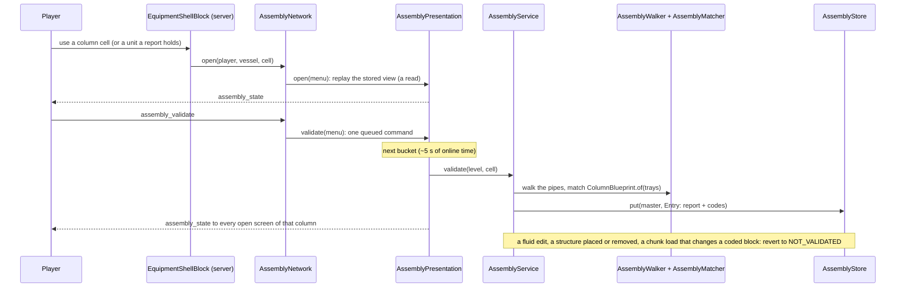

# Machine assemblies: a column's plant, validated against its design

**Snapshot:** ce71b45c (main, mod 0.15.0), 2026-10-27 · **Updated:** 2026-10-27 (new chapter, batch 2026-10-26-multi-machine-framework, first stage: the distillation column assembly; work packages W1 to W7, findings F2 and F3, owner answers Q1 to Q9)
Up: [code guide](README.md)

## Read this when

- A column's assembly screen shows a part in the wrong colour, the wrong state or the wrong place, or Validate structure gives an answer you did not expect.
- A report did not go back to "not validated" after a change, or went back without one (`assembly status=REVERTED` lines).
- You add a slot, a link or a part form to a column's blueprint, or a new kind of assembly.
- You change what a click on a column or on a unit next to it opens, or the laying tool's assembly marks.
- You touch the `assembly-2` packets, the `icheme_assemblies` store, or the review world (`runReviewWorldServer`).

The column's design (what Save design stores, `ColumnComponents`, `ColumnDesign`) and the column's nozzles are in [equipment.md](equipment.md); Save design's packet is in [column-v3.md](column-v3.md). The pipes and fittings the walk reads are registry devices ([fluid-runtime.md](fluid-runtime.md)).

## In one paragraph

A real distillation column is one item of a plant: an overhead system (an ejector under vacuum, a condenser, a receiver drum with a water boot, a reflux pump, a tee that splits reflux from distillate), a valve on every line that leaves the plant, a pump and a cooler per pumparound, and a kettle reboiler where the design has reboiler duty. The column calculator saves which of these the design needs; the constructor builds the column with that design; the player places and pipes the other units. **Validate structure** checks the pipes against the design and reports each part as in place (teal), misplaced (yellow) or missing (red). In code, a column built with components is an assembly master. `ColumnBlueprint.of(trays)` gives its slots and links. `AssemblyWalker` reads the pipes around it from the fluid registry and the shells in loaded chunks, as a `PortGraph`. `AssemblyMatcher` follows the links from the column and gives an `AssemblyReport`. `AssemblyStore` keeps each master's report and the structural code of every block it relied on. A validation runs only when the player presses the button; nothing polls. A fluid edit, a structure placed or removed, or a chunk load that changes a coded block reverts the report to not validated (`AssemblyService`). The column's screen is an engine presentation session: it shows the stored view at once and gets answers on the engine's bucket (`AssemblyPresentation`, AGENTS.md "Engine schedule and player-facing updates").

## Class map

Paths are relative to `src/main/java/com/wormzjl/icheme/`.

| Class | Role | Read it for |
|---|---|---|
| **Model (`science/assembly`, Minecraft-free)** | | |
| [`PortGraph`](../../../src/main/java/com/wormzjl/icheme/science/assembly/PortGraph.java) | The pipes as validation sees them: `run(Port)` from a unit's port to its end, `branches(Junction, Run arrived)`; `Unit(origin, kind, lying, boot, nozzles)`, `Port(unit, role, ordinal)`; `Element(kind, direction, position, pipesBefore)` with `Fitting` CONTROL_VALVE, INLINE_PUMP, OTHER; ends `AtPort`, `Junction`, `Terminal`, `OpenEnd`, `NotLoaded`, `Unconnected`; `Run(elements, end, pipes, positions)` | What a walk hands the matcher |
| [`Blueprint`](../../../src/main/java/com/wormzjl/icheme/science/assembly/Blueprint.java) | Slots and links: `Slot(part, index)` (lang key `gui.icheme.assembly.slot.<part>`); forms `UnitForm(kind, lyingWithBoot, in, out, utilities)`, `FittingForm`, `TeeForm(branches)`; `Step(slot, form, family, anyOrder)` (the first form is designed, the others fill the slot as the wrong kind); `Start` at a slot's port or after a slot; finishes `AtUnit`, `ToPort`, `Outside`; `Link(name, start, steps, finish, upstream, owner)` | The vocabulary of a design |
| [`ColumnBlueprint`](../../../src/main/java/com/wormzjl/icheme/science/assembly/ColumnBlueprint.java) | `of(trays)`: the column's slots and links from its `ColumnComponents` (below); refuses trays without components | What a column asks for |
| [`AssemblyMatcher`](../../../src/main/java/com/wormzjl/icheme/science/assembly/AssemblyMatcher.java) | `match(blueprint, graph, master, taken)`: binds slots along the links in order; the worst fault per slot; deterministic; `EXTERNAL_REACH` 16 | Every state a slot can get |
| [`AssemblyReport`](../../../src/main/java/com/wormzjl/icheme/science/assembly/AssemblyReport.java) | `SlotReport(slot, state, member, at, detail)`, `State` with its `Colour`, `PortReport(unit, role, ordinal, PortState)`, `footprint`, `members` (master first); `connected`/`misplaced`/`missing`/`complete`; `NONE` = `Long.MIN_VALUE` | The result |
| [`AssemblyView`](../../../src/main/java/com/wormzjl/icheme/science/assembly/AssemblyView.java) | What the screen shows: `Status` NO_DESIGN, NOT_VALIDATED, CHECKED, COMPLETE, the report (only when checked), `changedAt` | The GUI's input |
| **Server (`runtime/assembly`, `network`)** | | |
| [`AssemblyWalker`](../../../src/main/java/com/wormzjl/icheme/runtime/assembly/AssemblyWalker.java) | `PortGraph` over the world; `Ground` (`loaded`, `piece`, `shell`), `Piece(pipe, terminal, fitting, facing, faces)` with `code()`, `Shell(origin, shape)`; `MAX_WALK` 8192 blocks, `exhausted()`; `codes()` (the code of every block and nozzle read); `nozzleCode(kind, nozzle)` = `-1 - (kind.ordinal() << 16 \| nozzle)` | How pipes become runs |
| [`LevelGround`](../../../src/main/java/com/wormzjl/icheme/runtime/assembly/LevelGround.java) | Package-private `Ground`: the registry's latest projected registrations (`FluidWorldAuthority.at`) and the shell block entities, loaded chunks only; `piece(device)` | Which device is which fitting |
| [`AssemblyStore`](../../../src/main/java/com/wormzjl/icheme/runtime/assembly/AssemblyStore.java) | Per-level `SavedData` `icheme_assemblies`, `FORMAT` 1, state: `Entry(status, report, codes, changedAt)`, `Status` NOT_VALIDATED, CHECKED, COMPLETE; indexes by position and by chunk (`mastersAt`, `mastersInChunk`); `put`, `revert`, `forget`, `taken(except)`, `rebuilding()` | What survives a save |
| [`AssemblyService`](../../../src/main/java/com/wormzjl/icheme/runtime/assembly/AssemblyService.java) | Static, one queue per server: `designed(shape)`, `view` and `watched` (reads), `holder`, `cellOf`, `request`, `validate`, `tick`; the revert paths `edited`, `placed`, `removed`, `chunkLoaded`, `controllerLoaded`; `walks(server)` counter | When a report is made and when it reverts |
| [`AssemblyPresentation`](../../../src/main/java/com/wormzjl/icheme/runtime/assembly/AssemblyPresentation.java) | The column screens' sessions on a `PresentationMailbox` (100-tick buckets): `open`, `validate`, `close`, `tick`; `Host` | Engine-owned GUI updates |
| [`AssemblyWatch`](../../../src/main/java/com/wormzjl/icheme/runtime/assembly/AssemblyWatch.java) | The laying tool's watch, `RANGE` 48 blocks: `start`, `stop`, `tick`; `Host` | The tool's marks (W7) |
| [`network/AssemblyNetwork`](../../../src/main/java/com/wormzjl/icheme/network/AssemblyNetwork.java) | Protocol `assembly-2` (main thread); `open(player, vessel, cell)`, `target`, `closed`, `datasheet`, `presentationTick`, `forget`; the `VIEW` codec | What a click opens; the wire |
| [`world/inventory/AssemblyMenu`](../../../src/main/java/com/wormzjl/icheme/world/inventory/AssemblyMenu.java) | Menu `assembly`: origin, cell (a shell cell of the column), anchor, reach (`REACH` 8 + the clicked structure's largest size), selected member; client `view()`/`accept`; `removed` ends the session | Who may keep the screen open |
| **Client** | | |
| [`gui/screens/inventory/AssemblyScreen`](../../../src/main/java/com/wormzjl/icheme/client/gui/screens/inventory/AssemblyScreen.java) | The column's screen: the drawing scaled to fit, the parts list, Validate structure, Open unit, Datasheet; tabs Operation (a placeholder in this stage) and Structure | What the player sees |
| [`gui/common/AssemblyDiagram`](../../../src/main/java/com/wormzjl/icheme/client/gui/common/AssemblyDiagram.java) | Minecraft-free drawing model on a 680 × 724 grid: `Part` per slot, `Wire`, `Label`, `Pill`, `PortMark` (`SIZE` 8, with its partner slot); `of(trays)`; texts are keys under `gui.icheme.assembly.` | The drawing's layout |
| [`AssemblyToolClient`](../../../src/main/java/com/wormzjl/icheme/client/AssemblyToolClient.java), [`PortColours`](../../../src/main/java/com/wormzjl/icheme/client/PortColours.java) | The laying tool's watch on the client (`watch`, `received`, `frame`, `line`); the port class colours shared with the drawing | The tool's marks |

## Main flow

1. **A click.** `EquipmentShellBlock.use` runs on the server. `AssemblyNetwork.open` finds the target: a column opens its own screen (its controller cell); a unit opens the screen of the column whose report holds it (`AssemblyService.holder`, the least master if two do), with the unit selected. Otherwise the structure opens its own screen (`EquipmentShellBlock.openOwn`). A fake player opens nothing.
2. **Open.** The menu opens first; then the session subscribes and gets the stored view at once (`AssemblyService.view`: `NO_DESIGN` for a column without components, `NOT_VALIDATED` with no entry, else the entry). Nothing is walked.
3. **Validate.** The press queues one command in the session (a second press before the bucket is refused). On the bucket, each master is validated at most once (`validated`), and every open screen of that master gets the view, changed or not. Other sessions get the view only when it changed.
4. **Walk and match.** `AssemblyService.validate` builds an `AssemblyWalker` over `LevelGround` and calls `AssemblyMatcher.match(ColumnBlueprint.of(trays), walker, master unit, store.taken(master))`. The entry is COMPLETE when every slot is teal, else CHECKED. A walk that hit `MAX_WALK` logs `assembly status=WALK_LIMIT`.
5. **Revert.** The report holds until something it relied on changes (below). Then its entry becomes NOT_VALIDATED with `changedAt`, the place of the change, and the screens show it at the next bucket.

The column's blueprint (ColumnBlueprint)

Slots in report order: `column`, [`ejector`], `condenser`, `receiver`, `offgas_valve`, `water_valve`, `reflux_pump`, `reflux_tee`, `reflux_valve`, `distillate_valve`, `feed_valve`, `steam_valve` i, `draw_valve` i, `pa_pump` i and `pa_cooler` i, [`reboiler`], `bottoms_valve`. Bracketed slots follow the design's flags.

| Link | From | Steps | Finish |
|---|---|---|---|
| overhead | column VAPOUR_OUTLET | [ejector: SUCTION → DISCHARGE, MOTIVE a utility]; condenser: an air cooler's PROCESS_INLET or an exchanger's SHELL_INLET (decision D15; the other kind is the wrong kind) | at the unit |
| condensate | after the condenser | receiver: a lying drum with a boot at its SIDE connection (any other drum is the wrong kind) | at the unit |
| offgas | receiver VAPOUR_OUTLET | a control valve | outside |
| water | receiver BOOT_DRAIN | a control valve | outside |
| oil | receiver LIQUID_OUTLET | the reflux pump (standard or in-line as designed; the other is the wrong kind); the reflux tee: one branch through the reflux valve to the column's REFLUX, one through the distillate valve outside | at the tee |
| feed (upstream) | column FEED | a control valve | outside |
| steam i (upstream) | column STEAM i | a control valve | outside |
| draw i | column DRAW i | a control valve | outside |
| pumparound i | column PUMPAROUND_DRAW i | the pump and the cooler in either order (`anyOrder`; the cooler on its shell side, tubes a utility) | the column's RETURN i |
| reboiler, vapour_return, bottoms (with a kettle) | column BOTTOMS → kettle FEED; kettle VAPOUR_OUTLET → column VAPOUR_RETURN; kettle LIQUID_OUTLET → a control valve | | outside |
| bottoms (no kettle) | column BOTTOMS | a control valve | outside (Q9 (a): no vapour return) |

The reflux line is in every design, also at a zero reflux ratio (owner answer Q2). An upstream link (feed, steam) is walked from the column against the stream. `ColumnBlueprintTest.theBlueprintNamesEveryNozzleOfTheBuiltColumnAndNoOther` ties the blueprint to `ColumnStructure`'s nozzles.

The walk (AssemblyWalker, LevelGround)

- A run starts at a nozzle's pipe block and follows joined blocks. Only pipes join (decision D20). A fitting passes along its axis and is recorded as an `Element` with its direction and the pipes before it.
- A run ends at a structure's nozzle (`AtPort`), a block of three or more joints (`Junction`, whose other runs `branches` gives), a one-block tank, generator or void (`Terminal`, outside), an open end, a chunk that is not loaded (`NotLoaded`), or no pipe in front of a nozzle (`Unconnected`).
- The walk reads loaded chunks only (`getChunkNow`), never passes through a vessel or a constructed mover, and stops after `MAX_WALK` 8192 blocks; the rest reads as not loaded.
- `LevelGround.piece(device)`: a device with ports (a vessel, a constructed mover) is null: the walk meets it at its shell's nozzles. A pipe's fitting comes from the law it compiles through (`hydraulicKind`): VALVE is a CONTROL_VALVE whatever module or setting it has; PUMP or COMPRESSOR an INLINE_PUMP; a shutoff, check valve or strainer is OTHER and passes the line on. A one-block filter is OTHER, a one-block pump or compressor an INLINE_PUMP, a one-block valve a CONTROL_VALVE; a reservoir, generator or void is a terminal.
- Every block and nozzle read gets a structural code (`Piece.code()`, or `nozzleCode` for a nozzle); a setting edit does not change a code.

Slot states and port states (AssemblyMatcher, AssemblyReport)

States in rank order (a later one outranks an earlier one on the same slot):

| State | Colour | Meaning |
|---|---|---|
| OK | teal | in place |
| SHARED | yellow | the unit is already a member of another column's report (`taken`); it is not bound, and the line's later steps are MISSING |
| WRONG_ORDER | yellow | met on another line than its step expected |
| BRANCHED | yellow | a junction where the design has none: before a line's last step (unless the step is a tee), after it on a line that must reach a port, or a tee with more runs than branches |
| EXTRA_VALVE | yellow | a control valve the design does not ask for |
| VALVE_REVERSED | yellow | a control valve pointing against the stream |
| WRONG_PORT | yellow | a unit entered at the wrong nozzle, or a line ending at the wrong port |
| WRONG_KIND | yellow | a unit or fitting of the slot's family but not the designed form |
| NOT_LOADED | red | the line runs into a chunk that is not loaded (or past the walk budget) |
| OPEN_END | red | the line stops |
| MISSING | red | nothing fills the slot |

- A unit is bound as soon as any of its ports is reached; a misplaced part stays bound and the walk goes on through it. A stopped line leaves its later steps pending; met later on another line they are WRONG_ORDER, never met they are MISSING.
- An outside line may end in a terminal, a branch, or an open end at least `EXTERNAL_REACH` 16 pipe blocks beyond its last valve; fittings after that boundary valve are outside the assembly and not checked.
- A fitting's arrow must point with the stream: along the walk downstream, back along it on an upstream link (feed, steam), so those valves point into the column.
- A tee's branches are assigned by the best score over their permutations: a branch is taken by where it goes.
- Port states: NEEDED (its class colour), CONNECTED (grey), UTILITY (advice: cooling water, motive steam; its class colour until piped), UNUSED. Every port the blueprint names on a filled slot is NEEDED until a run reaches it (`requireNamed`).
- The same graph always gives the same report (`theSamePipesGiveTheSameReport`).

Reverting without polling (AssemblyService)

| Path | Trigger | Reverts | Log `reason=` |
|---|---|---|---|
| `edited` | each `FluidWorldAuthority.DeviceChange` of a queued edit (`FluidWorldAuthority.listen`, registered in `IChemE`) | a report with that position coded, when the code changed; a COMPLETE report whose coded block a new device stands beside | `changed`, `branch` |
| `placed` | `EquipmentStructure.place` and the end of a refresh | a COMPLETE report coding a shell cell of the structure or the block in front of a nozzle; a new designed column gets a NOT_VALIDATED entry | `structure` |
| `removed` | a dismantle and the start of a refresh | the column's own entry is forgotten; a report holding the structure, or coding its cells or nozzle blocks | `removed` |
| `chunkLoaded` | a chunk with coded blocks loads (after `FluidWorldAuthority.loadedChunk`) | the next tick compares each coded block with what stands there (reads only) | `chunk_load` |

- A CHECKED report reverts only at a block or part it found: an addition beside it does not revert it, because the player is building. A COMPLETE one reverts on any structural change it relied on, a new branch included.
- Log line: `assembly status=REVERTED master=… was=… at=… reason=…`.
- `tick` (from `IChemE`'s server tick, after `FluidWorldAuthority.tick`) runs the queued chunk checks, then the queued requests, one validation per master per round. Nothing runs when nothing is queued.
- A dropped store (another format, or one that does not read) is marked `rebuild`: each designed column's controller cell queues one validation when it loads (`controllerLoaded`), and only for a column with no entry yet.

The laying tool's watch (AssemblyWatch, AssemblyToolClient)

- Holding the laying tool is the request. The client judges it (`AssemblyToolClient.watch`, called each tick by `PipeLayingClient`) and sends `assembly_watch` on and off: the server learns of a number key a tick after the request, so a server check of the hand would refuse the request it answers.
- Taking the tool up replays the stored view of every column with a block, a nozzle or a member within `RANGE` 48 blocks (`AssemblyService.watched`, reads). On each bucket the watcher gets the views that changed, the columns that came into range, and an end (no view) for each that left or is gone. The server does not check the hand: it drops only a watcher who left the world (`Host.present`: disconnected or removed), at the next bucket; putting the tool away ends the watch by the client's word (`stop`).
- On the client a watched port gets a frame 0.4 across round the tool's port square: yellow on a misplaced part's ports, the port class colour while the port is NEEDED or a UTILITY, none otherwise (`frame`). Aiming at it adds its line to the port label (`line`: the partner it should reach and its state, key `gui.icheme.assembly.tool.line`).

Formats and wire

- **Store** `icheme_assemblies` in each level's data storage (`AssemblyStore.of`), state (AGENTS.md: state formats change freely): `format` (`FORMAT` 1), `rebuild`, `entries` (each: `master`, `status`, the coded positions and codes, `changed`, the slots, ports, footprint and members). Bounds `MAX_MASTERS` 4096, `MAX_SLOTS` 256, `MAX_PORTS` 1024, `MAX_FOOTPRINT` 2 · `MAX_WALK`. A store of another format, or one that does not read, is dropped whole (`assembly_store status=STATE_DROPPED`) and marked for rebuilding.
- **Protocol `assembly-2`** (all `HandlerThread.MAIN`; bounds `MAX_SLOTS` 256, `MAX_PORTS` 1024, `MAX_MEMBERS` 256, `MAX_TEXT` 1024; the `VIEW` codec leaves out the footprint):

| Payload | Direction | Fields |
|---|---|---|
| `icheme:assembly_state` | S→C | container id, view |
| `icheme:assembly_validate` | C→S | container id |
| `icheme:assembly_open_unit` | C→S | container id, member (varlong origin) |
| `icheme:assembly_watch` | C→S | bool on |
| `icheme:assembly_watched` | S→C | master (varlong), optional view |
| `icheme:assembly_datasheet` | S→C | BlockPos |

- **Menu opening buffer**: origin, column cell, anchor, reach (double), selected member (long).
- The column design itself is a fact on the shell (`Components`, `Turns`) and on the calculator (`Design`): [equipment.md](equipment.md), [column-v3.md](column-v3.md).

Traps

- **A report is state.** Losing the store loses only reports; the columns validate again (after a drop, once per column as its controller loads). Never put a fact in it.
- **Only Validate walks.** A screen open, a watch, a chunk load or an edit never walks. A chunk load compares codes; an edit looks up one index.
- **A setting edit reverts nothing.** A valve's module or a pump's flow changes no structural code; installing or removing a fitting does.
- **Columns without components have no assembly** (`designed` is false): every column built before this batch, and every column a refresh rebuilt from such a shape. Their screen shows NO_DESIGN.
- **Open unit and Datasheet replace the column's screen.** `openOwn` opens the member's fluid menu or sends its datasheet, closing the column's menu and its session first.
- **The first report keeps a unit.** A unit another column's report already holds is SHARED for the next column validated and not bound there. Should two reports hold one (one validated while the other was reverted), a click opens the least master's screen (`holder`).
- `cellOf` looks for a loaded shell cell among the report's coded nozzles: a member whose cells are not loaded cannot be opened from the list.

## Change the layer that owns it

| Change | Owning class | Tests that pin it |
|---|---|---|
| What a column asks for (slots, links, families) | `ColumnBlueprint` | `ColumnBlueprintTest` (7) |
| How a slot is filled or faulted; tee branches; outside lines | `AssemblyMatcher` | `AssemblyMatcherTest` (19, on the hand-built `TestGraph`) |
| How pipes and fittings are read from the world | `AssemblyWalker`, `LevelGround` | `AssemblyWalkerTest` (5), `LevelGroundTest` (1) |
| When a report reverts | `AssemblyService` (`edited`, `placed`, `removed`, `chunkLoaded`) | GameTests `AssemblyGameTests` (`aRemovedPipeRevertsACompleteReport`, `aPipeAddedAtAnOpenEndKeepsAPartialReport`) |
| What a save keeps; a dropped store | `AssemblyStore`, `AssemblyService.controllerLoaded` | `AssemblyStoreTest` (4), `AssemblyGameTests` (`aReloadKeepsACompleteReportWithoutAWalk`, `aDroppedStoreRebuildsWithOneWalkPerColumn`) |
| GUI timing: replay on open, one validation per bucket | `AssemblyPresentation`, `AssemblyNetwork` | `AssemblyPresentationTest` (3) |
| The laying tool's watch | `AssemblyWatch`, `AssemblyToolClient`, `PipeLayingClient` | `AssemblyToolWatchTest` (4) |
| Packets and bounds | `AssemblyNetwork` | `network/AssemblyNetworkCodecTest` (3) |
| What a click opens | `AssemblyNetwork.open`/`target`, `EquipmentShellBlock.use`/`openOwn` | `AssemblyGameTests.aClickOnAMemberOpensItsColumnsGuiWithTheMemberSelected` |
| The drawing, the parts list, the words | `AssemblyDiagram`, `AssemblyScreen`, `lang/en_us.json` (`gui.icheme.assembly.*`) | `client/gui/common/AssemblyDiagramTest` (3); layout: dev client |
| A nozzle's flow direction (IN, OUT), a unit's pass-through partner | `science/equipment/PortMarkings` ([equipment.md](equipment.md)) | `PortMarkingsTest` (6) |

## Tests that pin it

All unit tests run under `test` (none is a slow gate class in `build.gradle`).

- [`science/assembly/`](../../../src/test/java/com/wormzjl/icheme/science/assembly/): `ColumnBlueprintTest` (7), `AssemblyMatcherTest` (19: every case of the design table complete on its plant; the column alone; a partly connected unit; an open end; an unloaded chunk; a reversed pump and valve; a pumparound on the cooler's tube side; a standing drum as receiver; an extra valve and a valve beyond the boundary; an ejector after the condenser; a branch before the feed valve; the reflux tee's branches; a reflux line without its tee; a column stripped by sump steam; a shared condenser; the 16-block outside rule; an in-line pump where a standard one is designed; determinism), helper `TestGraph`.
- [`runtime/assembly/`](../../../src/test/java/com/wormzjl/icheme/runtime/assembly/): `AssemblyWalkerTest` (5), `LevelGroundTest` (1), `AssemblyStoreTest` (4), `AssemblyPresentationTest` (3), `AssemblyToolWatchTest` (4).
- `network/AssemblyNetworkCodecTest` (3), `client/gui/common/AssemblyDiagramTest` (3).
- GameTests [`AssemblyGameTests`](../../../src/fluidGameTest/java/com/wormzjl/icheme/fluid/gametest/AssemblyGameTests.java) (6, namespace `icheme_fluid_test`, batches `assembly-*`, `runFluidGameTestServer`): a plant built as designed validates complete; a click on a member opens its column's screen with the member selected; a removed pipe reverts a complete report; a pipe added at an open end keeps a partial report; a reload keeps a complete report without a walk; a dropped store rebuilds with one walk per column.
- **Review world** (not a gate): [`ColumnReviewWorld`](../../../src/fluidGameTest/java/com/wormzjl/icheme/fluid/gametest/ColumnReviewWorld.java) (namespace `icheme_review`, structure `data/icheme_review/structure/empty.nbt`), run `reviewWorldServer` (task `runReviewWorldServer`, game directory `run/review-world`, loads `icheme` and `icheme_fluid_test`). It builds a 2 m, 20-tray column with every part a design can ask for (feed on tray 12, a draw on tray 9, a pumparound from tray 7 to 5, a kettle and sump steam, an ejector, an air cooler, a lying receiver with a boot, the pumps and the PA cooler, a valve and a tank on every boundary line), validates it complete, then puts it back to not validated, and leaves the world in `run/review-world/world` to copy into a client's saves.

Design background: `documentation/2026-10-26-multi-machine-framework/` (the plan's sections 4 to 11, the owner's answers Q1 to Q9, findings F2 and F3, the column assembly cases).

## Terms

- **Assembly**: a master structure (here a column built with components) and the units, fittings and pipes its design asks for.
- **Master / member**: the column the assembly is validated from / a unit a slot holds.
- **Slot**: one required part of the design (a unit, a fitting or a tee). **Link**: a required pipe path between slots, or from a slot to outside.
- **Report**: a validation's result, a state per slot and per port. **Entry**: a report, its status and the codes it relied on, in the store.
- **Code**: a block's or nozzle's structural identity as the walk read it; what a revert compares.
- **Outside**: a terminal, or a line that runs on at least 16 pipe blocks past its boundary valve.
- **Utility**: a port the design advises but does not check (cooling water, motive steam).
